<div align="center">

**TRƯỜNG ĐẠI HỌC VINH**

**VIỆN KỸ THUẬT VÀ CÔNG NGHỆ**

<br>

# BÁO CÁO ĐỒ ÁN HỌC PHẦN

## CÔNG NGHỆ PHẦN MỀM

<br>

# XÂY DỰNG HỆ THỐNG HỖ TRỢ IT NỘI BỘ

## (TICKETIT)

<br><br>

**NHÓM:** [Điền số nhóm]

**GIẢNG VIÊN HƯỚNG DẪN:** [Điền họ tên, học vị GVHD]

**SINH VIÊN THỰC HIỆN:**

| STT | Họ và tên | Mã số sinh viên | Ghi chú |
|---:|---|---|---|
| 1 | [Họ và tên sinh viên 1] | [MSSV] | [Nhóm trưởng / Thành viên] |
| 2 | [Họ và tên sinh viên 2] | [MSSV] | [Thành viên] |
| 3 | [Họ và tên sinh viên 3] | [MSSV] | [Thành viên] |

<br><br>

**Nghệ An, tháng 11 năm 2026**

</div>

---

> **Ghi chú sử dụng báo cáo**
>
> - Báo cáo được trình bày theo cấu trúc mẫu đồ án học phần Công nghệ phần mềm (`Mau-CNPM.pdf`), đồng thời bổ sung các nội dung chuyên sâu phù hợp với dự án **TicketIT**.
> - Các thông tin cá nhân như họ tên sinh viên, MSSV, nhóm, giảng viên hướng dẫn được để trong dấu `[...]` để người sử dụng tự điền.
> - Các sơ đồ được viết bằng **Mermaid** để có thể hiển thị trực tiếp trên GitHub, GitLab, VS Code hoặc các trình đọc Markdown hỗ trợ Mermaid.
> - Các vị trí `Hình 3.x` là nơi chèn ảnh chụp màn hình thực tế của hệ thống. Khi chuyển sang Word/PDF, có thể thay các khối ghi chú bằng ảnh chụp tương ứng.
> - Nội dung phản ánh đúng phiên bản mã nguồn hiện tại của dự án: **Laravel 13.36, PHP 8.3.30, MySQL 8.4, Tailwind CSS 4.3, Alpine.js 3.17, Vite 8**.
> - Tài khoản demo và mật khẩu mặc định được trình bày tại Phụ lục C.

---

## MỞ ĐẦU

Trong bối cảnh chuyển đổi số diễn ra mạnh mẽ trong các trường học và doanh nghiệp, bộ phận công nghệ thông tin (IT) phải tiếp nhận và xử lý ngày càng nhiều yêu cầu hỗ trợ từ người dùng: sự cố máy tính, mạng, máy in, email, phần mềm nghiệp vụ, tài khoản, bảo mật… Các yêu cầu này thường được gửi qua nhiều kênh khác nhau như chat, điện thoại, email hoặc trao đổi trực tiếp. Việc tiếp nhận rời rạc khiến thông tin dễ bị thất lạc, khó theo dõi tiến độ, khó đo lường thời gian phản hồi và không có dữ liệu tổng hợp phục vụ cải tiến chất lượng dịch vụ.

Đề tài **“Xây dựng hệ thống hỗ trợ IT nội bộ (TicketIT)”** được thực hiện nhằm giải quyết bài toán trên bằng một ứng dụng web tập trung. Hệ thống cho phép người dùng tạo phiếu yêu cầu hỗ trợ, theo dõi trạng thái và trao đổi với kỹ thuật viên; cho phép kỹ thuật viên tiếp nhận, phân loại, phân công, ghi chú nội bộ và cập nhật tiến độ; cho phép trưởng nhóm và quản trị viên quản lý nhóm xử lý, người dùng, danh mục sự cố và theo dõi tình hình chung của toàn bộ hệ thống.

Điểm nổi bật của TicketIT là quy trình xử lý phiếu được mô hình hóa rõ ràng theo vòng đời trạng thái, mức ưu tiên được tính tự động từ ma trận **Ảnh hưởng × Khẩn cấp**, mã phiếu được sinh tự động theo năm, mọi thay đổi đều được ghi nhận vào lịch sử hoạt động và lịch sử trạng thái. Hệ thống cũng hỗ trợ bình luận công khai, ghi chú nội bộ, tệp đính kèm, thông báo trong ứng dụng và thông báo qua email, giúp quá trình phối hợp giữa người yêu cầu và bộ phận IT trở nên minh bạch và có trách nhiệm hơn.

Đồ án sử dụng **PHP 8.3** với framework **Laravel 13**, cơ sở dữ liệu **MySQL 8.4**, giao diện **Blade + Tailwind CSS 4 + Alpine.js + Vite**. Hệ thống được tổ chức theo kiến trúc MVC kết hợp Service Layer, Form Request, Policy và Enum, bảo đảm mã nguồn dễ đọc, dễ bảo trì và có thể mở rộng. Toàn bộ giao diện, thông báo lỗi và dữ liệu mẫu được Việt hóa; tên bảng, tên cột và tên tệp cũng được đặt theo tiếng Việt để thuận tiện cho việc trình bày, bảo vệ đồ án.

Báo cáo được chia thành ba chương chính:

- **Chương 1 – Mô tả bài toán:** trình bày bối cảnh, thực trạng, mục tiêu, phạm vi, các hệ thống tham khảo và yêu cầu của hệ thống mới.
- **Chương 2 – Phân tích và thiết kế hệ thống:** xác định tác nhân, ca sử dụng, thiết kế dữ liệu, kiến trúc, quy trình nghiệp vụ, giao diện và bảo mật.
- **Chương 3 – Xây dựng hệ thống:** mô tả môi trường phát triển, các chức năng đã hiện thực, giao diện, kiểm thử, kết quả đạt được và hạn chế.
 

## LỜI CẢM ƠN

Lời đầu tiên, nhóm chúng em xin gửi lời cảm ơn chân thành đến quý thầy cô **Trường Đại học Vinh**, đặc biệt là quý thầy cô **Viện Kỹ thuật và Công nghệ**, những người đã truyền đạt cho chúng em nhiều kiến thức nền tảng quan trọng trong suốt quá trình học tập. Những kiến thức về phân tích thiết kế hệ thống, công nghệ phần mềm, cơ sở dữ liệu và lập trình ứng dụng web là hành trang cần thiết để nhóm có thể hoàn thành đề tài này.

Nhóm chúng em xin bày tỏ lòng biết ơn sâu sắc đến giảng viên hướng dẫn **TS. [Họ và tên giảng viên hướng dẫn]** – người đã tận tình chỉ dẫn, góp ý và định hướng cho nhóm trong từng giai đoạn của đồ án. Thầy/cô không chỉ giúp chúng em giải quyết các vấn đề chuyên môn mà còn nhắc nhở chúng em về cách làm việc có kế hoạch, cách đặt câu hỏi đúng và cách kiểm chứng kết quả trước khi kết luận. Những góp ý của thầy/cô đã giúp sản phẩm của nhóm hoàn thiện hơn cả về chức năng lẫn cách trình bày.

Chúng em cũng xin cảm ơn gia đình, bạn bè và các thành viên trong nhóm đã luôn động viên, chia sẻ và phối hợp trong suốt thời gian thực hiện đồ án. Mặc dù đã cố gắng hết sức, báo cáo và sản phẩm khó tránh khỏi những thiếu sót do kinh nghiệm thực tế còn hạn chế. Nhóm chúng em rất mong nhận được sự nhận xét, góp ý của quý thầy cô và các bạn để có thể tiếp tục hoàn thiện hệ thống trong tương lai.

Chúng em xin chân thành cảm ơn!

## DANH MỤC CÁC HÌNH

| Hình | Tên hình |
|---|---|
| Hình 1.1 | Quy trình tiếp nhận và xử lý yêu cầu hỗ trợ IT hiện tại |
| Hình 1.2 | Mô hình tổng quát hệ thống TicketIT |
| Hình 2.1 | Biểu đồ ca sử dụng tổng quát của hệ thống |
| Hình 2.2 | Sơ đồ thực thể – liên kết (ERD) |
| Hình 2.3 | Kiến trúc phân lớp của hệ thống |
| Hình 2.4 | Sơ đồ triển khai hệ thống |
| Hình 2.5 | Biểu đồ hoạt động tạo phiếu yêu cầu |
| Hình 2.6 | Biểu đồ tuần tự tạo phiếu yêu cầu |
| Hình 2.7 | Biểu đồ tuần tự phân công phiếu |
| Hình 2.8 | Biểu đồ tuần tự thay đổi trạng thái phiếu |
| Hình 2.9 | Biểu đồ trạng thái vòng đời phiếu yêu cầu |
| Hình 2.10 | Sơ đồ điều hướng các màn hình chính |
| Hình 3.1 | Giao diện đăng nhập |
| Hình 3.2 | Giao diện đăng ký tài khoản |
| Hình 3.3 | Giao diện tổng quan theo vai trò |
| Hình 3.4 | Giao diện danh sách và bộ lọc phiếu |
| Hình 3.5 | Giao diện tạo phiếu yêu cầu |
| Hình 3.6 | Giao diện chi tiết phiếu yêu cầu |
| Hình 3.7 | Giao diện thông báo |
| Hình 3.8 | Giao diện quản lý người dùng |
| Hình 3.9 | Giao diện quản lý nhóm xử lý |
| Hình 3.10 | Giao diện quản lý phòng ban và vị trí |
| Hình 3.11 | Giao diện hồ sơ cá nhân |

## DANH MỤC CÁC BẢNG

| Bảng | Tên bảng |
|---|---|
| Bảng 1.1 | So sánh một số hệ thống hỗ trợ IT tiêu biểu |
| Bảng 1.2 | Yêu cầu chức năng của hệ thống |
| Bảng 1.3 | Yêu cầu phi chức năng của hệ thống |
| Bảng 1.4 | Danh sách tác nhân và trách nhiệm |
| Bảng 2.1 | Kế hoạch phát triển theo Sprint |
| Bảng 2.2 | Danh sách ca sử dụng |
| Bảng 2.3 | Đặc tả ca sử dụng tạo phiếu yêu cầu |
| Bảng 2.4 | Đặc tả ca sử dụng phân công và xử lý phiếu |
| Bảng 2.5 | Từ điển dữ liệu bảng `nguoi_dung` |
| Bảng 2.6 | Từ điển dữ liệu bảng `phieu_yeu_cau` |
| Bảng 2.7.1 – 2.7.16 | Từ điển dữ liệu chi tiết các bảng nghiệp vụ còn lại |
| Bảng 2.8 | Thành phần và trách nhiệm trong kiến trúc |
| Bảng 2.9 | Quy tắc chuyển trạng thái phiếu |
| Bảng 2.10 | Ma trận Ảnh hưởng × Khẩn cấp → Mức ưu tiên |
| Bảng 2.11 | Mục tiêu thời gian phản hồi và giải quyết theo SLA |
| Bảng 2.12 | Ma trận phân quyền theo vai trò |
| Bảng 2.13 | Ma trận sự kiện và đối tượng nhận thông báo |
| Bảng 2.14 | Danh sách màn hình và chức năng chính |
| Bảng 2.15 | Mối đe dọa bảo mật và biện pháp kiểm soát |
| Bảng 3.1 | Môi trường phát triển và kiểm thử |
| Bảng 3.2 | Sprint backlog và kết quả thực hiện |
| Bảng 3.3 | Kiểm thử xác thực và phân quyền |
| Bảng 3.4 | Kiểm thử quản lý phiếu yêu cầu |
| Bảng 3.5 | Kiểm thử bình luận, ghi chú và tệp đính kèm |
| Bảng 3.6 | Kiểm thử thông báo |
| Bảng 3.7 | Kiểm thử quản trị người dùng và danh mục |
| Bảng 3.8 | Ma trận kiểm thử tổng thể |
| Bảng 3.9 | Đối chiếu yêu cầu chức năng với kết quả |
| Bảng 3.10 | Hạn chế và hướng phát triển |
| Bảng A.1 | Danh sách route chính của hệ thống |
| Bảng C.1 | Tài khoản demo |
| Bảng C.2 | Dữ liệu mẫu sau khi seed |
| Bảng E.1 | Mã trạng thái phiếu |
| Bảng E.2 | Mã mức ưu tiên |
| Bảng E.3 | Danh mục sự cố hai cấp |
| Bảng F.1 | Checklist kiểm thử chức năng |

## DANH MỤC TỪ VIẾT TẮT

| Từ viết tắt | Ý nghĩa |
|---|---|
| API | Application Programming Interface – Giao diện lập trình ứng dụng |
| CRUD | Create, Read, Update, Delete – Tạo, đọc, cập nhật, xóa |
| CSRF | Cross-Site Request Forgery – Tấn công giả mạo yêu cầu chéo trang |
| ERD | Entity Relationship Diagram – Sơ đồ thực thể liên kết |
| IT | Information Technology – Công nghệ thông tin |
| KPI | Key Performance Indicator – Chỉ số đo lường hiệu quả |
| MVC | Model–View–Controller |
| ORM | Object–Relational Mapping – Ánh xạ quan hệ đối tượng |
| PSR | PHP Standards Recommendations – Chuẩn mã nguồn PHP |
| RBAC | Role-Based Access Control – Kiểm soát truy cập theo vai trò |
| SLA | Service Level Agreement – Cam kết mức độ dịch vụ |
| SMTP | Simple Mail Transfer Protocol – Giao thức gửi email |
| UI/UX | User Interface / User Experience – Giao diện và trải nghiệm người dùng |
| XSS | Cross-Site Scripting – Tấn công chèn mã độc vào trang web |

## MỤC LỤC

> *Số trang trong mục lục sẽ được cập nhật tương ứng khi xuất báo cáo sang PDF/Word. Dưới đây là mục lục theo cấu trúc nội dung.*

- **MỞ ĐẦU**
- **LỜI CẢM ƠN**
- **DANH MỤC CÁC HÌNH**
- **DANH MỤC CÁC BẢNG**
- **DANH MỤC TỪ VIẾT TẮT**
- **CHƯƠNG 1. MÔ TẢ BÀI TOÁN**
  - 1.1. Mô tả tổng quan bài toán
  - 1.2. Tìm hiểu bài toán
    - 1.2.1. Thực trạng tiếp nhận và xử lý yêu cầu hỗ trợ IT
    - 1.2.2. Những khó khăn của quy trình hiện tại
    - 1.2.3. Mục tiêu của hệ thống mới
    - 1.2.4. Phạm vi và giới hạn của hệ thống
  - 1.3. Một số hệ thống và ứng dụng liên quan
  - 1.4. Các yêu cầu của hệ thống mới
    - 1.4.1. Yêu cầu chức năng
    - 1.4.2. Yêu cầu phi chức năng
    - 1.4.3. Yêu cầu dữ liệu
    - 1.4.4. Tác nhân của hệ thống
- **CHƯƠNG 2. PHÂN TÍCH VÀ THIẾT KẾ HỆ THỐNG**
  - 2.1. Phân tích yêu cầu và xác định tác nhân
    - 2.1.1. Kế hoạch phát triển theo Sprint
    - 2.1.2. Xác định tác nhân
    - 2.1.3. Biểu đồ ca sử dụng tổng quát
    - 2.1.4. Đặc tả các ca sử dụng chính
  - 2.2. Thiết kế dữ liệu
    - 2.2.1. Sơ đồ thực thể – liên kết
    - 2.2.2. Từ điển dữ liệu
    - 2.2.3. Ràng buộc toàn vẹn và chỉ mục
  - 2.3. Thiết kế kiến trúc
    - 2.3.1. Kiến trúc phân lớp MVC và Service Layer
    - 2.3.2. Cấu trúc thư mục mã nguồn
    - 2.3.3. Sơ đồ triển khai
  - 2.4. Thiết kế quy trình nghiệp vụ
    - 2.4.1. Quy trình tạo phiếu yêu cầu
    - 2.4.2. Quy trình phân công xử lý
    - 2.4.3. Vòng đời và quy tắc chuyển trạng thái
    - 2.4.4. Ma trận ưu tiên và mục tiêu SLA
    - 2.4.5. Chiến lược phân công
    - 2.4.6. Ma trận phân quyền
    - 2.4.7. Quy trình thông báo
  - 2.5. Thiết kế giao diện
    - 2.5.1. Nguyên tắc thiết kế và design system
    - 2.5.2. Danh sách màn hình
    - 2.5.3. Mô tả các màn hình chính
  - 2.6. Thiết kế bảo mật
- **CHƯƠNG 3. XÂY DỰNG HỆ THỐNG**
  - 3.1. Môi trường phát triển
  - 3.2. Quản lý dự án và tiến độ
    - 3.2.1. Cách tổ chức công việc
    - 3.2.2. Sprint backlog
  - 3.3. Xây dựng chức năng xác thực và phân quyền
    - 3.3.1. Xây dựng sản phẩm
    - 3.3.2. Giao diện
    - 3.3.3. Kiểm thử chức năng
  - 3.4. Xây dựng chức năng quản lý phiếu yêu cầu
    - 3.4.1. Xây dựng sản phẩm
    - 3.4.2. Giao diện
    - 3.4.3. Kiểm thử chức năng
  - 3.5. Xây dựng chức năng bình luận, ghi chú và tệp đính kèm
    - 3.5.1. Xây dựng sản phẩm
    - 3.5.2. Giao diện
    - 3.5.3. Kiểm thử chức năng
  - 3.6. Xây dựng chức năng thông báo
    - 3.6.1. Xây dựng sản phẩm
    - 3.6.2. Giao diện
    - 3.6.3. Kiểm thử chức năng
  - 3.7. Xây dựng chức năng quản trị người dùng và danh mục
    - 3.7.1. Xây dựng sản phẩm
    - 3.7.2. Giao diện
    - 3.7.3. Kiểm thử chức năng
  - 3.8. Kiểm thử tổng thể và đánh giá
    - 3.8.1. Chiến lược kiểm thử
    - 3.8.2. Ma trận kiểm thử tổng thể
    - 3.8.3. Các lỗi đã phát hiện và khắc phục
    - 3.8.4. Đánh giá kết quả kiểm thử
    - 3.8.5. Hạn chế trong kiểm thử
  - 3.9. Kết quả đạt được và hạn chế
    - 3.9.1. Đối chiếu yêu cầu chức năng với kết quả
    - 3.9.2. Kết quả dữ liệu và giao diện
    - 3.9.3. Hạn chế và hướng phát triển
- **KẾT LUẬN VÀ HƯỚNG PHÁT TRIỂN**
  - Kết quả đạt được
  - Bài học kinh nghiệm
  - Hướng phát triển
  - Kết luận
- **TÀI LIỆU THAM KHẢO**
- **PHỤ LỤC**
  - Phụ lục A. Danh sách route chính
  - Phụ lục B. Cấu trúc thư mục mã nguồn
  - Phụ lục C. Tài khoản demo và dữ liệu mẫu
  - Phụ lục D. Hướng dẫn cài đặt và cấu hình
  - Phụ lục E. Bảng mã trạng thái, ưu tiên và danh mục
  - Phụ lục F. Checklist kiểm thử chức năng
  - Phụ lục G. Gợi ý vị trí chèn ảnh chụp màn hình

# CHƯƠNG 1. MÔ TẢ BÀI TOÁN

## 1.1. Mô tả tổng quan bài toán

Trong một trường học hoặc doanh nghiệp, bộ phận IT đóng vai trò là đầu mối tiếp nhận mọi sự cố liên quan đến hạ tầng công nghệ và các hệ thống thông tin. Các yêu cầu thường rất đa dạng: máy tính không khởi động được, mất kết nối mạng, máy in không nhận lệnh in, quên mật khẩu, không đăng nhập được phần mềm nghiệp vụ, hộp thư đầy, nghi ngờ email lừa đảo hoặc cần cấp quyền truy cập. Mỗi yêu cầu có mức độ ảnh hưởng và độ khẩn cấp khác nhau, đòi hỏi bộ phận IT phải phân loại, ưu tiên và phân công xử lý phù hợp.

Bài toán đặt ra cho TicketIT là xây dựng một **hệ thống hỗ trợ IT nội bộ tập trung**, thay thế cách tiếp nhận rời rạc qua chat, điện thoại, email hoặc bảng tính. Hệ thống phải bảo đảm mỗi yêu cầu được ghi nhận thành một **phiếu yêu cầu (ticket)** có mã duy nhất, có người chịu trách nhiệm, có trạng thái rõ ràng và có đầy đủ lịch sử trao đổi. Người dùng có thể theo dõi tiến độ mà không cần hỏi lại nhiều lần; kỹ thuật viên có thể tập trung vào hàng đợi công việc; trưởng nhóm và quản trị viên có thể giám sát tình hình chung, điều chỉnh phân công và quản lý danh mục nền.

Trong phạm vi đồ án, hệ thống hướng tới bốn nhóm người dùng chính:

- **Người yêu cầu (requester):** nhân viên, giảng viên hoặc sinh viên cần hỗ trợ kỹ thuật. Họ tạo phiếu, theo dõi trạng thái, trao đổi với IT, đóng phiếu khi hài lòng hoặc mở lại khi sự cố chưa được khắc phục.
- **Kỹ thuật viên (agent):** tiếp nhận phiếu, cập nhật trạng thái, phân công lại, trao đổi công khai với người dùng và ghi chú nội bộ.
- **Trưởng nhóm IT (lead):** có quyền của kỹ thuật viên, đồng thời quản lý nhóm xử lý, theo dõi hàng đợi và điều phối công việc.
- **Quản trị viên (admin):** quản lý tài khoản, vai trò, phòng ban, vị trí, nhóm xử lý và toàn bộ cấu hình nghiệp vụ.

Hình 1.1 mô tả quy trình tiếp nhận và xử lý yêu cầu theo cách thủ công thường gặp trước khi có hệ thống tập trung.

**Hình 1.1. Quy trình tiếp nhận và xử lý yêu cầu hỗ trợ IT hiện tại**

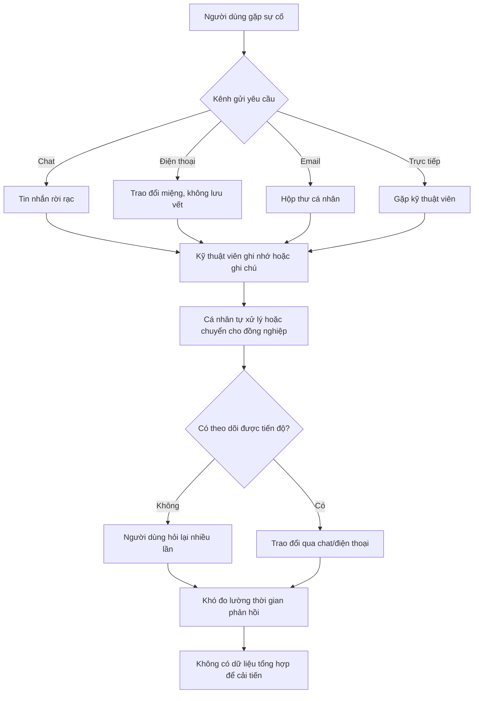

## 1.2. Tìm hiểu bài toán

### 1.2.1. Thực trạng tiếp nhận và xử lý yêu cầu hỗ trợ IT

Trong môi trường giáo dục hoặc doanh nghiệp quy mô vừa và nhỏ, bộ phận IT thường chỉ có vài người nhưng phải phục vụ hàng trăm người dùng. Yêu cầu hỗ trợ đến từ nhiều nguồn và không theo một biểu mẫu thống nhất. Người dùng có thể nhắn trực tiếp qua ứng dụng chat, gọi điện, gửi email cho một kỹ thuật viên quen thuộc hoặc đến tận phòng IT. Kỹ thuật viên tiếp nhận thông tin bằng trí nhớ, tin nhắn hoặc ghi chú cá nhân; việc chuyển giao công việc giữa các thành viên chủ yếu diễn ra bằng lời nói.

Khi số lượng yêu cầu tăng lên, cách làm này bộc lộ nhiều hạn chế. Một sự cố có thể được báo cho nhiều người và bị xử lý trùng lặp; một yêu cầu quan trọng có thể bị chìm trong các tin nhắn khác; người dùng không biết phiếu của mình đang ở bước nào; trưởng nhóm không có cái nhìn tổng thể về tải công việc của từng kỹ thuật viên. Việc thiếu dữ liệu lịch sử cũng khiến bộ phận IT khó trả lời các câu hỏi như: sự cố nào lặp lại nhiều nhất, thời gian phản hồi trung bình là bao lâu, nhóm nào đang quá tải, nguyên nhân gốc của các sự cố phổ biến là gì.

### 1.2.2. Những khó khăn của quy trình hiện tại

Từ thực trạng trên, có thể xác định các khó khăn chính:

1. **Thông tin phân tán:** yêu cầu nằm rải rác trong chat, email, điện thoại và ghi chú cá nhân, không có nguồn dữ liệu duy nhất.
2. **Không có mã định danh:** mỗi yêu cầu không có mã phiếu nên khó tra cứu, đối chiếu và theo dõi xuyên suốt.
3. **Không rõ trạng thái:** người dùng không biết yêu cầu đã được tiếp nhận, đang xử lý hay đã hoàn tất; kỹ thuật viên không có hàng đợi công việc thống nhất.
4. **Phân công thiếu công bằng:** công việc tập trung vào một vài người hoặc bị bỏ quên do không có cơ chế phân công, theo dõi trách nhiệm.
5. **Thiếu ưu tiên khoa học:** mức ưu tiên được quyết định cảm tính, không dựa trên ảnh hưởng và độ khẩn cấp; các sự cố nghiêm trọng có thể bị xử lý chậm.
6. **Thiếu lịch sử và bằng chứng:** không lưu lại đầy đủ trao đổi, tệp đính kèm, thời điểm thay đổi trạng thái và người thực hiện.
7. **Khó đo lường chất lượng:** không có số liệu về thời gian phản hồi đầu tiên, thời gian giải quyết, số phiếu mở, số phiếu quá hạn SLA.
8. **Rủi ro bảo mật:** thông tin sự cố có thể chứa dữ liệu nhạy cảm nhưng lại được trao đổi qua kênh không kiểm soát; tệp đính kèm không được phân quyền chặt chẽ.
9. **Khó mở rộng:** khi số người dùng và số nhóm xử lý tăng, cách làm thủ công không thể đáp ứng được nhu cầu phối hợp.

### 1.2.3. Mục tiêu của hệ thống mới

Hệ thống TicketIT được xây dựng nhằm đạt các mục tiêu sau:

- **Tập trung hóa:** mọi yêu cầu hỗ trợ được tạo và lưu trữ trong một hệ thống duy nhất, có mã phiếu và đường dẫn truy cập ổn định.
- **Chuẩn hóa quy trình:** mỗi phiếu đi qua vòng đời trạng thái được định nghĩa rõ ràng, có quy tắc chuyển trạng thái và điều kiện phân quyền.
- **Tự động hóa:** tự sinh mã phiếu, tự tính mức ưu tiên từ ma trận ảnh hưởng × khẩn cấp, tự gán nhóm mặc định theo danh mục, tự ghi lịch sử hoạt động và gửi thông báo.
- **Tăng tính minh bạch:** người dùng và kỹ thuật viên đều nhìn thấy tiến độ, trao đổi công khai, tệp đính kèm và lịch sử thay đổi trong cùng một trang.
- **Hỗ trợ ra quyết định:** dashboard theo vai trò hiển thị số phiếu đang mở, chưa phân công, được giao cho tôi, phiếu P1 và hàng đợi cần xử lý.
- **Bảo đảm an toàn thông tin:** phân quyền theo vai trò và quyền, kiểm soát tệp đính kèm, chặn tài khoản bị vô hiệu hóa, bảo vệ CSRF, XSS và tấn công brute-force.
- **Dễ sử dụng và dễ mở rộng:** giao diện tiếng Việt, responsive, cấu trúc mã nguồn rõ ràng theo MVC và Service Layer, có khả năng bổ sung báo cáo, API và tích hợp bên ngoài.

Hình 1.2 mô tả mô hình tổng quát của hệ thống với các nhóm người dùng, thành phần xử lý và kho dữ liệu.

**Hình 1.2. Mô hình tổng quát hệ thống TicketIT**

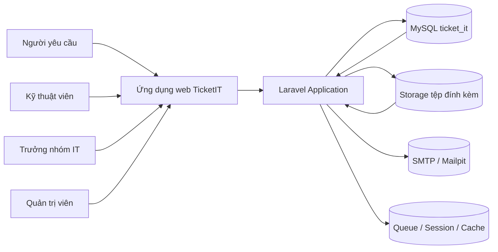

### 1.2.4. Phạm vi và giới hạn của hệ thống

**Phạm vi chức năng:**

- Quản lý tài khoản, đăng nhập, đăng ký, quên/đặt lại mật khẩu, xác thực email, đổi mật khẩu và xóa tài khoản.
- Phân quyền theo bốn vai trò và mười hai quyền chi tiết.
- Quản lý phiếu yêu cầu: tạo, xem, tìm kiếm, lọc, cập nhật, phân công, đổi trạng thái, đóng, mở lại.
- Bình luận công khai, ghi chú nội bộ, tệp đính kèm và lịch sử hoạt động.
- Thông báo trong ứng dụng và email.
- Dashboard theo vai trò.
- Quản trị người dùng, phòng ban, vị trí, nhóm xử lý và danh mục sự cố hai cấp.
- Dữ liệu mẫu phục vụ demo và bảo vệ đồ án.

**Giới hạn của phiên bản hiện tại:**

- Chưa có ứng dụng di động native; hệ thống chạy trên trình duyệt web responsive.
- Chưa tích hợp trực tiếp với hệ thống ERP, LMS, email nội bộ hoặc Active Directory/SSO.
- Chưa có module báo cáo – thống kê chuyên sâu; quyền `report.view` đã được khai báo nhưng giao diện báo cáo chưa triển khai.
- Chưa tự động phân công theo tải công việc; chiến lược phân công đã có trong dữ liệu cấu hình nhưng thao tác phân công hiện do kỹ thuật viên/trưởng nhóm thực hiện.
- Chưa có cơ chế tính vi phạm SLA theo giờ hành chính và tạm dừng khi chờ người dùng; các mốc thời gian và mục tiêu SLA đã được chuẩn bị trong enum.
- Chưa có API public, real-time notification (WebSocket) hoặc đánh giá hài lòng sau khi đóng phiếu.
- Chưa tích hợp quét virus cho tệp đính kèm; hệ thống chỉ kiểm tra định dạng và dung lượng.

## 1.3. Một số hệ thống và ứng dụng liên quan

Trên thị trường có nhiều nền tảng quản lý yêu cầu hỗ trợ, từ mã nguồn mở đến dịch vụ thương mại. Bảng 1.1 so sánh một số hệ thống tiêu biểu ở góc độ phù hợp với bài toán nội bộ của đồ án.

**Bảng 1.1. So sánh một số hệ thống hỗ trợ IT tiêu biểu**

| Hệ thống | Điểm mạnh | Hạn chế khi áp dụng cho đồ án | Mức độ phù hợp |
|---|---|---|---|
| **Jira Service Management** | Quy trình ITSM mạnh, SLA, báo cáo, tích hợp Atlassian | Chi phí cao, cấu hình phức tạp, giao diện không tối ưu cho tiếng Việt | Tham khảo mô hình |
| **Freshservice** | Giao diện hiện đại, quản lý tài sản, tự động hóa, báo cáo tốt | Dịch vụ trả phí, phụ thuộc cloud, khó tùy biến sâu | Tham khảo mô hình |
| **Zendesk Support** | Đa kênh, quản lý ticket, macro, báo cáo | Chi phí theo người dùng, không phù hợp đồ án học tập | Tham khảo |
| **osTicket** | Mã nguồn mở, miễn phí, quen thuộc với PHP/MySQL | Giao diện cũ, ít hỗ trợ tiếng Việt, khó tùy biến quy trình | Gần với đề tài |
| **GLPI** | Mã nguồn mở, quản lý tài sản CNTT, ITSM | Phức tạp, nặng, cần nhiều cấu hình | Tham khảo |
| **TicketIT (đồ án)** | Tiếng Việt, quy trình nội bộ gọn, mã nguồn dễ đọc, miễn phí, dễ mở rộng | Quy mô nhỏ, chưa có báo cáo nâng cao/API | **Phù hợp nhất** |

Từ việc tham khảo các hệ thống trên, nhóm xác định TicketIT không cần sao chép toàn bộ tính năng của các nền tảng ITSM lớn. Thay vào đó, hệ thống tập trung vào những nghiệp vụ cốt lõi nhất của một bộ phận IT nội bộ: tiếp nhận – phân loại – phân công – xử lý – phản hồi – đóng phiếu – thông báo. Cách tiếp cận này giúp sản phẩm vừa đủ dùng, dễ bảo vệ, dễ trình bày và có thể mở rộng dần theo nhu cầu thực tế.

## 1.4. Các yêu cầu của hệ thống mới

### 1.4.1. Yêu cầu chức năng

Bảng 1.2 liệt kê các yêu cầu chức năng của hệ thống, mã hóa theo từng nhóm nghiệp vụ để thuận tiện cho việc phân tích, thiết kế và kiểm thử.

**Bảng 1.2. Yêu cầu chức năng của hệ thống**

| Mã | Tên yêu cầu | Mô tả | Tác nhân | Ưu tiên |
|---|---|---|---|---|
| F01 | Đăng nhập / đăng xuất | Xác thực bằng email và mật khẩu; hỗ trợ ghi nhớ đăng nhập; chặn tài khoản bị vô hiệu hóa | Tất cả | Cao |
| F02 | Đăng ký tài khoản | Người dùng mới tự đăng ký; mặc định nhận vai trò `requester` | Khách | Cao |
| F03 | Quên / đặt lại mật khẩu | Gửi liên kết đặt lại qua email; đặt mật khẩu mới bằng token | Khách | Cao |
| F04 | Xác thực email và đổi mật khẩu | Gửi lại email xác thực; xác nhận mật khẩu hiện tại khi đổi mật khẩu | Người dùng | Trung bình |
| F05 | Dashboard theo vai trò | Hiển thị số liệu tổng quan và danh sách phiếu gần đây phù hợp với vai trò | Requester, Agent, Lead, Admin | Cao |
| F06 | Tạo phiếu yêu cầu | Nhập tiêu đề, mô tả, danh mục, phòng ban, vị trí, mức ảnh hưởng, độ khẩn cấp, tệp đính kèm | Requester, Staff | Cao |
| F07 | Danh sách và bộ lọc phiếu | Tìm kiếm theo mã/tiêu đề; lọc theo trạng thái, ưu tiên, danh mục, nhóm, người phụ trách; phân trang | Requester, Staff | Cao |
| F08 | Xem chi tiết phiếu | Hiển thị mô tả, tệp, trao đổi, lịch sử hoạt động, thông tin phân công, thời gian xử lý | Người được phép xem | Cao |
| F09 | Bình luận công khai | Gửi phản hồi công khai giữa người yêu cầu và bộ phận IT | Người được phép xem | Cao |
| F10 | Ghi chú nội bộ | Ghi chú chỉ dành cho staff; người yêu cầu không thấy | Agent, Lead, Admin | Cao |
| F11 | Tệp đính kèm | Tải lên, tải xuống tệp gắn với phiếu hoặc bình luận; kiểm tra định dạng, dung lượng | Người được phép xem | Trung bình |
| F12 | Phân công phiếu | Gán nhóm xử lý và kỹ thuật viên; cập nhật trạng thái `da_phan_cong` | Agent, Lead, Admin | Cao |
| F13 | Đổi trạng thái, đóng, mở lại | Chuyển trạng thái theo máy trạng thái; ghi lý do; đóng khi hoàn tất; mở lại khi cần | Staff, Requester (đóng/mở lại) | Cao |
| F14 | Thông báo | Thông báo trong ứng dụng và email khi tạo phiếu, phân công, đổi trạng thái, bình luận, đính kèm | Người liên quan | Trung bình |
| F15 | Quản lý người dùng | Tạo, cập nhật, khóa/mở khóa, xóa tài khoản; gán vai trò, phòng ban, vị trí, nhóm | Admin | Cao |
| F16 | Quản lý phòng ban, vị trí | CRUD phòng ban, vị trí; kiểm tra ràng buộc trước khi xóa | Admin | Trung bình |
| F17 | Quản lý nhóm xử lý | CRUD nhóm; gán trưởng nhóm, thành viên, chiến lược phân công, định mức | Admin | Trung bình |
| F18 | Quản lý danh mục sự cố | CRUD danh mục hai cấp; gán nhóm mặc định và ưu tiên mặc định | Admin | Trung bình |
| F19 | Hồ sơ cá nhân | Cập nhật họ tên, email; đổi mật khẩu; xóa tài khoản có xác nhận mật khẩu | Người dùng | Trung bình |
| F20 | Phân quyền | Kiểm soát quyền xem, tạo, sửa, phân công, đóng, mở lại, ghi chú, quản trị | Hệ thống | Cao |

### 1.4.2. Yêu cầu phi chức năng

**Bảng 1.3. Yêu cầu phi chức năng của hệ thống**

| Mã | Nhóm yêu cầu | Nội dung |
|---|---|---|
| N01 | Hiệu năng | Trang danh sách và chi tiết phiếu phản hồi trong thời gian hợp lý với dữ liệu demo; sử dụng phân trang, eager loading và index cơ sở dữ liệu |
| N02 | Bảo mật | Hash mật khẩu bằng bcrypt; bảo vệ CSRF, XSS, SQL injection; phân quyền theo vai trò và policy; giới hạn đăng nhập sai |
| N03 | Độ tin cậy | Thao tác tạo phiếu, phân công, đổi trạng thái được bọc trong transaction; lỗi gửi mail không làm hỏng giao dịch chính |
| N04 | Khả dụng | Giao diện tiếng Việt, bố cục rõ ràng, có thông báo thành công/lỗi, trạng thái rỗng và hướng dẫn nhập liệu |
| N05 | Tương thích | Hoạt động trên Chrome, Edge, Firefox, Safari phiên bản hiện đại; responsive từ mobile đến desktop |
| N06 | Hiệu quả sử dụng | Giảm số thao tác để tạo phiếu, phân công, đóng phiếu; hỗ trợ autofocus và điều hướng hợp lý |
| N07 | Dễ bảo trì | Mã nguồn theo MVC, Service Layer, Form Request, Policy, Enum; đặt tên tiếng Việt thống nhất; dùng Laravel Pint |
| N08 | Khả mở rộng | Có thể bổ sung module báo cáo, API, tích hợp email/SSO, tự động phân công mà không phá vỡ cấu trúc hiện tại |
| N09 | Sao lưu và phục hồi | Cơ sở dữ liệu MySQL có thể backup/restore định kỳ; tệp đính kèm lưu trên storage có thể sao lưu riêng |
| N10 | Ghi log và truy vết | Ghi nhận sự kiện phiếu, lịch sử trạng thái, người thực hiện, thời điểm; log ứng dụng phục vụ điều tra lỗi |
| N11 | Khả năng truy cập | Sử dụng nhãn form, màu sắc có độ tương phản, kích thước nút phù hợp; không phụ thuộc duy nhất vào màu sắc |
| N12 | Chất lượng mã nguồn | Tuân thủ quy ước Laravel/PHP hiện đại, có type hint, comment cho logic nghiệp vụ quan trọng, hạn chế lặp code |

### 1.4.3. Yêu cầu dữ liệu

Hệ thống cần quản lý các nhóm dữ liệu sau:

- **Dữ liệu người dùng:** họ tên, email, mật khẩu đã hash, điện thoại, phòng ban, vị trí, trạng thái hoạt động, vai trò.
- **Dữ liệu tổ chức:** phòng ban, vị trí/phòng làm việc, nhóm xử lý, thành viên nhóm, trưởng nhóm, định mức.
- **Dữ liệu danh mục:** danh mục sự cố hai cấp, nhóm mặc định, mức ưu tiên mặc định, trạng thái hoạt động.
- **Dữ liệu phiếu:** mã phiếu, tiêu đề, mô tả, người yêu cầu, người xử lý, nhóm, danh mục, trạng thái, ưu tiên, ảnh hưởng, khẩn cấp, các mốc thời gian, số lần mở lại, điểm hài lòng (dự phòng).
- **Dữ liệu trao đổi:** bình luận công khai, ghi chú nội bộ, tệp đính kèm, người tải lên, thời điểm.
- **Dữ liệu lịch sử:** sự kiện phiếu, lịch sử trạng thái, người thực hiện, lý do, thời gian bắt đầu/kết thúc.
- **Dữ liệu thông báo:** thông báo database, trạng thái đã đọc, nội dung, liên kết.

Yêu cầu về chất lượng dữ liệu: email duy nhất; mã phiếu duy nhất; khóa ngoại bảo đảm liên kết; trạng thái và mức ưu tiên thuộc tập giá trị hợp lệ; thời gian được lưu theo múi giờ `Asia/Ho_Chi_Minh`; dữ liệu nhạy cảm không hiển thị cho người không có quyền.

### 1.4.4. Tác nhân của hệ thống

**Bảng 1.4. Danh sách tác nhân và trách nhiệm**

| Tác nhân | Mô tả | Quyền hạn chính |
|---|---|---|
| **Khách (Guest)** | Người chưa đăng nhập | Đăng nhập, đăng ký, quên mật khẩu |
| **Người yêu cầu (Requester)** | Nhân viên/giảng viên/sinh viên cần hỗ trợ | Tạo phiếu; xem phiếu của mình; bình luận; đóng/mở lại phiếu; cập nhật hồ sơ |
| **Kỹ thuật viên (Agent)** | Nhân sự IT trực tiếp xử lý | Xem tất cả phiếu; cập nhật; phân công; đóng/mở lại; ghi chú nội bộ; đính kèm tệp |
| **Trưởng nhóm IT (Lead)** | Điều phối nhóm kỹ thuật | Như Agent + quyền `report.view` (chuẩn bị cho báo cáo) |
| **Quản trị viên (Admin)** | Quản trị hệ thống | Toàn quyền: quản lý người dùng, danh mục, nhóm, cấu hình và mọi phiếu |
| **Hệ thống (System)** | Thành phần tự động | Sinh mã phiếu, tính ưu tiên, ghi lịch sử, gửi thông báo, xử lý email/queue |

# CHƯƠNG 2. PHÂN TÍCH VÀ THIẾT KẾ HỆ THỐNG

## 2.1. Phân tích yêu cầu và xác định tác nhân

### 2.1.1. Kế hoạch phát triển theo Sprint

Để kiểm soát khối lượng công việc, nhóm tổ chức phát triển theo mô hình Scrum rút gọn với ba Sprint. Mỗi Sprint tập trung vào một nhóm chức năng có thể kiểm thử độc lập, sau đó tích hợp dần vào hệ thống hoàn chỉnh.

**Bảng 2.1. Kế hoạch phát triển theo Sprint**

| Sprint | Thời lượng dự kiến | Mục tiêu chính | Sản phẩm đầu ra |
|---|---|---|---|
| **Sprint 1** | 2 tuần | Xây dựng nền tảng xác thực, phân quyền và dữ liệu tổ chức | Đăng nhập/đăng ký/quên mật khẩu; 4 vai trò; 12 quyền; CRUD người dùng, phòng ban, vị trí, nhóm xử lý, danh mục |
| **Sprint 2** | 2 tuần | Xây dựng lõi nghiệp vụ quản lý phiếu | Tạo phiếu; sinh mã; tính ưu tiên; danh sách/lọc; chi tiết; phân công; vòng đời trạng thái; bình luận; ghi chú; tệp đính kèm |
| **Sprint 3** | 1,5 tuần | Hoàn thiện trải nghiệm, thông báo và kiểm thử | Dashboard theo vai trò; thông báo database/email; hồ sơ cá nhân; rà soát giao diện; kiểm thử chức năng và bảo mật |

Cách chia Sprint giúp nhóm có thể demo sớm các chức năng nền tảng, phát hiện lỗi sớm và điều chỉnh thiết kế trước khi bước vào phần nghiệp vụ phức tạp nhất là quản lý phiếu và vòng đời trạng thái.

### 2.1.2. Xác định tác nhân

Tác nhân là người hoặc hệ thống tương tác với hệ thống để hoàn thành một mục tiêu nghiệp vụ. Ngoài các tác nhân đã liệt kê trong Bảng 1.4, khi phân tích ca sử dụng cần phân biệt rõ phạm vi dữ liệu mà mỗi tác nhân được phép truy cập:

- **Requester** chỉ nhìn thấy phiếu do mình tạo, phiếu được giao cho mình hoặc phiếu mình đang theo dõi. Requester được tạo phiếu, bình luận công khai, đóng phiếu của mình và mở lại phiếu đã giải quyết/đã đóng.
- **Agent** nhìn thấy toàn bộ phiếu, được cập nhật trạng thái, phân công, đóng/mở lại, thêm ghi chú nội bộ và tải tệp. Agent không có quyền quản lý người dùng hay danh mục.
- **Lead** kế thừa quyền của Agent, có thêm quyền `report.view` và trách nhiệm điều phối nhóm, theo dõi hàng đợi và hỗ trợ Agent khi cần.
- **Admin** có toàn bộ quyền, bao gồm quản lý người dùng, phân quyền, danh mục, nhóm xử lý và cấu hình hệ thống.
- **System** là tác nhân phụ, thực hiện các hành vi tự động: sinh mã phiếu, tính ưu tiên, ghi sự kiện, ghi lịch sử trạng thái, gửi thông báo.

### 2.1.3. Biểu đồ ca sử dụng tổng quát

Hình 2.1 mô tả các ca sử dụng chính của hệ thống và mối liên hệ với các tác nhân. Sơ đồ được biểu diễn bằng Mermaid theo hướng gần đúng với biểu đồ ca sử dụng UML.

**  **

```mermaid
flowchart LR
    KH[Khách]
    NGUOI[Requester]
    AGENT[Agent]
    LEAD[Lead]
    ADMIN[Admin]

    subgraph HE_THONG["Hệ thống TicketIT"]
        UC01((UC-01 Đăng nhập))
        UC02((UC-02 Đăng ký))
        UC03((UC-03 Quên/đặt lại mật khẩu))
        UC04((UC-04 Xem tổng quan))
        UC05((UC-05 Tạo phiếu))
        UC06((UC-06 Xem danh sách/lọc phiếu))
        UC07((UC-07 Xem chi tiết phiếu))
        UC08((UC-08 Bình luận/ghi chú))
        UC09((UC-09 Đính kèm/tải tệp))
        UC10((UC-10 Phân công phiếu))
        UC11((UC-11 Đổi trạng thái/đóng/mở lại))
        UC12((UC-12 Nhận thông báo))
        UC13((UC-13 Quản lý người dùng))
        UC14((UC-14 Quản lý danh mục nền))
        UC15((UC-15 Quản lý nhóm xử lý))
        UC16((UC-16 Cập nhật hồ sơ))
    end

    KH --> UC01
    KH --> UC02
    KH --> UC03
    NGUOI --> UC04
    NGUOI --> UC05
    NGUOI --> UC06
    NGUOI --> UC07
    NGUOI --> UC08
    NGUOI --> UC09
    NGUOI --> UC11
    NGUOI --> UC12
    NGUOI --> UC16
    AGENT --> UC04
    AGENT --> UC06
    AGENT --> UC07
    AGENT --> UC08
    AGENT --> UC09
    AGENT --> UC10
    AGENT --> UC11
    AGENT --> UC12
    AGENT --> UC16
    LEAD --> UC04
    LEAD --> UC06
    LEAD --> UC07
    LEAD --> UC08
    LEAD --> UC09
    LEAD --> UC10
    LEAD --> UC11
    LEAD --> UC12
    LEAD --> UC16
    ADMIN --> UC13
    ADMIN --> UC14
    ADMIN --> UC15
    ADMIN --> UC04
    ADMIN --> UC06
    ADMIN --> UC07
    ADMIN --> UC08
    ADMIN --> UC09
    ADMIN --> UC10
    ADMIN --> UC11
    ADMIN --> UC12
    ADMIN --> UC16
```

**Bảng 2.2. Danh sách ca sử dụng**

| Mã | Ca sử dụng | Tác nhân chính | Mục tiêu | Ưu tiên |
|---|---|---|---|---|
| UC-01 | Đăng nhập | Khách | Truy cập hệ thống bằng tài khoản hợp lệ | Cao |
| UC-02 | Đăng ký | Khách | Tạo tài khoản requester mới | Cao |
| UC-03 | Quên/đặt lại mật khẩu | Khách | Khôi phục quyền truy cập | Cao |
| UC-04 | Xem tổng quan | Tất cả người dùng | Nắm tình hình phiếu theo vai trò | Cao |
| UC-05 | Tạo phiếu | Requester, Staff | Gửi yêu cầu hỗ trợ mới | Cao |
| UC-06 | Xem danh sách/lọc phiếu | Requester, Staff | Tìm đúng phiếu cần xử lý | Cao |
| UC-07 | Xem chi tiết phiếu | Người được phép xem | Xem đầy đủ thông tin, trao đổi, lịch sử | Cao |
| UC-08 | Bình luận/ghi chú | Người được phép xem | Trao đổi công khai hoặc ghi chú nội bộ | Cao |
| UC-09 | Đính kèm/tải tệp | Người được phép xem | Bổ sung bằng chứng, tài liệu | Trung bình |
| UC-10 | Phân công phiếu | Agent, Lead, Admin | Gán đúng người/nhóm xử lý | Cao |
| UC-11 | Đổi trạng thái/đóng/mở lại | Staff, Requester | Cập nhật tiến độ và kết thúc/mở lại phiếu | Cao |
| UC-12 | Nhận thông báo | Tất cả người dùng | Biết các thay đổi liên quan | Trung bình |
| UC-13 | Quản lý người dùng | Admin | Tạo/cập nhật/khóa/xóa tài khoản | Cao |
| UC-14 | Quản lý danh mục nền | Admin | Duy trì phòng ban, vị trí, danh mục | Trung bình |
| UC-15 | Quản lý nhóm xử lý | Admin | Duy trì nhóm, trưởng nhóm, thành viên | Trung bình |
| UC-16 | Cập nhật hồ sơ | Tất cả người dùng | Thay đổi thông tin cá nhân, mật khẩu | Trung bình |

### 2.1.4. Đặc tả các ca sử dụng chính

Trong phần này, nhóm đặc tả chi tiết hai ca sử dụng quan trọng nhất: **tạo phiếu yêu cầu** và **phân công – xử lý phiếu**. Các ca sử dụng còn lại được mô tả tóm tắt trong Bảng 2.2 và được triển khai tương ứng ở Chương 3.

**Bảng 2.3. Đặc tả ca sử dụng tạo phiếu yêu cầu**

| Thành phần | Nội dung |
|---|---|
| **Mã ca sử dụng** | UC-05 |
| **Tên ca sử dụng** | Tạo phiếu yêu cầu hỗ trợ |
| **Tác nhân chính** | Requester (hoặc Staff) |
| **Tác nhân phụ** | Hệ thống (sinh mã, tính ưu tiên, ghi lịch sử, gửi thông báo) |
| **Mục tiêu** | Ghi nhận một yêu cầu hỗ trợ mới với đầy đủ thông tin để bộ phận IT có thể tiếp nhận và xử lý |
| **Tiền điều kiện** | Người dùng đã đăng nhập, tài khoản đang hoạt động và đã xác thực email; có quyền `ticket.create` |
| **Hậu điều kiện** | Phiếu mới được tạo với mã duy nhất, trạng thái `moi`, mức ưu tiên được tính tự động; người yêu cầu được thêm vào danh sách theo dõi; sự kiện và lịch sử trạng thái được ghi; thông báo được gửi đến nhóm/staff phù hợp |
| **Luồng chính** | 1. Người dùng chọn **Tạo phiếu**.<br>2. Hệ thống hiển thị biểu mẫu với danh mục, phòng ban, vị trí mặc định theo hồ sơ.<br>3. Người dùng nhập tiêu đề, mô tả, chọn danh mục con, phòng ban, vị trí.<br>4. Người dùng chọn mức ảnh hưởng (1–3) và độ khẩn cấp (1–3); giao diện hiển thị mức ưu tiên dự kiến.<br>5. Người dùng có thể đính kèm tối đa 5 tệp hợp lệ.<br>6. Người dùng gửi phiếu.<br>7. Hệ thống kiểm tra dữ liệu bằng `LuuPhieuYeuCauRequest`.<br>8. Hệ thống sinh mã `TK-YYYY-NNNNNN`, tính ưu tiên, gán nhóm mặc định theo danh mục.<br>9. Hệ thống lưu phiếu, người theo dõi, sự kiện `tao_moi`, lịch sử trạng thái `moi`.<br>10. Hệ thống gửi thông báo cho nhóm xử lý hoặc lead/admin nếu chưa có nhóm.<br>11. Hệ thống chuyển đến trang chi tiết phiếu và hiển thị thông báo thành công. |
| **Luồng thay thế** | 4a. Người dùng không chọn phòng ban/vị trí → hệ thống dùng giá trị mặc định từ hồ sơ cá nhân.<br>5a. Người dùng không đính kèm tệp → phiếu vẫn được tạo bình thường.<br>8a. Danh mục không có nhóm mặc định → phiếu ở trạng thái `moi`, chưa có nhóm; staff có thể phân công sau. |
| **Luồng ngoại lệ** | 7a. Thiếu tiêu đề/mô tả/danh mục/ảnh hưởng/khẩn cấp → hiển thị lỗi theo từng trường, giữ dữ liệu đã nhập.<br>7b. Tệp sai định dạng hoặc vượt quá 5 MB → từ chối tệp và thông báo.<br>9a. Lỗi cơ sở dữ liệu → transaction rollback, không tạo phiếu dở dang.<br>10a. Gửi mail thất bại → ghi log, không làm hỏng giao dịch tạo phiếu. |
| **Quy tắc nghiệp vụ** | Tiêu đề tối đa 180 ký tự; mô tả 10–10.000 ký tự; danh mục phải đang hoạt động; ảnh hưởng/khẩn cấp chỉ nhận giá trị 1, 2, 3; tối đa 5 tệp; mỗi tệp tối đa 5 MB; định dạng cho phép: jpg, jpeg, png, gif, webp, pdf, doc, docx, xls, xlsx, ppt, pptx, txt, csv, zip, rar. |

**Bảng 2.4. Đặc tả ca sử dụng phân công và xử lý phiếu**

| Thành phần | Nội dung |
|---|---|
| **Mã ca sử dụng** | UC-10 / UC-11 |
| **Tên ca sử dụng** | Phân công và cập nhật trạng thái phiếu |
| **Tác nhân chính** | Agent, Lead, Admin |
| **Tác nhân phụ** | Hệ thống (thông báo, lịch sử, tính thời gian) |
| **Mục tiêu** | Gán người/nhóm phụ trách và cập nhật tiến độ xử lý phiếu theo đúng quy trình |
| **Tiền điều kiện** | Phiếu tồn tại; người thực hiện có quyền `ticket.assign`, `ticket.update`; phiếu đang ở trạng thái cho phép |
| **Hậu điều kiện** | Phiếu có người xử lý/nhóm xử lý; trạng thái được cập nhật; sự kiện và lịch sử trạng thái được ghi; thông báo được gửi đến người liên quan |
| **Luồng chính** | 1. Staff mở trang chi tiết phiếu.<br>2. Hệ thống hiển thị form **Phân công** và **Cập nhật xử lý** nếu có quyền.<br>3. Staff chọn nhóm xử lý và/hoặc kỹ thuật viên.<br>4. Hệ thống cập nhật `nhom_xu_ly_id`, `nguoi_xu_ly_id`; nếu là lần phân công đầu tiên, ghi `phan_cong_luc` và chuyển trạng thái sang `da_phan_cong`.<br>5. Staff chọn trạng thái mới trong danh sách trạng thái được phép chuyển.<br>6. Hệ thống kiểm tra quy tắc chuyển trạng thái; cập nhật trạng thái, các mốc thời gian và số lần mở lại nếu có.<br>7. Hệ thống ghi sự kiện `phan_cong`, `doi_trang_thai`, `dong_phieu`/`mo_lai` tương ứng.<br>8. Hệ thống gửi thông báo cho người được phân công, người yêu cầu và nhóm liên quan.<br>9. Hệ thống quay lại trang chi tiết với thông báo thành công. |
| **Luồng thay thế** | 3a. Chỉ đổi nhóm, không đổi người xử lý → phiếu chuyển sang nhóm mới.<br>3b. Chỉ đổi người xử lý → giữ nguyên nhóm hiện tại.<br>5a. Không chọn trạng thái mới → chỉ cập nhật phân công.<br>5b. Staff đổi mức ưu tiên → hệ thống ghi sự kiện `doi_uu_tien`. |
| **Luồng ngoại lệ** | 4a. Người xử lý không hoạt động → validation từ chối.<br>6a. Chuyển trạng thái không hợp lệ (ví dụ `da_dong` → `dang_xu_ly`) → trả lỗi và không cập nhật.<br>6b. Người không có quyền → HTTP 403.<br>8a. Gửi thông báo lỗi → ghi log, không ảnh hưởng giao dịch. |
| **Quy tắc nghiệp vụ** | Chỉ chuyển trạng thái theo máy trạng thái; trạng thái `da_phan_cong` trở đi yêu cầu có người xử lý; khi giải quyết ghi `giai_quyet_luc`; khi đóng ghi `dong_luc`; khi mở lại xóa mốc giải quyết/đóng và ghi sự kiện `mo_lai`. |

## 2.2. Thiết kế dữ liệu

### 2.2.1. Sơ đồ thực thể – liên kết

Cơ sở dữ liệu `ticket_it` được thiết kế theo mô hình quan hệ, chuẩn hóa đến dạng 3NF ở mức cần thiết. Các bảng nghiệp vụ chính gồm: `nguoi_dung`, `phong_ban`, `vi_tri`, `nhom_xu_ly`, `nhom_xu_ly_nguoi_dung`, `danh_muc`, `phieu_yeu_cau`, `binh_luan_phieu`, `tep_dinh_kem`, `su_kien_phieu`, `lich_su_trang_thai`, `nguoi_theo_doi`. Ngoài ra, hệ thống sử dụng các bảng hạ tầng của Laravel và Spatie Permission như `sessions`, `cache`, `jobs`, `notifications`, `roles`, `permissions`, `model_has_roles`, `role_has_permissions`.

Hình 2.2 mô tả sơ đồ thực thể – liên kết của các bảng nghiệp vụ cốt lõi.

**Hình 2.2. Sơ đồ thực thể – liên kết (ERD)**

```mermaid
erDiagram
    PHONG_BAN ||--o{ NG UOI_DUNG : "thuộc"
    VI_TRI ||--o{ NGUOI_DUNG : "làm việc tại"
    PHONG_BAN ||--o{ PHIEU_YEU_CAU : "của phòng ban"
    VI_TRI ||--o{ PHIEU_YEU_CAU : "xảy ra tại"
    DANH_MUC ||--o{ DANH_MUC : "cha - con"
    DANH_MUC ||--o{ PHIEU_YEU_CAU : "phân loại"
    NHOM_XU_LY ||--o{ DANH_MUC : "nhóm mặc định"
    NHOM_XU_LY ||--o{ PHIEU_YEU_CAU : "phụ trách"
    NGUOI_DUNG ||--o{ NHOM_XU_LY : "trưởng nhóm"
    NHOM_XU_LY ||--o{ NHOM_XU_LY_NGUOI_DUNG : "có thành viên"
    NGUOI_DUNG ||--o{ NHOM_XU_LY_NGUOI_DUNG : "tham gia"
    NGUOI_DUNG ||--o{ PHIEU_YEU_CAU : "yêu cầu"
    NGUOI_DUNG ||--o{ PHIEU_YEU_CAU : "xử lý"
    PHIEU_YEU_CAU ||--o{ BINH_LUAN_PHIEU : "có bình luận"
    NGUOI_DUNG ||--o{ BINH_LUAN_PHIEU : "viết"
    PHIEU_YEU_CAU ||--o{ TEP_DINH_KEM : "có tệp"
    BINH_LUAN_PHIEU ||--o{ TEP_DINH_KEM : "tệp của bình luận"
    NGUOI_DUNG ||--o{ TEP_DINH_KEM : "tải lên"
    PHIEU_YEU_CAU ||--o{ SU_KIEN_PHIEU : "có sự kiện"
    NGUOI_DUNG ||--o{ SU_KIEN_PHIEU : "thực hiện"
    PHIEU_YEU_CAU ||--o{ LICH_SU_TRANG_THAI : "có lịch sử"
    NGUOI_DUNG ||--o{ LICH_SU_TRANG_THAI : "thực hiện"
    PHIEU_YEU_CAU ||--o{ NGUOI_THEO_DOI : "có người theo dõi"
    NGUOI_DUNG ||--o{ NGUOI_THEO_DOI : "theo dõi"

    NGUOI_DUNG {
        bigint id PK
        string ten
        string email UK
        string dien_thoai
        string password
        bigint phong_ban_id FK
        bigint vi_tri_id FK
        boolean dang_hoat_dong
        timestamp email_verified_at
        timestamp phan_cong_gan_nhat_luc
        timestamps created_at_updated_at
    }

    PHONG_BAN {
        bigint id PK
        string ma UK
        string ten
        boolean dang_hoat_dong
    }

    VI_TRI {
        bigint id PK
        string ten
        boolean dang_hoat_dong
    }

    NHOM_XU_LY {
        bigint id PK
        string ma UK
        string ten
        string mo_ta
        bigint truong_nhom_id FK
        string chien_luoc_phan_cong
        int dinh_muc
        boolean dang_hoat_dong
    }

    NHOM_XU_LY_NGUOI_DUNG {
        bigint nhom_xu_ly_id PK
        bigint nguoi_dung_id PK
        boolean la_truong_nhom
        int dinh_muc
    }

    DANH_MUC {
        bigint id PK
        bigint danh_muc_cha_id FK
        string ma UK
        string ten
        string mo_ta
        bigint nhom_mac_dinh_id FK
        string uu_tien_mac_dinh
        boolean dang_hoat_dong
    }

    PHIEU_YEU_CAU {
        bigint id PK
        string ma UK
        string tieu_de
        text mo_ta
        bigint nguoi_yeu_cau_id FK
        bigint phong_ban_id FK
        bigint vi_tri_id FK
        bigint danh_muc_id FK
        bigint nhom_xu_ly_id FK
        bigint nguoi_xu_ly_id FK
        string trang_thai
        string uu_tien
        string anh_huong
        string khan_cap
        string kenh
        timestamp phan_cong_luc
        timestamp phan_hoi_dau_luc
        timestamp giai_quyet_luc
        timestamp dong_luc
    }

    BINH_LUAN_PHIEU {
        bigint id PK
        bigint phieu_yeu_cau_id FK
        bigint nguoi_dung_id FK
        text noi_dung
        string loai
        boolean la_phan_hoi_dau
    }

    TEP_DINH_KEM {
        bigint id PK
        bigint phieu_yeu_cau_id FK
        bigint binh_luan_id FK
        bigint nguoi_tai_len_id FK
        string disk
        string duong_dan
        string ten_goc
        string dinh_dang
        bigint kich_thuoc
    }

    SU_KIEN_PHIEU {
        bigint id PK
        bigint phieu_yeu_cau_id FK
        bigint nguoi_thuc_hien_id FK
        string loai
        string tu_gia_tri
        string den_gia_tri
        json du_lieu_them
    }

    LICH_SU_TRANG_THAI {
        bigint id PK
        bigint phieu_yeu_cau_id FK
        string trang_thai_truoc
        string trang_thai_sau
        bigint nguoi_thuc_hien_id FK
        string ly_do
        timestamp bat_dau_luc
        timestamp ket_thuc_luc
    }

    NGUOI_THEO_DOI {
        bigint id PK
        bigint phieu_yeu_cau_id FK
        bigint nguoi_dung_id FK
    }
```

### 2.2.2. Từ điển dữ liệu

**Bảng 2.5. Từ điển dữ liệu bảng `nguoi_dung`**

| Cột | Kiểu dữ liệu | Ràng buộc | Mô tả |
|---|---|---|---|
| `id` | bigint unsigned | PK, auto increment | Khóa chính |
| `ten` | varchar(255) | NOT NULL | Họ và tên người dùng |
| `email` | varchar(255) | NOT NULL, UNIQUE | Email đăng nhập |
| `dien_thoai` | varchar(32) | NULL | Số điện thoại liên hệ |
| `email_verified_at` | timestamp | NULL | Thời điểm xác thực email |
| `password` | varchar(255) | NOT NULL | Mật khẩu đã hash bcrypt |
| `phong_ban_id` | bigint unsigned | FK → `phong_ban.id`, NULL, ON DELETE SET NULL | Phòng ban của người dùng |
| `vi_tri_id` | bigint unsigned | FK → `vi_tri.id`, NULL, ON DELETE SET NULL | Vị trí làm việc |
| `dang_hoat_dong` | boolean | DEFAULT true | Trạng thái hoạt động |
| `anh_dai_dien` | varchar(255) | NULL | Đường dẫn ảnh đại diện (dự phòng) |
| `phan_cong_gan_nhat_luc` | timestamp | NULL | Lần phân công gần nhất |
| `remember_token` | varchar(100) | NULL | Token ghi nhớ đăng nhập |
| `created_at`, `updated_at` | timestamp | NULL | Thời điểm tạo/cập nhật |

**Bảng 2.6. Từ điển dữ liệu bảng `phieu_yeu_cau`**

| Cột | Kiểu dữ liệu | Ràng buộc | Mô tả |
|---|---|---|---|
| `id` | bigint unsigned | PK | Khóa chính |
| `ma` | varchar(24) | NOT NULL, UNIQUE | Mã phiếu `TK-YYYY-NNNNNN` |
| `tieu_de` | varchar(180) | NOT NULL | Tiêu đề sự cố |
| `mo_ta` | text | NOT NULL | Mô tả chi tiết |
| `nguoi_yeu_cau_id` | bigint unsigned | FK → `nguoi_dung.id`, NOT NULL, CASCADE | Người gửi yêu cầu |
| `phong_ban_id` | bigint unsigned | FK → `phong_ban.id`, NULL, SET NULL | Phòng ban ghi nhận sự cố |
| `vi_tri_id` | bigint unsigned | FK → `vi_tri.id`, NULL, SET NULL | Vị trí xảy ra sự cố |
| `danh_muc_id` | bigint unsigned | FK → `danh_muc.id`, NULL, SET NULL | Danh mục sự cố |
| `nhom_xu_ly_id` | bigint unsigned | FK → `nhom_xu_ly.id`, NULL, SET NULL | Nhóm xử lý |
| `nguoi_xu_ly_id` | bigint unsigned | FK → `nguoi_dung.id`, NULL, SET NULL | Kỹ thuật viên phụ trách |
| `trang_thai` | varchar(24) | DEFAULT `moi`, INDEX | Trạng thái phiếu |
| `uu_tien` | varchar(2) | DEFAULT `P3`, INDEX | Mức ưu tiên P1–P4 |
| `anh_huong` | varchar(10) | DEFAULT `trung_binh` | Mức ảnh hưởng |
| `khan_cap` | varchar(10) | DEFAULT `trung_binh` | Độ khẩn cấp |
| `kenh` | varchar(16) | DEFAULT `web` | Kênh tiếp nhận |
| `phan_cong_luc` | timestamp | NULL | Thời điểm phân công đầu tiên |
| `phan_hoi_dau_luc` | timestamp | NULL | Thời điểm phản hồi công khai đầu tiên của staff |
| `giai_quyet_luc` | timestamp | NULL | Thời điểm giải quyết |
| `dong_luc` | timestamp | NULL | Thời điểm đóng phiếu |
| `created_at`, `updated_at` | timestamp | NULL | Thời điểm tạo/cập nhật |
| Index | — | `(nguoi_yeu_cau_id, trang_thai)`, `(nguoi_xu_ly_id, trang_thai)`, `(nhom_xu_ly_id, trang_thai)`, `created_at` | Tối ưu truy vấn danh sách/lọc |

**Bảng 2.7. Từ điển dữ liệu các bảng nghiệp vụ còn lại**

Các bảng còn lại được trình bày chi tiết theo cùng cấu trúc với Bảng 2.5 và Bảng 2.6, gồm bốn cột: tên cột, kiểu dữ liệu, ràng buộc và mô tả nghiệp vụ. Mỗi bảng con 2.7.x tương ứng với một bảng thực tế trong cơ sở dữ liệu `ticket_it`.

**Bảng 2.7.1. Từ điển dữ liệu bảng `phong_ban`**

| Cột | Kiểu dữ liệu | Ràng buộc | Mô tả |
|---|---|---|---|
| `id` | bigint unsigned | PK, auto increment | Khóa chính |
| `ma` | varchar(32) | NOT NULL, UNIQUE | Mã phòng ban, ví dụ `CNTT`, `HCNS`; dùng để phân loại người dùng và phiếu theo đơn vị |
| `ten` | varchar(255) | NOT NULL | Tên phòng ban/đơn vị |
| `dang_hoat_dong` | boolean | DEFAULT true | Trạng thái hoạt động; chỉ phòng ban đang hoạt động mới được chọn khi tạo người dùng/phiếu |
| `created_at`, `updated_at` | timestamp | NULL | Thời điểm tạo/cập nhật bản ghi |
| Index | — | PK(`id`), UNIQUE(`ma`) | Tối ưu tra cứu theo mã phòng ban |

Quan hệ: một phòng ban có nhiều người dùng (`nguoi_dung.phong_ban_id`) và nhiều phiếu (`phieu_yeu_cau.phong_ban_id`).

**Bảng 2.7.2. Từ điển dữ liệu bảng `vi_tri`**

| Cột | Kiểu dữ liệu | Ràng buộc | Mô tả |
|---|---|---|---|
| `id` | bigint unsigned | PK, auto increment | Khóa chính |
| `ten` | varchar(255) | NOT NULL | Tên vị trí cụ thể, ví dụ `Phòng 305`, `Phòng Lab 1` |
| `dang_hoat_dong` | boolean | DEFAULT true | Trạng thái hoạt động |
| `created_at`, `updated_at` | timestamp | NULL | Thời điểm tạo/cập nhật bản ghi |
| Index | — | PK(`id`) | Tối ưu tra cứu theo khóa chính |

Quan hệ: một vị trí có nhiều người dùng (`nguoi_dung.vi_tri_id`) và nhiều phiếu (`phieu_yeu_cau.vi_tri_id`). Hàm `fullName()` trả về tên vị trí để hiển thị.

**Bảng 2.7.3. Từ điển dữ liệu bảng `nhom_xu_ly`**

| Cột | Kiểu dữ liệu | Ràng buộc | Mô tả |
|---|---|---|---|
| `id` | bigint unsigned | PK, auto increment | Khóa chính |
| `ma` | varchar(32) | NOT NULL, UNIQUE | Mã nhóm xử lý |
| `ten` | varchar(255) | NOT NULL | Tên nhóm kỹ thuật viên |
| `mo_ta` | varchar(255) | NULL | Mô tả lĩnh vực phụ trách |
| `truong_nhom_id` | bigint unsigned | NULL, FK → `nguoi_dung.id`, ON DELETE SET NULL | Trưởng nhóm |
| `chien_luoc_phan_cong` | varchar(32) | DEFAULT `khop_ky_nang` | Chiến lược phân công: `khop_ky_nang` (luân chuyển theo tải công việc), `it_viec_nhat` (ít việc nhất), `xoay_vong` (xoay vòng) |
| `dinh_muc` | smallint unsigned | DEFAULT 20 | Định mức phiếu/người, kiểm tra trong khoảng 1–500 |
| `dang_hoat_dong` | boolean | DEFAULT true | Trạng thái hoạt động |
| `created_at`, `updated_at` | timestamp | NULL | Thời điểm tạo/cập nhật bản ghi |
| Index | — | PK(`id`), UNIQUE(`ma`), INDEX(`truong_nhom_id`) | Tối ưu tra cứu nhóm và trưởng nhóm |

Quan hệ: trưởng nhóm (`lead`), thành viên (n-n qua `nhom_xu_ly_nguoi_dung`), phiếu (`tickets`), danh mục mặc định (`categories`).

**Bảng 2.7.4. Từ điển dữ liệu bảng `nhom_xu_ly_nguoi_dung`**

| Cột | Kiểu dữ liệu | Ràng buộc | Mô tả |
|---|---|---|---|
| `nhom_xu_ly_id` | bigint unsigned | PK (thành phần), FK → `nhom_xu_ly.id`, ON DELETE CASCADE | Nhóm xử lý |
| `nguoi_dung_id` | bigint unsigned | PK (thành phần), FK → `nguoi_dung.id`, ON DELETE CASCADE | Thành viên nhóm |
| `la_truong_nhom` | boolean | DEFAULT false | Đánh dấu thành viên là trưởng nhóm trong nhóm |
| `dinh_muc` | smallint unsigned | NULL | Định mức riêng của thành viên; NULL nghĩa là dùng định mức chung của nhóm |
| `created_at`, `updated_at` | timestamp | NULL | Thời điểm tham gia/cập nhật |
| Index | — | PK(`nhom_xu_ly_id`, `nguoi_dung_id`), INDEX(`nguoi_dung_id`) | Chống trùng thành viên trong cùng nhóm |

Quan hệ n-n được khai báo qua `NhomXuLy::members()` và `NguoiDung::teams()`, cho phép lấy kèm `la_truong_nhom` và `dinh_muc`.

**Bảng 2.7.5. Từ điển dữ liệu bảng `danh_muc`**

| Cột | Kiểu dữ liệu | Ràng buộc | Mô tả |
|---|---|---|---|
| `id` | bigint unsigned | PK, auto increment | Khóa chính |
| `danh_muc_cha_id` | bigint unsigned | NULL, FK → `danh_muc.id`, ON DELETE SET NULL | Danh mục cha; NULL là danh mục cấp 1. Mỗi danh mục cha có thể có nhiều danh mục con (tối đa 2 cấp) |
| `ma` | varchar(64) | NOT NULL, UNIQUE | Mã danh mục sự cố |
| `ten` | varchar(255) | NOT NULL | Tên danh mục |
| `mo_ta` | varchar(255) | NULL | Mô tả danh mục |
| `nhom_mac_dinh_id` | bigint unsigned | NULL, FK → `nhom_xu_ly.id`, ON DELETE SET NULL | Nhóm xử lý mặc định khi tạo phiếu thuộc danh mục này |
| `uu_tien_mac_dinh` | varchar(2) | NULL | Mức ưu tiên mặc định của danh mục (`P1`–`P4`), lưu để phục vụ cấu hình/gợi ý; mức ưu tiên thực tế của phiếu được tính từ ma trận ảnh hưởng × khẩn cấp |
| `dang_hoat_dong` | boolean | DEFAULT true | Trạng thái hoạt động; chỉ danh mục đang hoạt động mới được chọn khi tạo phiếu |
| `created_at`, `updated_at` | timestamp | NULL | Thời điểm tạo/cập nhật bản ghi |
| Index | — | PK(`id`), UNIQUE(`ma`), INDEX(`nhom_mac_dinh_id`), INDEX(`danh_muc_cha_id`, `dang_hoat_dong`) | Tối ưu duyệt cây danh mục và lọc danh mục đang hoạt động |

Quan hệ: `parent`, `children`, `defaultTeam`, `tickets`; hàm `fullName()` hiển thị dạng `Danh mục cha / Danh mục con`.

**Bảng 2.7.6. Từ điển dữ liệu bảng `binh_luan_phieu`**

| Cột | Kiểu dữ liệu | Ràng buộc | Mô tả |
|---|---|---|---|
| `id` | bigint unsigned | PK, auto increment | Khóa chính |
| `phieu_yeu_cau_id` | bigint unsigned | NOT NULL, FK → `phieu_yeu_cau.id`, ON DELETE CASCADE | Phiếu được trao đổi |
| `nguoi_dung_id` | bigint unsigned | NOT NULL, FK → `nguoi_dung.id`, ON DELETE CASCADE | Người viết bình luận/ghi chú |
| `noi_dung` | text | NOT NULL | Nội dung trao đổi; validation 2–5.000 ký tự |
| `loai` | varchar(16) | DEFAULT `cong_khai`, INDEX | `cong_khai` = bình luận công khai; `noi_bo` = ghi chú nội bộ chỉ staff thấy |
| `la_phan_hoi_dau` | boolean | DEFAULT false | `true` nếu là phản hồi công khai đầu tiên của staff; đồng thời cập nhật `phieu_yeu_cau.phan_hoi_dau_luc` |
| `created_at`, `updated_at` | timestamp | NULL | Thời điểm tạo/cập nhật bản ghi |
| Index | — | PK(`id`), INDEX(`loai`), INDEX(`nguoi_dung_id`), INDEX(`phieu_yeu_cau_id`, `created_at`) | Tối ưu hiển thị timeline và lọc ghi chú nội bộ |

Quan hệ: `ticket`, `author`, `attachments`; hàm `isInternal()` xác định bình luận là ghi chú nội bộ.

**Bảng 2.7.7. Từ điển dữ liệu bảng `tep_dinh_kem`**

| Cột | Kiểu dữ liệu | Ràng buộc | Mô tả |
|---|---|---|---|
| `id` | bigint unsigned | PK, auto increment | Khóa chính |
| `phieu_yeu_cau_id` | bigint unsigned | NOT NULL, FK → `phieu_yeu_cau.id`, ON DELETE CASCADE | Phiếu chứa tệp |
| `binh_luan_id` | bigint unsigned | NULL, FK → `binh_luan_phieu.id`, ON DELETE CASCADE | Bình luận chứa tệp; NULL nếu tệp gắn trực tiếp với phiếu |
| `nguoi_tai_len_id` | bigint unsigned | NULL, FK → `nguoi_dung.id`, ON DELETE SET NULL | Người tải tệp lên |
| `disk` | varchar(32) | DEFAULT `local` | Tên disk lưu trữ của Laravel |
| `duong_dan` | varchar(255) | NOT NULL | Đường dẫn tương đối trong storage, ví dụ `phieu/12/abc.pdf` |
| `ten_goc` | varchar(255) | NOT NULL | Tên tệp gốc dùng khi hiển thị/tải xuống |
| `dinh_dang` | varchar(128) | NULL | MIME type của tệp |
| `kich_thuoc` | bigint unsigned | DEFAULT 0 | Kích thước tệp (byte) |
| `created_at`, `updated_at` | timestamp | NULL | Thời điểm tải lên/cập nhật |
| Index | — | PK(`id`), INDEX(`phieu_yeu_cau_id`), INDEX(`binh_luan_id`), INDEX(`nguoi_tai_len_id`) | Tối ưu tải danh sách tệp theo phiếu/bình luận |

Quy tắc: tối đa 5 tệp mỗi lần gửi, mỗi tệp tối đa 5.120 KB (cấu hình `ho_tro.tep_dinh_kem`); định dạng cho phép gồm jpg, jpeg, png, gif, webp, pdf, doc, docx, xls, xlsx, ppt, pptx, txt, csv, zip, rar. Tệp được lưu ngoài thư mục `public` trong `storage/app/private/phieu/{id}` và chỉ tải được khi người dùng có quyền xem phiếu.

**Bảng 2.7.8. Từ điển dữ liệu bảng `su_kien_phieu`**

| Cột | Kiểu dữ liệu | Ràng buộc | Mô tả |
|---|---|---|---|
| `id` | bigint unsigned | PK, auto increment | Khóa chính |
| `phieu_yeu_cau_id` | bigint unsigned | NOT NULL, FK → `phieu_yeu_cau.id`, ON DELETE CASCADE | Phiếu phát sinh sự kiện |
| `nguoi_thuc_hien_id` | bigint unsigned | NULL, FK → `nguoi_dung.id`, ON DELETE SET NULL | Người thực hiện; NULL nếu do hệ thống thực hiện |
| `loai` | varchar(32) | NOT NULL, INDEX | Loại sự kiện: `tao_moi`, `cap_nhat`, `doi_trang_thai`, `doi_uu_tien`, `phan_cong`, `binh_luan`, `ghi_chu_noi_bo`, `dinh_kem_tep`, `mo_lai`, `dong_phieu`, `them_nguoi_theo_doi` |
| `tu_gia_tri` | varchar(32) | NULL | Giá trị cũ (trạng thái hoặc mức ưu tiên) |
| `den_gia_tri` | varchar(32) | NULL | Giá trị mới |
| `du_lieu_them` | json | NULL | Dữ liệu bổ sung: `ly_do`, `nguoi_xu_ly`, `nguoi_xu_ly_id`, `team`, `nhom_xu_ly_id`, `comment_id`, `ten`… |
| `created_at`, `updated_at` | timestamp | NULL | Thời điểm phát sinh/cập nhật |
| Index | — | PK(`id`), INDEX(`loai`), INDEX(`nguoi_thuc_hien_id`), INDEX(`phieu_yeu_cau_id`, `created_at`) | Tối ưu hiển thị timeline và lọc theo loại sự kiện |

Vai trò: là nhật ký hoạt động đầy đủ của phiếu; hàm `summary()` chuyển sự kiện thành câu tiếng Việt để hiển thị timeline. Sự kiện `mo_lai` vẫn được lưu nên có thể đếm số lần mở lại từ bảng này.

**Bảng 2.7.9. Từ điển dữ liệu bảng `lich_su_trang_thai`**

| Cột | Kiểu dữ liệu | Ràng buộc | Mô tả |
|---|---|---|---|
| `id` | bigint unsigned | PK, auto increment | Khóa chính |
| `phieu_yeu_cau_id` | bigint unsigned | NOT NULL, FK → `phieu_yeu_cau.id`, ON DELETE CASCADE | Phiếu được ghi lịch sử |
| `trang_thai_truoc` | varchar(24) | NULL | Trạng thái trước; NULL ở bản ghi khởi tạo `moi` |
| `trang_thai_sau` | varchar(24) | NOT NULL | Trạng thái sau |
| `nguoi_thuc_hien_id` | bigint unsigned | NULL, FK → `nguoi_dung.id`, ON DELETE SET NULL | Người thực hiện |
| `ly_do` | varchar(255) | NULL | Lý do/ghi chú khi chuyển trạng thái |
| `bat_dau_luc` | timestamp | NULL | Thời điểm bắt đầu trạng thái |
| `ket_thuc_luc` | timestamp | NULL | Thời điểm kết thúc; NULL nghĩa là trạng thái đang mở |
| `created_at`, `updated_at` | timestamp | NULL | Thời điểm tạo/cập nhật bản ghi |
| Index | — | PK(`id`), INDEX(`nguoi_thuc_hien_id`), INDEX(`phieu_yeu_cau_id`, `created_at`) | Tối ưu dựng lịch sử trạng thái |

Vai trò: khi chuyển trạng thái, service đóng bản ghi đang mở và ghi `ket_thuc_luc`, sau đó tạo bản ghi mới cho trạng thái mới. Thời gian của từng trạng thái có thể tính từ `bat_dau_luc`/`ket_thuc_luc`; tổng thời gian giải quyết có thể tính từ `created_at`/`giai_quyet_luc`.

**Bảng 2.7.10. Từ điển dữ liệu bảng `nguoi_theo_doi`**

| Cột | Kiểu dữ liệu | Ràng buộc | Mô tả |
|---|---|---|---|
| `id` | bigint unsigned | PK, auto increment | Khóa chính |
| `phieu_yeu_cau_id` | bigint unsigned | NOT NULL, FK → `phieu_yeu_cau.id`, ON DELETE CASCADE | Phiếu được theo dõi |
| `nguoi_dung_id` | bigint unsigned | NOT NULL, FK → `nguoi_dung.id`, ON DELETE CASCADE | Người theo dõi |
| `created_at`, `updated_at` | timestamp | NULL | Thời điểm bắt đầu/cập nhật theo dõi |
| Index | — | PK(`id`), UNIQUE(`phieu_yeu_cau_id`, `nguoi_dung_id`), INDEX(`nguoi_dung_id`) | Chống trùng người theo dõi trên cùng phiếu |

Vai trò: người yêu cầu được tự động thêm vào danh sách theo dõi khi tạo phiếu; bảng được dùng trong scope `visibleTo` và xác định người nhận thông báo.

**Bảng 2.7.11. Từ điển dữ liệu bảng `notifications`**

| Cột | Kiểu dữ liệu | Ràng buộc | Mô tả |
|---|---|---|---|
| `id` | char(36) | PK | UUID của thông báo |
| `type` | varchar(255) | NOT NULL | Lớp notification, ví dụ `App\Notifications\ThongBaoPhieu` |
| `notifiable_type` | varchar(255) | NOT NULL | Lớp đối tượng nhận, ví dụ `App\Models\NguoiDung` |
| `notifiable_id` | bigint unsigned | NOT NULL | ID người nhận thông báo |
| `data` | text | NOT NULL | Chuỗi JSON chứa `phieu_yeu_cau_id`, `ma_phieu`, `title`, `message`, `url` |
| `read_at` | timestamp | NULL | Thời điểm đọc; NULL nghĩa là chưa đọc |
| `created_at`, `updated_at` | timestamp | NULL | Thời điểm tạo/cập nhật thông báo |
| Index | — | PK(`id`), INDEX(`notifiable_type`, `notifiable_id`) | Truy vấn thông báo theo người dùng |

Vai trò: lưu thông báo kênh database; topbar hiển thị sáu thông báo gần nhất, trang `/thong-bao` hiển thị đầy đủ; `read_at` phục vụ đếm số thông báo chưa đọc.

**Bảng 2.7.12. Từ điển dữ liệu bảng `roles`**

| Cột | Kiểu dữ liệu | Ràng buộc | Mô tả |
|---|---|---|---|
| `id` | bigint unsigned | PK, auto increment | Khóa chính |
| `name` | varchar(255) | NOT NULL | Tên vai trò: `requester` (Người yêu cầu), `agent` (Kỹ thuật viên), `lead` (Trưởng nhóm), `admin` (Quản trị viên) |
| `guard_name` | varchar(255) | NOT NULL | Guard áp dụng; dự án sử dụng `web` |
| `created_at`, `updated_at` | timestamp | NULL | Thời điểm tạo/cập nhật vai trò |
| Index | — | PK(`id`), UNIQUE(`name`, `guard_name`) | Chống trùng vai trò trong cùng guard |

Vai trò: bảng của Spatie Permission; 4 vai trò được seed bởi `VaiTroQuyenSeeder`.

**Bảng 2.7.13. Từ điển dữ liệu bảng `permissions`**

| Cột | Kiểu dữ liệu | Ràng buộc | Mô tả |
|---|---|---|---|
| `id` | bigint unsigned | PK, auto increment | Khóa chính |
| `name` | varchar(255) | NOT NULL | Mã quyền: `ticket.view.own`, `ticket.view.all`, `ticket.create`, `ticket.update`, `ticket.assign`, `ticket.close`, `ticket.reopen`, `ticket.internal-note`, `report.view`, `catalog.manage`, `user.manage`, `admin.manage` |
| `guard_name` | varchar(255) | NOT NULL | Guard áp dụng; dự án sử dụng `web` |
| `created_at`, `updated_at` | timestamp | NULL | Thời điểm tạo/cập nhật quyền |
| Index | — | PK(`id`), UNIQUE(`name`, `guard_name`) | Chống trùng quyền trong cùng guard |

Vai trò: bảng của Spatie Permission; 12 quyền được seed bởi `VaiTroQuyenSeeder`. Ma trận gán quyền cho từng vai trò được trình bày tại Bảng 2.12.

**Bảng 2.7.14. Từ điển dữ liệu bảng `model_has_roles`**

| Cột | Kiểu dữ liệu | Ràng buộc | Mô tả |
|---|---|---|---|
| `role_id` | bigint unsigned | PK (thành phần), FK → `roles.id`, ON DELETE CASCADE | Vai trò được gán |
| `model_type` | varchar(255) | NOT NULL, PK (thành phần) | Lớp người dùng, giá trị `App\Models\NguoiDung` |
| `model_id` | bigint unsigned | NOT NULL, PK (thành phần) | ID người dùng |
| Index | — | PK(`role_id`, `model_id`, `model_type`), INDEX(`model_id`, `model_type`) | Gán vai trò cho người dùng |

Vai trò: bảng trung gian của Spatie Permission; controller dùng `syncRoles()` khi tạo/cập nhật người dùng.

**Bảng 2.7.15. Từ điển dữ liệu bảng `model_has_permissions`**

| Cột | Kiểu dữ liệu | Ràng buộc | Mô tả |
|---|---|---|---|
| `permission_id` | bigint unsigned | PK (thành phần), FK → `permissions.id`, ON DELETE CASCADE | Quyền được gán trực tiếp |
| `model_type` | varchar(255) | NOT NULL, PK (thành phần) | Lớp người dùng, giá trị `App\Models\NguoiDung` |
| `model_id` | bigint unsigned | NOT NULL, PK (thành phần) | ID người dùng |
| Index | — | PK(`permission_id`, `model_id`, `model_type`), INDEX(`model_id`, `model_type`) | Gán quyền trực tiếp cho người dùng |

Vai trò: bảng chuẩn của Spatie Permission dùng để gán quyền trực tiếp cho người dùng; dự án hiện gán quyền qua vai trò nên bảng thường rỗng.

**Bảng 2.7.16. Từ điển dữ liệu bảng `role_has_permissions`**

| Cột | Kiểu dữ liệu | Ràng buộc | Mô tả |
|---|---|---|---|
| `permission_id` | bigint unsigned | PK (thành phần), FK → `permissions.id`, ON DELETE CASCADE | Quyền |
| `role_id` | bigint unsigned | PK (thành phần), FK → `roles.id`, ON DELETE CASCADE | Vai trò |
| Index | — | PK(`permission_id`, `role_id`), INDEX(`role_id`) | Gán quyền cho vai trò |

Vai trò: bảng trung gian của Spatie Permission; `VaiTroQuyenSeeder` dùng `syncPermissions()` để gán 12 quyền cho 4 vai trò.

Ghi chú: các bảng hạ tầng `sessions`, `cache`, `cache_locks`, `jobs`, `job_batches`, `failed_jobs`, `password_reset_tokens` do Laravel sinh ra, giữ nguyên cấu trúc chuẩn và không trình bày chi tiết trong báo cáo.

### 2.2.3. Ràng buộc toàn vẹn và chỉ mục

Các ràng buộc quan trọng được thiết kế như sau:

- **Toàn vẹn thực thể:** mỗi bảng có khóa chính; các bảng danh mục có khóa tự nhiên (`ma`) duy nhất.
- **Toàn vẹn tham chiếu:** khóa ngoại bảo đảm phiếu luôn gắn với người yêu cầu; khi xóa người dùng, phiếu do người đó tạo bị xóa theo (CASCADE); các tham chiếu danh mục, phòng ban, vị trí, nhóm, người xử lý dùng SET NULL để tránh mất dữ liệu phiếu.
- **Toàn vẹn miền giá trị:** trạng thái, ưu tiên, ảnh hưởng, khẩn cấp, loại bình luận được kiểm soát bằng Enum ở tầng ứng dụng; một số cột có giá trị mặc định hợp lý.
- **Toàn vẹn người dùng:** email duy nhất; mật khẩu luôn được hash; tài khoản bị vô hiệu hóa không thể đăng nhập hoặc tiếp tục phiên.
- **Ràng buộc nghiệp vụ:** chỉ chuyển trạng thái theo máy trạng thái; chỉ người có quyền mới được phân công/đóng/mở lại; không xóa phòng ban/vị trí/nhóm đang được sử dụng; không xóa người dùng đã có phiếu.
- **Chỉ mục:** các chỉ mục trên `phieu_yeu_cau` phục vụ truy vấn theo người yêu cầu, người xử lý, nhóm và trạng thái; chỉ mục trên bảng trao đổi/lịch sử phục vụ hiển thị timeline theo thời gian.

## 2.3. Thiết kế kiến trúc

### 2.3.1. Kiến trúc phân lớp MVC và Service Layer

Hệ thống được xây dựng trên nền tảng Laravel theo mô hình **MVC (Model–View–Controller)**, kết hợp thêm **Service Layer**, **Form Request**, **Policy** và **Enum** để tách biệt trách nhiệm giữa các thành phần.

- **Presentation Layer:** các file Blade, component, layout, Tailwind CSS và Alpine.js. Lớp này chỉ hiển thị dữ liệu, nhận thao tác người dùng và gửi request đến controller.
- **Application Layer:** route, controller, form request, middleware, policy. Lớp này điều phối request, kiểm tra quyền, xác thực dữ liệu và gọi service.
- **Domain Layer:** model Eloquent, enum nghiệp vụ, service xử lý phiếu, thông báo, tệp đính kèm. Lớp này chứa logic nghiệp vụ quan trọng và các quy tắc chuyển trạng thái.
- **Infrastructure Layer:** MySQL, filesystem, mail SMTP, queue, session, cache, notification. Lớp này cung cấp khả năng lưu trữ và giao tiếp với bên ngoài.

**Hình 2.3. Kiến trúc phân lớp của hệ thống**

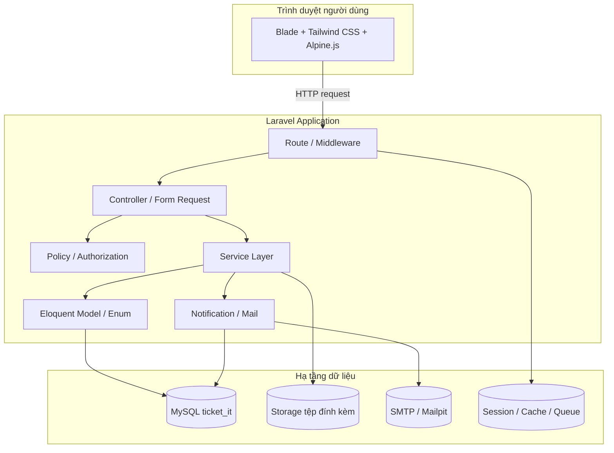

**Bảng 2.8. Thành phần và trách nhiệm trong kiến trúc**

| Thành phần | Ví dụ trong dự án | Trách nhiệm |
|---|---|---|
| Route | `routes/web.php`, `routes/auth.php` | Định nghĩa URL, method, middleware và tên route |
| Middleware | `EnsureUserIsActive`, `permission:user.manage` | Chặn tài khoản bị khóa; kiểm tra quyền truy cập |
| Controller | `PhieuYeuCauController`, `NguoiDungController` | Điều phối request, gọi service, trả view/redirect |
| Form Request | `LuuPhieuYeuCauRequest`, `CapNhatPhieuYeuCauRequest` | Xác thực dữ liệu và thông báo lỗi tiếng Việt |
| Policy | `PhieuYeuCauPolicy`, `TepDinhKemPolicy` | Kiểm tra quyền xem/sửa/đóng/phân công/tải tệp |
| Service | `DichVuPhieuYeuCau`, `DichVuThongBaoPhieu`, `DichVuTepDinhKem` | Chứa logic nghiệp vụ, transaction, ghi sự kiện, gửi thông báo |
| Model | `NguoiDung`, `PhieuYeuCau`, `BinhLuanPhieu`... | Ánh xạ bảng, quan hệ, cast enum/JSON |
| Enum | `TrangThaiPhieu`, `UuTienPhieu`, `MucAnhHuong`, `MucKhanCap` | Chuẩn hóa tập giá trị và quy tắc nghiệp vụ |
| View/Component | `layouts.app`, `x-status-badge`, `x-priority-badge` | Hiển thị giao diện, badge, form, bảng, thông báo |
| Notification | `ThongBaoPhieu` | Gửi thông báo database và email |
| Storage | `storage/app/private/phieu/{id}` | Lưu tệp đính kèm ngoài cơ sở dữ liệu |

### 2.3.2. Cấu trúc thư mục mã nguồn

Cấu trúc thư mục chính của dự án:

```text
TicketIT/
├── app/
│   ├── Enums/                 TrangThaiPhieu, UuTienPhieu, MucAnhHuong, MucKhanCap,
│   │                           LoaiBinhLuan, LoaiSuKienPhieu
│   ├── Http/
│   │   ├── Controllers/       Auth, Admin, PhieuYeuCau, BinhLuan, TepDinhKem,
│   │   │                       ThongBao, TongQuan, HoSo
│   │   ├── Middleware/         EnsureUserIsActive
│   │   └── Requests/          Form Request cho phiếu, bình luận, tệp, hồ sơ, admin
│   ├── Models/                NguoiDung, PhongBan, ViTri, NhomXuLy, DanhMuc,
│   │                           PhieuYeuCau, BinhLuanPhieu, TepDinhKem,
│   │                           SuKienPhieu, LichSuTrangThai, NguoiTheoDoi
│   ├── Notifications/         ThongBaoPhieu
│   ├── Policies/              PhieuYeuCauPolicy, TepDinhKemPolicy
│   └── Services/Phieu/        DichVuPhieuYeuCau, DichVuTepDinhKem,
│                               DichVuThongBaoPhieu
├── database/
│   ├── migrations/            Tạo bảng người dùng, tổ chức, nhóm xử lý,
│   │                           danh mục, phiếu, quyền
│   └── seeders/               VaiTroQuyen, ToChuc, DanhMuc,
│                               NguoiDungMau, PhieuYeuCauMau
├── resources/views/
│   ├── auth/                  Đăng nhập, đăng ký, quên/đặt lại mật khẩu, xác thực
│   ├── phieu-yeu-cau/         index, create, show
│   ├── quan-tri/              nguoi-dung, phong-ban, vi-tri, nhom-xu-ly
│   ├── ho-so/                 Hồ sơ và các partial
│   ├── thong-bao/             Danh sách thông báo
│   ├── components/            Icon, badge, card, empty state, page header
│   └── layouts/               app, guest
├── routes/                    web.php, auth.php, console.php
├── config/                    app, auth, database, mail, permission, ho_tro
├── public/                    entry point, build assets
└── storage/                   log, cache, session, tệp đính kèm
```

Tên bảng, cột và tệp được Việt hóa để thuận tiện cho việc đọc và bảo vệ đồ án; các thành phần hạ tầng của Laravel (bảng `sessions`, `cache`, `jobs`, `notifications`, route `login`/`register`) được giữ nguyên theo quy ước framework.

### 2.3.3. Sơ đồ triển khai

Trong môi trường phát triển, hệ thống được triển khai trên máy cá nhân sử dụng Laragon (Apache + PHP + MySQL) và Vite dev server cho tài nguyên frontend. Khi triển khai thực tế, có thể dùng Nginx/Apache, PHP-FPM, MySQL và một dịch vụ SMTP riêng.

**Hình 2.4. Sơ đồ triển khai hệ thống**

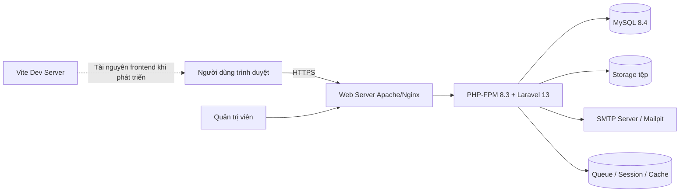

Trong chế độ phát triển, Vite phục vụ CSS/JS qua cổng riêng; khi build production, tài nguyên được biên dịch vào `public/build` và Laravel phục vụ trực tiếp từ web server.

## 2.4. Thiết kế quy trình nghiệp vụ

### 2.4.1. Quy trình tạo phiếu yêu cầu

Quy trình tạo phiếu bắt đầu khi người dùng có quyền `ticket.create` mở biểu mẫu. Hệ thống hiển thị danh mục hai cấp, phòng ban và vị trí đang hoạt động; các giá trị mặc định được lấy từ hồ sơ người dùng. Khi người dùng chọn mức ảnh hưởng và độ khẩn cấp, giao diện hiển thị mức ưu tiên dự kiến theo cùng công thức với backend, giúp người dùng hiểu mức độ ưu tiên trước khi gửi.

Khi gửi, `LuuPhieuYeuCauRequest` kiểm tra dữ liệu; `DichVuPhieuYeuCau::create()` mở transaction, sinh mã phiếu, tính ưu tiên, gán nhóm mặc định theo danh mục, lưu người theo dõi, ghi sự kiện và lịch sử trạng thái, sau đó gọi dịch vụ thông báo. Nếu gửi thông báo thất bại, lỗi được ghi log nhưng không làm hỏng việc tạo phiếu.

**Hình 2.5. Biểu đồ hoạt động tạo phiếu yêu cầu**

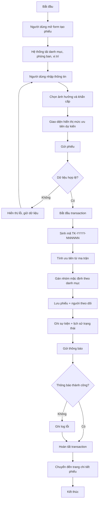

**Hình 2.6. Biểu đồ tuần tự tạo phiếu yêu cầu**

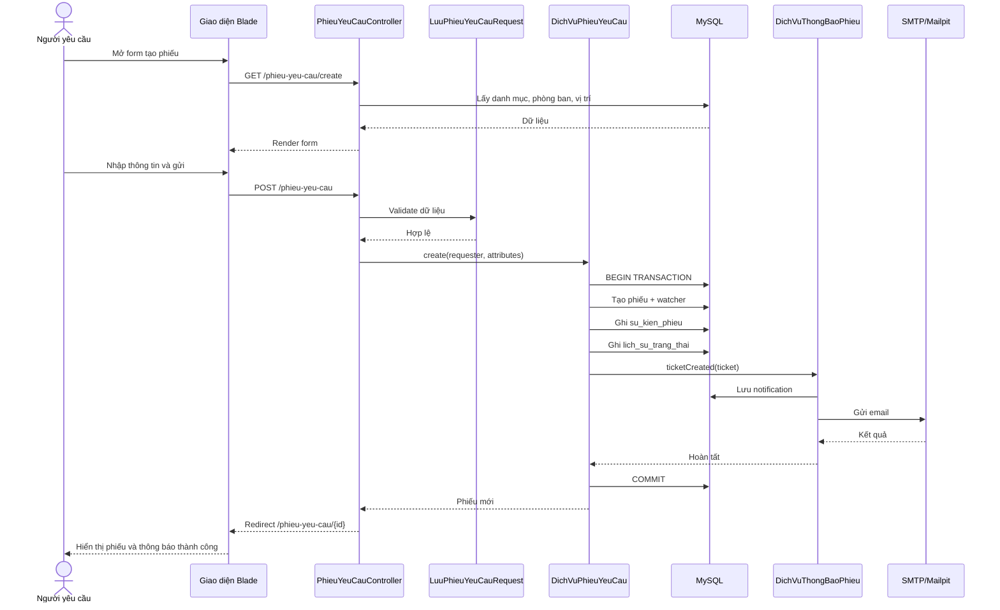

### 2.4.2. Quy trình phân công xử lý

Khi staff mở phiếu, hệ thống hiển thị form phân công nếu người dùng có quyền `ticket.assign`. Staff có thể chọn nhóm xử lý và/hoặc kỹ thuật viên. Nếu đây là lần phân công đầu tiên và có người xử lý, hệ thống ghi `phan_cong_luc`, chuyển trạng thái sang `da_phan_cong` và cập nhật `phan_cong_gan_nhat_luc` cho người được giao. Mỗi lần phân công đều được ghi sự kiện kèm tên người xử lý và nhóm; người được phân công nhận thông báo ngay sau đó.

**Hình 2.7. Biểu đồ tuần tự phân công phiếu**

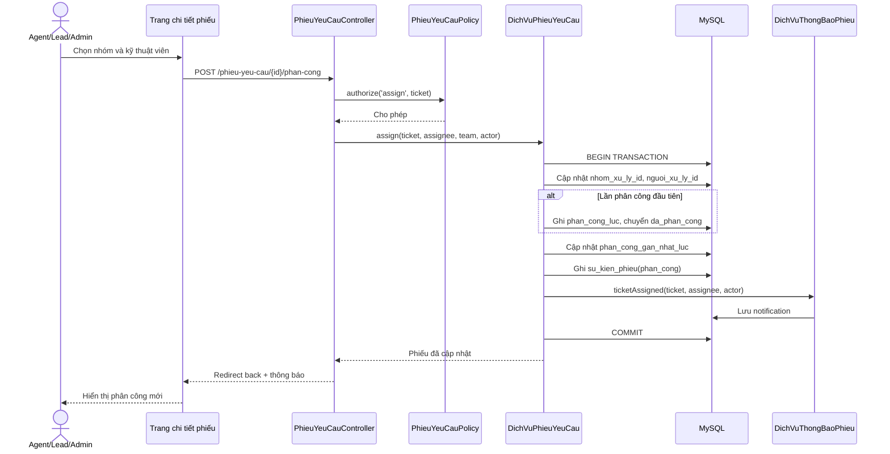

### 2.4.3. Vòng đời và quy tắc chuyển trạng thái

Phiếu được quản lý bởi một máy trạng thái hữu hạn với tám trạng thái. Mỗi trạng thái có danh sách trạng thái đích được phép; nếu yêu cầu chuyển trạng thái không hợp lệ, service ném lỗi validation và dữ liệu không thay đổi. Khi chuyển trạng thái, hệ thống đóng bản ghi lịch sử đang mở, tính số phút của trạng thái cũ, tạo bản ghi lịch sử mới và ghi sự kiện tương ứng.

**Hình 2.8. Biểu đồ tuần tự thay đổi trạng thái phiếu**

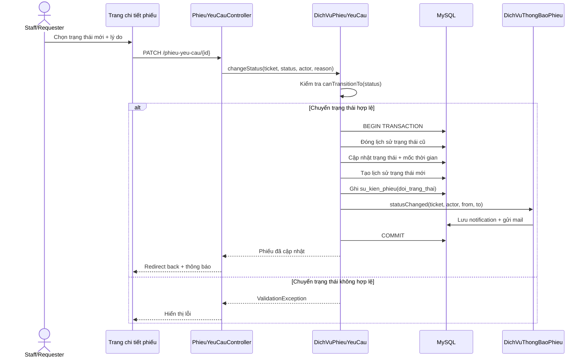

**Hình 2.9. Biểu đồ trạng thái vòng đời phiếu yêu cầu**

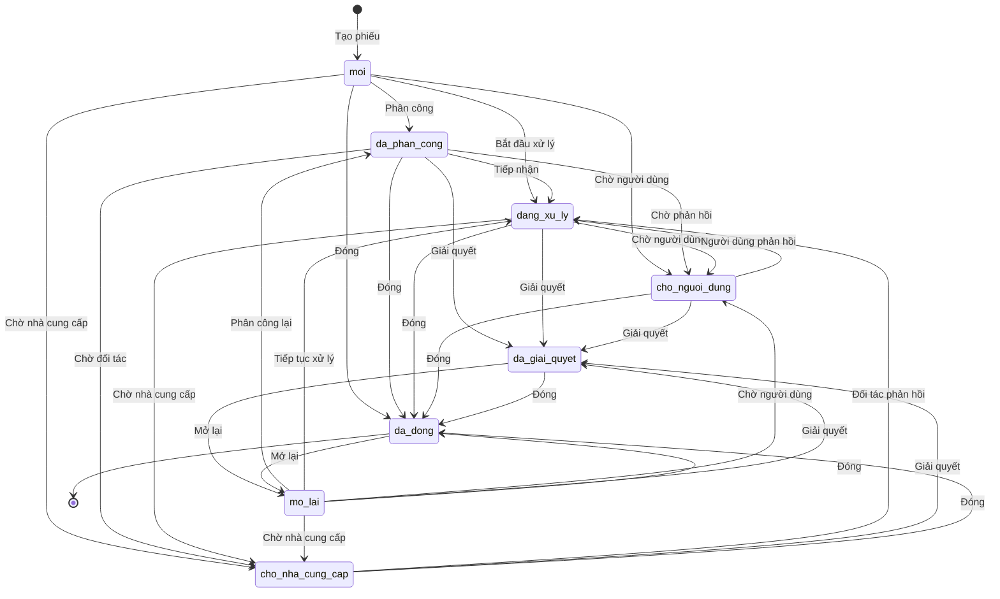

**Bảng 2.9. Quy tắc chuyển trạng thái phiếu**

| Trạng thái hiện tại | Các trạng thái được phép chuyển tới | Ghi chú nghiệp vụ |
|---|---|---|
| `moi` | `da_phan_cong`, `dang_xu_ly`, `cho_nguoi_dung`, `cho_nha_cung_cap`, `da_dong` | Phiếu mới có thể được phân công hoặc xử lý ngay; đóng nếu không cần xử lý |
| `da_phan_cong` | `dang_xu_ly`, `cho_nguoi_dung`, `cho_nha_cung_cap`, `da_giai_quyet`, `da_dong` | Đã có người/nhóm phụ trách |
| `dang_xu_ly` | `cho_nguoi_dung`, `cho_nha_cung_cap`, `da_giai_quyet`, `da_dong` | Đang xử lý; có thể tạm chờ thông tin |
| `cho_nguoi_dung` | `dang_xu_ly`, `da_giai_quyet`, `da_dong` | Chờ người dùng cung cấp thêm thông tin |
| `cho_nha_cung_cap` | `dang_xu_ly`, `da_giai_quyet`, `da_dong` | Chờ đối tác/nhà cung cấp |
| `da_giai_quyet` | `da_dong`, `mo_lai` | Đã khắc phục; chờ xác nhận/đóng |
| `da_dong` | `mo_lai` | Chỉ mở lại khi người dùng hoặc staff có quyền |
| `mo_lai` | `da_phan_cong`, `dang_xu_ly`, `cho_nguoi_dung`, `cho_nha_cung_cap`, `da_giai_quyet`, `da_dong` | Quay lại quy trình xử lý |

### 2.4.4. Ma trận ưu tiên và mục tiêu SLA

Mức ưu tiên của phiếu được tính tự động từ hai chiều: **mức ảnh hưởng** (1–3) và **độ khẩn cấp** (1–3). Ma trận này giúp tránh việc đánh giá ưu tiên cảm tính và bảo đảm các sự cố ảnh hưởng hệ thống dùng chung, đang gây gián đoạn công việc được xử lý trước.

**Bảng 2.10. Ma trận Ảnh hưởng × Khẩn cấp → Mức ưu tiên**

| Ảnh hưởng \ Khẩn cấp | Thấp (1) | Trung bình (2) | Cao (3) |
|---|---|---|---|
| **Thấp (1)** – ảnh hưởng 1 người | P4 | P4 | P3 |
| **Trung bình (2)** – ảnh hưởng 1 phòng ban | P4 | P3 | P2 |
| **Cao (3)** – ảnh hưởng hệ thống dùng chung | P3 | P2 | **P1** |

Mỗi mức ưu tiên có mục tiêu thời gian phản hồi đầu tiên và thời gian giải quyết tương ứng. Các mục tiêu này được định nghĩa trong enum `UuTienPhieu` và có thể dùng để xây dựng báo cáo tuân thủ SLA trong tương lai.

**Bảng 2.11. Mục tiêu thời gian phản hồi và giải quyết theo SLA**

| Mức ưu tiên | Ý nghĩa | Phản hồi đầu tiên | Giải quyết |
|---|---|---|---|
| **P1** | Nghiêm trọng | 15 phút | 120 phút (2 giờ) |
| **P2** | Cao | 30 phút | 240 phút (4 giờ) |
| **P3** | Trung bình | 120 phút (2 giờ) | 480 phút (8 giờ) |
| **P4** | Thấp | 480 phút (8 giờ) | 1.440 phút (24 giờ) |

Trong phiên bản hiện tại, hệ thống đã lưu các mốc `phan_hoi_dau_luc`, `giai_quyet_luc`, `dong_luc`; việc tính vi phạm SLA theo giờ hành động và tạm dừng khi chờ người dùng được xem là hướng phát triển. Khi giải quyết phiếu, service ghi nhận mốc `giai_quyet_luc` để phục vụ báo cáo sau này.

### 2.4.5. Chiến lược phân công

Mỗi nhóm xử lý có trường `chien_luoc_phan_cong` với ba lựa chọn:

1. **`khop_ky_nang` – Luân chuyển theo tải công việc (khuyến nghị):** ưu tiên kỹ thuật viên phù hợp với danh mục/nhóm và có ít phiếu đang mở hơn.
2. **`it_viec_nhat` – Ít phiếu đang mở nhất:** chọn kỹ thuật viên có số phiếu chưa hoàn tất thấp nhất.
3. **`xoay_vong` – Xoay vòng:** phân công lần lượt theo danh sách thành viên để chia đều công việc.

Trong phiên bản hiện tại, các chiến lược này được lưu trong cấu hình nhóm và hiển thị cho quản trị viên; thao tác phân công thực tế do Agent/Lead/Admin thực hiện trên giao diện. Cơ chế tự động chọn người dựa trên chiến lược và tải công việc là hướng phát triển tiếp theo, có thể triển khai bằng một service định tuyến tự động mà không thay đổi cấu trúc dữ liệu.

### 2.4.6. Ma trận phân quyền

Hệ thống sử dụng Spatie Laravel Permission với bốn vai trò và mười hai quyền. Ngoài kiểm tra quyền ở middleware, các hành động nhạy cảm còn được kiểm tra bằng policy để bảo đảm đúng phạm vi dữ liệu (ví dụ requester chỉ xem phiếu của mình).

**Bảng 2.12. Ma trận phân quyền theo vai trò**

| Quyền | Requester | Agent | Lead | Admin |
|---|:---:|:---:|:---:|:---:|
| `ticket.view.own` – Xem phiếu của mình | ✓ | — | — | ✓ |
| `ticket.view.all` – Xem tất cả phiếu | — | ✓ | ✓ | ✓ |
| `ticket.create` – Tạo phiếu | ✓ | ✓ | ✓ | ✓ |
| `ticket.update` – Cập nhật xử lý | — | ✓ | ✓ | ✓ |
| `ticket.assign` – Phân công | — | ✓ | ✓ | ✓ |
| `ticket.close` – Đóng phiếu | — | ✓ | ✓ | ✓ |
| `ticket.reopen` – Mở lại phiếu | — | ✓ | ✓ | ✓ |
| `ticket.internal-note` – Ghi chú nội bộ | — | ✓ | ✓ | ✓ |
| `report.view` – Xem báo cáo | — | — | ✓ | ✓ |
| `catalog.manage` – Quản lý danh mục | — | — | — | ✓ |
| `user.manage` – Quản lý người dùng | — | — | — | ✓ |
| `admin.manage` – Quản trị hệ thống | — | — | — | ✓ |

Lưu ý: Requester vẫn có thể đóng/mở lại phiếu của mình thông qua policy `close`/`reopen` dù không có quyền `ticket.close`/`ticket.reopen` toàn cục. Admin được policy `before()` cho phép toàn quyền trên phiếu. Các quyền `catalog.manage`, `user.manage`, `admin.manage` được bảo vệ ở cấp route bằng middleware `permission:...`.

### 2.4.7. Quy trình thông báo

Thông báo được gửi qua hai kênh: **database** (hiển thị chuông và trang thông báo) và **email** (SMTP/Mailpit trong môi trường phát triển). Dịch vụ `DichVuThongBaoPhieu` xác định người nhận theo ngữ cảnh, loại bỏ người thực hiện và tài khoản không hoạt động, sau đó gửi thông báo. Nếu gửi thất bại, lỗi được ghi log và không làm gián đoạn nghiệp vụ chính.

**Bảng 2.13. Ma trận sự kiện và đối tượng nhận thông báo**

| Sự kiện | Người nhận | Kênh | Ghi chú |
|---|---|---|---|
| Tạo phiếu mới | Staff của nhóm xử lý; nếu chưa có nhóm thì Lead/Admin | Database + Email | Không gửi cho người tạo |
| Phân công phiếu | Kỹ thuật viên được phân công | Database + Email | Kèm tên người phân công |
| Đổi trạng thái | Người yêu cầu, người xử lý, staff của nhóm | Database + Email | Nêu rõ trạng thái cũ/mới |
| Bình luận công khai | Người yêu cầu, người xử lý, người theo dõi | Database + Email | Tạo phản hồi đầu tiên ghi nhận `phan_hoi_dau_luc` |
| Ghi chú nội bộ | Người xử lý, staff của nhóm | Database + Email | Người yêu cầu không nhận |
| Tệp đính kèm mới | Người yêu cầu, người xử lý, staff của nhóm | Database + Email | Kèm tên tệp |
| Đánh dấu đã đọc | Chính người dùng | Database | Xóa chỉ báo chưa đọc |

Mỗi thông báo database lưu `phieu_yeu_cau_id`, `ma_phieu`, `title`, `message`, `url` để giao diện hiển thị và điều hướng. Thông báo email có tiêu đề `[Mã phiếu] Tiêu đề`, lời chào theo tên người nhận, nội dung sự kiện, thông tin phiếu và nút **Xem phiếu**.

## 2.5. Thiết kế giao diện

### 2.5.1. Nguyên tắc thiết kế và design system

Giao diện được thiết kế theo hướng hiện đại, tối giản và ưu tiên tiếng Việt. Các nguyên tắc chính:

- **Rõ ràng thứ bậc thông tin:** tiêu đề trang, mô tả ngắn, breadcrumb, nút hành động chính và các badge trạng thái/ưu tiên được đặt ở vị trí dễ nhìn.
- **Nhất quán:** sử dụng chung các component `page-header`, `stat-card`, `status-badge`, `priority-badge`, `empty-state`, `input-error`, `icon`.
- **Phản hồi tức thời:** mọi thao tác tạo/cập nhật/đóng phiếu đều có thông báo thành công hoặc lỗi; form giữ lại dữ liệu khi validation thất bại.
- **An toàn thao tác:** các hành động nguy hiểm như đóng phiếu, mở lại, xóa tài khoản đều có hộp thoại xác nhận.
- **Responsive:** sidebar thu gọn trên mobile, bảng có cuộn ngang, form chuyển từ nhiều cột sang một cột.
- **Khả năng truy cập:** nhãn form liên kết với input, màu sắc trạng thái có text đi kèm, kích thước nút đủ lớn, độ tương phản phù hợp.

**Design system tóm tắt:**

| Thành phần | Quy ước |
|---|---|
| Font chữ | `Instrument Sans`, fallback system-ui, Segoe UI, sans-serif |
| Màu chính | Indigo (`indigo-600`, `indigo-700`) cho hành động chính |
| Màu nền | Slate nhạt (`slate-100`), card trắng, viền `slate-200` |
| Màu trạng thái | Xanh dương (mới), indigo (đã phân công), xanh lá (hoạt động/giải quyết), hổ phách (chờ), cam (chờ NCC), xám (đóng), hồng (mở lại) |
| Màu ưu tiên | P1 hồng/rose, P2 cam, P3 hổ phách, P4 xám |
| Bo góc | `rounded-lg` cho input/nút, `rounded-xl` cho card |
| Bóng đổ | `shadow-sm` cho card, `shadow-lg` cho dropdown |
| Khoảng cách | Hệ thống spacing của Tailwind (4/6/8px…) |
| Biểu tượng | Component `x-icon` dùng SVG nội tuyến |

### 2.5.2. Danh sách màn hình

**Bảng 2.14. Danh sách màn hình và chức năng chính**

| STT | Màn hình | Route | Tác nhân | Chức năng chính |
|---:|---|---|---|---|
| 1 | Đăng nhập | `/login` | Khách | Nhập email/mật khẩu, ghi nhớ đăng nhập, quên mật khẩu |
| 2 | Đăng ký | `/register` | Khách | Tạo tài khoản requester |
| 3 | Quên mật khẩu | `/forgot-password` | Khách | Gửi liên kết đặt lại qua email |
| 4 | Đặt lại mật khẩu | `/reset-password/{token}` | Khách | Đặt mật khẩu mới |
| 5 | Xác thực email | `/verify-email` | Người dùng | Gửi lại email xác thực |
| 6 | Tổng quan | `/tong-quan` | Tất cả | Thống kê theo vai trò, phiếu gần đây, hàng đợi |
| 7 | Danh sách phiếu | `/phieu-yeu-cau` | Tất cả | Tìm kiếm, lọc, phân trang |
| 8 | Tạo phiếu | `/phieu-yeu-cau/create` | Requester, Staff | Nhập thông tin, chọn ảnh hưởng/khẩn cấp, đính kèm |
| 9 | Chi tiết phiếu | `/phieu-yeu-cau/{id}` | Người được xem | Xem mô tả, tệp, bình luận, lịch sử; cập nhật/phân công |
| 10 | Thông báo | `/thong-bao` | Tất cả | Xem, đánh dấu đã đọc |
| 11 | Hồ sơ cá nhân | `/ho-so` | Tất cả | Cập nhật thông tin, đổi mật khẩu, xóa tài khoản |
| 12 | Quản lý người dùng | `/quan-tri/nguoi-dung` | Admin | CRUD, gán vai trò/nhóm, khóa/mở khóa |
| 13 | Quản lý phòng ban | `/quan-tri/phong-ban` | Admin | CRUD phòng ban |
| 14 | Quản lý vị trí | `/quan-tri/vi-tri` | Admin | CRUD vị trí |
| 15 | Quản lý nhóm xử lý | `/quan-tri/nhom-xu-ly` | Admin | CRUD nhóm, thành viên, chiến lược, định mức |

**Hình 2.10. Sơ đồ điều hướng các màn hình chính**

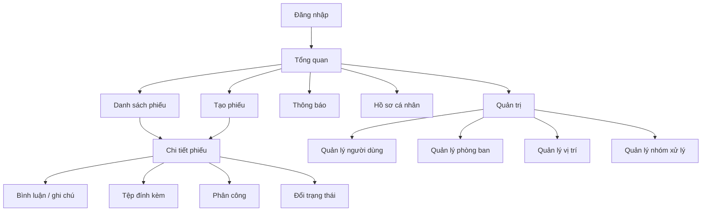

### 2.5.3. Mô tả các màn hình chính

**Màn hình đăng nhập:** bố cục hai cột trên desktop. Cột trái là khối giới thiệu hệ thống với các điểm nổi bật; cột phải là card đăng nhập gồm email, mật khẩu, checkbox ghi nhớ, liên kết quên mật khẩu và đăng ký. Trang hiển thị danh sách tài khoản demo và mật khẩu chung để phục vụ bảo vệ đồ án.

**Màn hình tổng quan:** hiển thị bốn thẻ số liệu theo vai trò. Với staff: phiếu đang mở, chưa phân công, được giao cho tôi, ưu tiên P1. Với requester: phiếu đang xử lý, đã giải quyết, đã đóng, tổng phiếu của tôi. Bên dưới là bảng 8 phiếu gần đây và (với staff) danh sách hàng đợi chưa phân công, sắp xếp theo thời gian tạo.

**Màn hình danh sách phiếu:** bộ lọc gồm tìm kiếm theo mã/tiêu đề, trạng thái, ưu tiên, danh mục hai cấp, người phụ trách (tất cả/giao cho tôi/chưa phân công/từng kỹ thuật viên). Bảng hiển thị mã, tiêu đề, người gửi, phòng ban, danh mục, người phụ trách, nhóm, ưu tiên, trạng thái và ngày tạo; có phân trang và giữ query string.

**Màn hình tạo phiếu:** bố cục hai cột. Cột trái gồm tiêu đề, danh mục, mô tả, phòng ban, vị trí, tệp đính kèm, chọn mức ảnh hưởng và độ khẩn cấp. Cột phải hiển thị **mức ưu tiên dự kiến** theo thời gian thực bằng Alpine.js và các mẹo mô tả sự cố. Nút gửi phiếu ở cuối form.

**Màn hình chi tiết phiếu:** phần đầu hiển thị tiêu đề, mã, thời gian, các badge trạng thái/ưu tiên/danh mục/nhóm và số lần mở lại. Cột trái gồm mô tả, tệp đính kèm, dòng thời gian hoạt động; cột phải gồm thông tin người yêu cầu, người xử lý, phòng ban, vị trí, các mốc thời gian và form cập nhật xử lý/phân công (nếu có quyền). Khu vực bình luận phân biệt công khai và ghi chú nội bộ; ghi chú nội bộ chỉ hiển thị với staff.

**Màn hình thông báo:** danh sách thông báo có trạng thái đọc/chưa đọc, tiêu đề, nội dung, thời gian; nút đánh dấu tất cả đã đọc. Trên topbar có dropdown hiển thị sáu thông báo gần nhất và badge số lượng chưa đọc.

**Màn hình quản trị:** các màn hình danh sách có ô tìm kiếm, bảng dữ liệu, nút thêm mới, cột hành động sửa/xóa. Form thêm/cập nhật dùng bố cục hai cột, có validation và thông báo lỗi tiếng Việt. Màn hình người dùng cho phép gán vai trò, phòng ban, vị trí, nhóm xử lý và trạng thái hoạt động.

## 2.6. Thiết kế bảo mật

Bảo mật là yêu cầu quan trọng vì phiếu hỗ trợ có thể chứa thông tin nội bộ, lỗi hệ thống, tệp đính kèm và dữ liệu cá nhân. Hệ thống áp dụng nhiều lớp kiểm soát:

- **Xác thực:** đăng nhập bằng email/mật khẩu; mật khẩu được hash bằng bcrypt (BCRYPT_ROUNDS=12); hỗ trợ ghi nhớ đăng nhập; đăng xuất hủy phiên và tái tạo CSRF token.
- **Xác thực email:** các route nghiệp vụ yêu cầu middleware `verified`; người dùng có thể gửi lại email xác thực với giới hạn tần suất.
- **Xác nhận mật khẩu:** trước khi đổi mật khẩu hoặc xóa tài khoản, người dùng phải nhập lại mật khẩu hiện tại.
- **Giới hạn đăng nhập sai:** tối đa 5 lần thất bại theo cặp email/IP; vượt quá sẽ bị khóa tạm thời và thông báo thời gian còn lại.
- **Chặn tài khoản bị vô hiệu hóa:** kiểm tra ngay sau khi đăng nhập và ở mọi request thông qua middleware `EnsureUserIsActive`.
- **Phân quyền:** RBAC với 4 vai trò, 12 quyền; middleware `permission:...` cho route quản trị; policy cho hành động trên từng phiếu/tệp.
- **CSRF:** mọi form POST/PUT/PATCH/DELETE đều có `@csrf`; Laravel kiểm tra token tự động.
- **XSS:** Blade tự động escape dữ liệu hiển thị; nội dung người dùng không được render raw HTML.
- **SQL injection:** sử dụng Eloquent/Query Builder với binding; không nối chuỗi SQL trực tiếp từ input.
- **Mass assignment:** model khai báo `#[Fillable]` rõ ràng, chỉ các trường được phép mới mass assign.
- **Tệp đính kèm:** kiểm tra `file`, dung lượng tối đa 5 MB, danh sách MIME/extension cho phép; lưu ngoài `public` trong `storage/app/private/phieu/{id}`; chỉ người có quyền xem phiếu mới được tải xuống; tệp của ghi chú nội bộ chỉ staff được tải.
- **Ghi log:** các lỗi gửi mail, lỗi tệp được `report()`; Laravel ghi log ứng dụng; lịch sử nghiệp vụ được lưu trong database.
- **Sao lưu:** khuyến nghị backup định kỳ MySQL và thư mục storage; không đưa `.env`, khóa ứng dụng hoặc mật khẩu vào mã nguồn công khai.

**Bảng 2.15. Mối đe dọa bảo mật và biện pháp kiểm soát**

| Mối đe dọa | Hậu quả tiềm tàng | Biện pháp kiểm soát |
|---|---|---|
| Đăng nhập brute-force | Chiếm tài khoản | Giới hạn 5 lần/email+IP, ghi nhận Lockout, mật khẩu hash bcrypt |
| Tài khoản bị khóa vẫn truy cập | Dữ liệu bị lộ | Middleware `EnsureUserIsActive`, logout và invalidate session |
| Truy cập phiếu của người khác | Lộ thông tin nội bộ | Policy `view`, scope `visibleTo`, kiểm tra watcher/assignee/requester |
| Ghi chú nội bộ bị lộ | Lộ thông tin xử lý | Lọc `loai != noi_bo` cho requester; policy `internalNote` |
| Tải tệp độc hại | Mã độc, lỗi hệ thống | Giới hạn extension/MIME/dung lượng; lưu ngoài public; không thực thi tệp |
| CSRF | Thao tác trái phép | Token CSRF trên form; SameSite cookie |
| XSS | Đánh cắp phiên, chèn mã | Blade escaping; không render HTML thô từ input |
| SQL injection | Lộ/sửa dữ liệu | Eloquent binding; không nối chuỗi SQL |
| Mass assignment | Ghi đè trường nhạy cảm | `#[Fillable]`; validate bằng Form Request |
| Lộ thông tin qua email | Rò rỉ nội dung | Chỉ gửi cho người liên quan; không gửi ghi chú nội bộ cho requester |
| Mất dữ liệu | Không khôi phục được | Backup định kỳ; transaction cho thao tác quan trọng |
| Thư viện lỗi thời | Lỗ hổng đã biết | Chạy `composer audit`, cập nhật dependency định kỳ |

# CHƯƠNG 3. XÂY DỰNG HỆ THỐNG

## 3.1. Môi trường phát triển

Hệ thống được phát triển và kiểm thử trên môi trường Windows với Laragon, PHP 8.3 và MySQL 8.4. Bảng 3.1 tổng hợp các thành phần chính.

**Bảng 3.1. Môi trường phát triển và kiểm thử**

| Thành phần | Phiên bản / cấu hình | Ghi chú |
|---|---|---|
| Hệ điều hành | Windows 11 | Môi trường phát triển cá nhân |
| Web server | Apache 2.4.66 (Laragon) | DocumentRoot trỏ đến thư mục `public` |
| PHP | 8.3.30 | Bật các extension `pdo_mysql`, `mbstring`, `openssl`, `fileinfo`, `intl`, `zip`, `curl` |
| Framework | Laravel 13.36 | Kiến trúc MVC, Service Layer |
| Composer | 2.10.2 | Quản lý dependency PHP |
| Cơ sở dữ liệu | MySQL 8.4 | Database `ticket_it`, charset `utf8mb4`, collation `utf8mb4_unicode_ci` |
| Node.js / npm | Node ≥ 18, npm | Build tài nguyên frontend |
| Vite | 8.x | Dev server và build production |
| Tailwind CSS | 4.3 | Utility-first CSS |
| Alpine.js | 3.17 | Tương tác phía client (sidebar, dropdown, tính ưu tiên) |
| Laravel Breeze | 2.4 (Blade) | Scaffold xác thực |
| Spatie Permission | 8.3 | Phân quyền theo vai trò |
| Mail | Mailpit (SMTP `127.0.0.1:1025`, UI `:8025`) | Kiểm thử email trong môi trường phát triển |
| IDE | Visual Studio Code | Soạn thảo và debug |
| Quản lý mã nguồn | Git | Theo dõi thay đổi |
| Định dạng mã | Laravel Pint | Chuẩn hóa code style |

Cấu hình môi trường quan trọng trong `.env`:

```dotenv
APP_NAME="Hệ thống hỗ trợ IT"
APP_ENV=local
APP_URL=http://ticketit.test
APP_LOCALE=vi
APP_TIMEZONE=Asia/Ho_Chi_Minh

DB_CONNECTION=mysql
DB_HOST=127.0.0.1
DB_PORT=3306
DB_DATABASE=ticket_it
DB_USERNAME=root
DB_PASSWORD=

SESSION_DRIVER=database
CACHE_STORE=database
QUEUE_CONNECTION=database

MAIL_MAILER=smtp
MAIL_HOST=127.0.0.1
MAIL_PORT=1025
MAIL_FROM_ADDRESS="helpdesk@ticket.it"
```

## 3.2. Quản lý dự án và tiến độ

### 3.2.1. Cách tổ chức công việc

Nhóm tổ chức công việc theo mô hình Scrum rút gọn kết hợp bảng Kanban. Bảng công việc có thể được triển khai trên Trello, GitHub Projects hoặc công cụ tương đương với các cột:

- **Backlog:** các hạng mục chưa ưu tiên hoặc chưa lên lịch.
- **To do:** công việc của Sprint hiện tại.
- **In progress:** đang thực hiện.
- **Review:** đã hoàn thành, đang tự kiểm tra/đối chiếu yêu cầu.
- **Done:** đã kiểm thử và tích hợp.

Mỗi thẻ công việc mô tả mục tiêu, đầu ra, người phụ trách và tiêu chí hoàn thành. Cuối mỗi Sprint, nhóm rà soát các chức năng đã làm, cập nhật tài liệu và ghi nhận vấn đề còn tồn đọng.

### 3.2.2. Sprint backlog

**Bảng 3.2. Sprint backlog và kết quả thực hiện**

| Mã | Công việc | Sprint | Kết quả |
|---|---|---|---|
| S1-01 | Khởi tạo Laravel, cấu hình `.env`, kết nối MySQL | Sprint 1 | Hoàn thành |
| S1-02 | Cài Breeze, Việt hóa giao diện xác thực | Sprint 1 | Hoàn thành |
| S1-03 | Tạo migration người dùng, phòng ban, vị trí, nhóm, danh mục, phiếu | Sprint 1 | Hoàn thành |
| S1-04 | Seed 4 vai trò, 12 quyền, tài khoản demo | Sprint 1 | Hoàn thành |
| S1-05 | Xây dựng CRUD người dùng, phòng ban, vị trí, nhóm xử lý | Sprint 1 | Hoàn thành |
| S1-06 | Thiết kế layout, sidebar, topbar, component dùng chung | Sprint 1 | Hoàn thành |
| S2-01 | Xây dựng enum trạng thái, ưu tiên, ảnh hưởng, khẩn cấp | Sprint 2 | Hoàn thành |
| S2-02 | Xây dựng service tạo phiếu, sinh mã, tính ưu tiên | Sprint 2 | Hoàn thành |
| S2-03 | Xây dựng danh sách phiếu, tìm kiếm, bộ lọc, phân trang | Sprint 2 | Hoàn thành |
| S2-04 | Xây dựng trang chi tiết phiếu, timeline, thông tin phụ | Sprint 2 | Hoàn thành |
| S2-05 | Xây dựng phân công, đổi trạng thái, đóng/mở lại | Sprint 2 | Hoàn thành |
| S2-06 | Xây dựng bình luận, ghi chú nội bộ, tệp đính kèm | Sprint 2 | Hoàn thành |
| S3-01 | Xây dựng dashboard theo vai trò | Sprint 3 | Hoàn thành |
| S3-02 | Xây dựng thông báo database + email | Sprint 3 | Hoàn thành |
| S3-03 | Xây dựng hồ sơ cá nhân, đổi mật khẩu, xóa tài khoản | Sprint 3 | Hoàn thành |
| S3-04 | Rà soát responsive, empty state, thông báo lỗi | Sprint 3 | Hoàn thành |
| S3-05 | Kiểm thử chức năng, phân quyền, bảo mật | Sprint 3 | Hoàn thành |
| S3-06 | Viết README và tài liệu bàn giao | Sprint 3 | Hoàn thành |

## 3.3. Xây dựng chức năng xác thực và phân quyền

### 3.3.1. Xây dựng sản phẩm

Chức năng xác thực được xây dựng dựa trên Laravel Breeze (Blade) và được Việt hóa toàn bộ giao diện. Các route xác thực được tách riêng trong `routes/auth.php`, gồm đăng nhập, đăng ký, quên mật khẩu, đặt lại mật khẩu, xác thực email, xác nhận mật khẩu và đăng xuất.

Một phần khai báo route:

```php
Route::middleware('guest')->group(function () {
    Route::get('register', [DangKyController::class, 'create'])->name('register');
    Route::post('register', [DangKyController::class, 'store']);
    Route::get('login', [PhienDangNhapController::class, 'create'])->name('login');
    Route::post('login', [PhienDangNhapController::class, 'store']);
    Route::get('forgot-password', [GuiLienKetDatLaiMatKhauController::class, 'create'])
        ->name('password.request');
    Route::post('reset-password', [DatLaiMatKhauController::class, 'store'])
        ->name('password.store');
});

Route::middleware('auth')->group(function () {
    Route::get('verify-email', NhacXacThucEmailController::class)
        ->name('verification.notice');
    Route::get('confirm-password', [XacNhanMatKhauController::class, 'show'])
        ->name('password.confirm');
    Route::put('password', [DoiMatKhauController::class, 'update'])->name('password.update');
    Route::post('logout', [PhienDangNhapController::class, 'destroy'])->name('logout');
});
```

`DangNhapRequest` giới hạn số lần đăng nhập sai theo email và IP:

```php
public function ensureIsNotRateLimited(): void
{
    if (! RateLimiter::tooManyAttempts($this->throttleKey(), 5)) {
        return;
    }

    event(new Lockout($this));

    $seconds = RateLimiter::availableIn($this->throttleKey());

    throw ValidationException::withMessages([
        'email' => trans('auth.throttle', [
            'seconds' => $seconds,
            'so_phut' => ceil($seconds / 60),
        ]),
    ]);
}
```

Sau khi xác thực thành công, controller kiểm tra trạng thái tài khoản:

```php
if (! Auth::user()->dang_hoat_dong) {
    Auth::guard('web')->logout();
    $request->session()->invalidate();
    $request->session()->regenerateToken();

    throw ValidationException::withMessages([
        'email' => 'Tài khoản của bạn đã bị vô hiệu hoá. Vui lòng liên hệ quản trị viên IT.',
    ]);
}
```

Middleware `EnsureUserIsActive` được gắn vào nhóm `web`, bảo đảm tài khoản bị vô hiệu hóa bị đăng xuất ngay cả khi đang có phiên:

```php
public function handle(Request $request, Closure $next): Response
{
    if ($request->user() !== null && ! $request->user()->dang_hoat_dong) {
        Auth::guard('web')->logout();
        $request->session()->invalidate();
        $request->session()->regenerateToken();

        return redirect()->route('login')->withErrors([
            'email' => 'Tài khoản của bạn đã bị vô hiệu hoá. Vui lòng liên hệ quản trị viên IT.',
        ]);
    }

    return $next($request);
}
```

Phân quyền được seed bằng `VaiTroQuyenSeeder` với 12 quyền và ma trận 4 vai trò. Admin nhận toàn bộ quyền; lead nhận quyền của agent cộng `report.view`; agent nhận các quyền xử lý phiếu; requester chỉ nhận `ticket.view.own` và `ticket.create`. Policy `PhieuYeuCauPolicy` kiểm tra thêm phạm vi dữ liệu:

```php
public function before(NguoiDung $user): ?bool
{
    return $user->isAdmin() ? true : null;
}

public function view(NguoiDung $user, PhieuYeuCau $ticket): bool
{
    return $ticket->isVisibleTo($user);
}

public function assign(NguoiDung $user, PhieuYeuCau $ticket): bool
{
    return $user->can('ticket.assign') && $user->isStaff();
}

public function internalNote(NguoiDung $user, PhieuYeuCau $ticket): bool
{
    return $user->can('ticket.internal-note') && $ticket->isVisibleTo($user);
}
```

Các route quản trị được bảo vệ bằng middleware quyền:

```php
Route::prefix('quan-tri')->name('quan-tri.')->middleware('permission:user.manage')->group(function () {
    Route::resource('nguoi-dung', NguoiDungController::class)
        ->only(['index', 'create', 'store', 'edit', 'update', 'destroy']);
    Route::post('nguoi-dung/{user}/kich-hoat', [NguoiDungController::class, 'toggle'])
        ->name('nguoi-dung.kich-hoat');
});
```

### 3.3.2. Giao diện

Giao diện đăng nhập và đăng ký sử dụng layout `guest`, bố cục hai cột trên desktop và một cột trên mobile. Trang đăng nhập có khối giới thiệu hệ thống, form đăng nhập, liên kết quên mật khẩu/đăng ký và khung tài khoản demo. Trang đăng ký thông báo rõ tài khoản mới sẽ nhận vai trò Người yêu cầu.

> 🖼️ **Hình 3.1. Giao diện đăng nhập**
>
> *Chèn ảnh chụp màn hình trang `/login` tại đây.*

> 🖼️ **Hình 3.2. Giao diện đăng ký tài khoản**
>
> *Chèn ảnh chụp màn hình trang `/register` tại đây.*

Các màn hình quên mật khẩu, đặt lại mật khẩu, xác nhận mật khẩu và xác thực email dùng cùng layout, có thông báo trạng thái và lỗi validation tiếng Việt. Trang hồ sơ cá nhân cho phép cập nhật họ tên/email, đổi mật khẩu và xóa tài khoản với xác nhận mật khẩu.

### 3.3.3. Kiểm thử chức năng

**Bảng 3.3. Kiểm thử xác thực và phân quyền**

| Mã | Kịch bản | Dữ liệu / thao tác | Kết quả mong đợi | Kết quả |
|---|---|---|---|---|
| AUTH-01 | Đăng nhập đúng | `admin@ticket.it` / `11111111` | Chuyển đến `/tong-quan`, hiển thị tên và vai trò | Đạt |
| AUTH-02 | Đăng nhập sai mật khẩu | Email đúng, mật khẩu sai | Ở lại trang đăng nhập, báo lỗi | Đạt |
| AUTH-03 | Tài khoản bị vô hiệu hóa | Admin khóa tài khoản, user đăng nhập | Từ chối đăng nhập, thông báo liên hệ quản trị | Đạt |
| AUTH-04 | Giới hạn đăng nhập sai | Sai 5 lần liên tiếp | Khóa tạm thời, thông báo thời gian chờ | Đạt |
| AUTH-05 | Đăng ký tài khoản | Nhập họ tên, email mới, mật khẩu hợp lệ | Tạo tài khoản requester, tự đăng nhập | Đạt |
| AUTH-06 | Đăng ký email trùng | Dùng email đã tồn tại | Báo lỗi email đã được sử dụng | Đạt |
| AUTH-07 | Quên mật khẩu | Nhập email tồn tại | Gửi email chứa liên kết đặt lại | Đạt |
| AUTH-08 | Đặt lại mật khẩu | Mở token hợp lệ, nhập mật khẩu mới | Đổi mật khẩu thành công, đăng nhập được | Đạt |
| AUTH-09 | Truy cập quản trị khi không có quyền | Agent mở `/quan-tri/nguoi-dung` | HTTP 403 | Đạt |
| AUTH-10 | Requester xem phiếu người khác | Requester mở phiếu không thuộc quyền | HTTP 403/404 | Đạt |
| AUTH-11 | Admin xem mọi phiếu | Admin mở danh sách phiếu | Thấy toàn bộ phiếu | Đạt |
| AUTH-12 | Đổi mật khẩu sai mật khẩu hiện tại | Nhập current_password sai | Báo lỗi, không đổi | Đạt |
| AUTH-13 | Xóa tài khoản không nhập mật khẩu | Gửi form xóa trống | Báo lỗi, tài khoản còn tồn tại | Đạt |

## 3.4. Xây dựng chức năng quản lý phiếu yêu cầu

### 3.4.1. Xây dựng sản phẩm

**Mô hình dữ liệu và enum nghiệp vụ**

Phiếu yêu cầu được lưu trong bảng `phieu_yeu_cau` với các trường chính: mã, tiêu đề, mô tả, người yêu cầu, phòng ban, vị trí, danh mục, nhóm xử lý, người xử lý, trạng thái, ưu tiên, ảnh hưởng, khẩn cấp và các mốc thời gian. Model `PhieuYeuCau` khai báo fillable, cast enum và các quan hệ:

```php
#[Fillable([
    'ma', 'tieu_de', 'mo_ta', 'nguoi_yeu_cau_id', 'phong_ban_id', 'vi_tri_id',
    'danh_muc_id', 'nhom_xu_ly_id', 'nguoi_xu_ly_id', 'trang_thai', 'uu_tien',
    'anh_huong', 'khan_cap', 'kenh', 'phan_cong_luc', 'phan_hoi_dau_luc',
    'giai_quyet_luc', 'dong_luc',
])]
class PhieuYeuCau extends Model
{
    protected function casts(): array
    {
        return [
            'trang_thai' => TrangThaiPhieu::class,
            'uu_tien' => UuTienPhieu::class,
            'anh_huong' => MucAnhHuong::class,
            'khan_cap' => MucKhanCap::class,
            'phan_cong_luc' => 'datetime',
            'phan_hoi_dau_luc' => 'datetime',
            'giai_quyet_luc' => 'datetime',
            'dong_luc' => 'datetime',
        ];
    }

    public function requester(): BelongsTo
    {
        return $this->belongsTo(NguoiDung::class, 'nguoi_yeu_cau_id');
    }

    public function assignee(): BelongsTo
    {
        return $this->belongsTo(NguoiDung::class, 'nguoi_xu_ly_id');
    }

    public function comments(): HasMany
    {
        return $this->hasMany(BinhLuanPhieu::class, 'phieu_yeu_cau_id');
    }
}
```

Các enum `TrangThaiPhieu`, `UuTienPhieu`, `MucAnhHuong`, `MucKhanCap` đóng vai trò là nguồn sự thật cho tập giá trị và quy tắc nghiệp vụ. Ví dụ, `UuTienPhieu::fromImpactUrgency()` hiện thực ma trận ưu tiên:

```php
public static function fromImpactUrgency(MucAnhHuong $impact, MucKhanCap $urgency): self
{
    return match (true) {
        $impact === MucAnhHuong::Cao && $urgency === MucKhanCap::Cao => self::P1,
        $impact === MucAnhHuong::Cao && $urgency === MucKhanCap::TrungBinh => self::P2,
        $impact === MucAnhHuong::TrungBinh && $urgency === MucKhanCap::Cao => self::P2,
        $impact === MucAnhHuong::Cao && $urgency === MucKhanCap::Thap => self::P3,
        $impact === MucAnhHuong::TrungBinh && $urgency === MucKhanCap::TrungBinh => self::P3,
        $impact === MucAnhHuong::Thap && $urgency === MucKhanCap::Cao => self::P3,
        default => self::P4,
    };
}
```

**Service tạo phiếu**

`DichVuPhieuYeuCau::create()` là trung tâm của nghiệp vụ tạo phiếu. Phương thức này mở transaction, suy ra ưu tiên, gán nhóm mặc định theo danh mục, thêm người yêu cầu vào danh sách theo dõi, ghi sự kiện và lịch sử trạng thái, sau đó gửi thông báo:

```php
public function create(NguoiDung $requester, array $attributes): PhieuYeuCau
{
    return DB::transaction(function () use ($requester, $attributes): PhieuYeuCau {
        $impact = MucAnhHuong::from((int) ($attributes['anh_huong'] ?? MucAnhHuong::TrungBinh->value));
        $urgency = MucKhanCap::from((int) ($attributes['khan_cap'] ?? MucKhanCap::TrungBinh->value));
        $category = isset($attributes['danh_muc_id'])
            ? DanhMuc::query()->find($attributes['danh_muc_id'])
            : null;

        $ticket = PhieuYeuCau::query()->create([
            'ma' => $this->nextCode(),
            'tieu_de' => $attributes['tieu_de'],
            'mo_ta' => $attributes['mo_ta'],
            'nguoi_yeu_cau_id' => $requester->id,
            'phong_ban_id' => $attributes['phong_ban_id'] ?? $requester->phong_ban_id,
            'vi_tri_id' => $attributes['vi_tri_id'] ?? $requester->vi_tri_id,
            'danh_muc_id' => $category?->id,
            'nhom_xu_ly_id' => $category?->nhom_mac_dinh_id,
            'trang_thai' => TrangThaiPhieu::Moi,
            'uu_tien' => UuTienPhieu::fromImpactUrgency($impact, $urgency),
            'anh_huong' => $impact,
            'khan_cap' => $urgency,
            'kenh' => $attributes['kenh'] ?? 'web',
        ]);

        $ticket->watchers()->syncWithoutDetaching([$requester->id]);

        $this->recordEvent($ticket, $requester, LoaiSuKienPhieu::TaoMoi, null, TrangThaiPhieu::Moi->value);
        $this->recordStatusHistory($ticket, null, TrangThaiPhieu::Moi, $requester, 'Khởi tạo phiếu');
        $this->notifier->ticketCreated($ticket);

        return $ticket->refresh();
    });
}
```

Mã phiếu được sinh theo năm và sử dụng khóa dòng để tránh trùng trong điều kiện truy cập đồng thời:

```php
private function nextCode(): string
{
    $year = now()->format('Y');
    $prefix = "TK-{$year}-";

    $latestCode = PhieuYeuCau::query()
        ->where('ma', 'like', $prefix.'%')
        ->lockForUpdate()
        ->max('ma');

    $sequence = $latestCode ? ((int) substr($latestCode, -6)) + 1 : 1;

    return sprintf('%s%06d', $prefix, $sequence);
}
```

Khi cập nhật trạng thái, service kiểm tra quy tắc chuyển trạng thái và cập nhật các mốc thời gian:

```php
if (! $ticket->trang_thai->canTransitionTo($status)) {
    throw ValidationException::withMessages([
        'trang_thai' => "Không thể chuyển phiếu từ \"{$ticket->trang_thai->label()}\" sang \"{$status->label()}\".",
    ]);
}

return DB::transaction(function () use ($ticket, $status, $actor, $reason): PhieuYeuCau {
    $from = $ticket->trang_thai;
    $now = now();
    $updates = ['trang_thai' => $status];

    $openHistory = $ticket->statusHistories()->whereNull('ket_thuc_luc')->latest()->first();

    if ($openHistory !== null) {
        $openHistory->update([
            'ket_thuc_luc' => $now,
        ]);
    }

    if ($status === TrangThaiPhieu::DaGiaiQuyet) {
        $updates['giai_quyet_luc'] = $now;
    }

    if ($status === TrangThaiPhieu::DaDong) {
        $updates['dong_luc'] = $now;
        $updates['giai_quyet_luc'] = $ticket->giai_quyet_luc ?? $now;
    }

    if ($status === TrangThaiPhieu::MoLai) {
        $updates['giai_quyet_luc'] = null;
        $updates['dong_luc'] = null;
    }

    $ticket->update($updates);

    $this->recordStatusHistory($ticket, $from, $status, $actor, $reason);
    $this->recordEvent($ticket, $actor, LoaiSuKienPhieu::DoiTrangThai, $from->value, $status->value, [
        'ly_do' => $reason,
    ]);

    $this->notifier->statusChanged($ticket->refresh(), $actor, $from, $status);

    return $ticket->refresh();
});
```

**Controller và validation**

`PhieuYeuCauController` tiếp nhận request, phân quyền, gọi service và trả về view/redirect. Phương thức `index()` áp dụng scope `visibleTo`, eager loading và các bộ lọc:

```php
$tickets = PhieuYeuCau::query()
    ->visibleTo($user)
    ->with(['requester', 'assignee', 'category.parent', 'assignedTeam', 'department'])
    ->when($filters['q'] ?? null, function ($query, string $search): void {
        $query->where(function ($query) use ($search): void {
            $query->where('ma', 'like', "%{$search}%")
                ->orWhere('tieu_de', 'like', "%{$search}%");
        });
    })
    ->when($filters['trang_thai'] ?? null, fn ($query, string $status) => $query->where('trang_thai', $status))
    ->when($filters['uu_tien'] ?? null, fn ($query, string $priority) => $query->where('uu_tien', $priority))
    ->when($filters['nhom_xu_ly_id'] ?? null, fn ($query, int $teamId) => $query->where('nhom_xu_ly_id', $teamId))
    ->when(($filters['nguoi_xu_ly'] ?? null) === 'me', fn ($query) => $query->where('nguoi_xu_ly_id', $user->id))
    ->when(($filters['nguoi_xu_ly'] ?? null) === 'unassigned', fn ($query) => $query->whereNull('nguoi_xu_ly_id'))
    ->latest()
    ->paginate(config('ho_tro.phieu.so_ban_ghi_moi_trang'))
    ->withQueryString();
```

`LuuPhieuYeuCauRequest` kiểm tra các trường bắt buộc, độ dài mô tả, danh mục đang hoạt động, giá trị ảnh hưởng/khẩn cấp và tệp đính kèm:

```php
return [
    'tieu_de' => ['required', 'string', 'max:180'],
    'mo_ta' => ['required', 'string', 'min:10', 'max:10000'],
    'danh_muc_id' => ['required', Rule::exists('danh_muc', 'id')->where('dang_hoat_dong', true)],
    'phong_ban_id' => ['nullable', Rule::exists('phong_ban', 'id')->where('dang_hoat_dong', true)],
    'vi_tri_id' => ['nullable', Rule::exists('vi_tri', 'id')->where('dang_hoat_dong', true)],
    'anh_huong' => ['required', 'integer', 'in:1,2,3'],
    'khan_cap' => ['required', 'integer', 'in:1,2,3'],
    'attachments' => ['nullable', 'array', 'max:5'],
    'attachments.*' => ['file', 'max:5120', 'mimes:jpg,jpeg,png,gif,webp,pdf,doc,docx,xls,xlsx,ppt,pptx,txt,csv,zip,rar'],
];
```

Trang chi tiết phiếu thực hiện phân quyền `view`, tải các quan hệ cần thiết, lọc bình luận/ghi chú theo vai trò và đánh dấu đã đọc các thông báo liên quan:

```php
$this->authorize('view', $ticket);

$isStaff = $user->isStaff();

$comments = $ticket->comments()
    ->with(['author', 'attachments.uploader'])
    ->when(! $isStaff, fn ($query) => $query->where('loai', 'cong_khai'))
    ->oldest()
    ->get();

$user->unreadNotifications->each(function ($notification) use ($ticket): void {
    if (($notification->data['phieu_yeu_cau_id'] ?? null) === $ticket->id) {
        $notification->markAsRead();
    }
});
```

Các thao tác phân công, đổi trạng thái, đóng và mở lại đều kiểm tra policy tương ứng trước khi gọi service. Nhờ vậy, cùng một route nhưng hành vi được giới hạn theo vai trò và quan hệ với phiếu.

### 3.4.2. Giao diện

**Dashboard:** hiển thị bốn thẻ số liệu theo vai trò, bảng phiếu gần đây và hàng đợi chưa phân công. Các thẻ có liên kết nhanh đến danh sách phiếu với bộ lọc tương ứng (ví dụ thẻ P1 mở danh sách `uu_tien=P1`).

> 🖼️ **Hình 3.3. Giao diện tổng quan theo vai trò**
>
> *Chèn ảnh chụp màn hình trang `/tong-quan` tại đây.*

**Danh sách phiếu:** bộ lọc gồm tìm kiếm, trạng thái, ưu tiên, danh mục hai cấp và người phụ trách. Bảng có các cột mã/tiêu đề, người gửi/phòng ban, danh mục, người phụ trách/nhóm, ưu tiên, trạng thái và ngày tạo. Các badge trạng thái/ưu tiên dùng component dùng chung để bảo đảm nhất quán.

> 🖼️ **Hình 3.4. Giao diện danh sách và bộ lọc phiếu**
>
> *Chèn ảnh chụp màn hình trang `/phieu-yeu-cau` tại đây.*

**Tạo phiếu:** form được chia hai cột. Cột trái chứa thông tin bắt buộc và tệp đính kèm; cột phải hiển thị mức ưu tiên dự kiến theo thời gian thực. Khi chọn ảnh hưởng/khẩn cấp, Alpine.js tính lại nhãn ưu tiên ngay trên giao diện, giúp người dùng hiểu tác động của lựa chọn.

> 🖼️ **Hình 3.5. Giao diện tạo phiếu yêu cầu**
>
> *Chèn ảnh chụp màn hình trang `/phieu-yeu-cau/create` tại đây.*

**Chi tiết phiếu:** phần đầu hiển thị trạng thái, ưu tiên, danh mục, nhóm và số lần mở lại. Cột trái hiển thị mô tả, tệp đính kèm, bình luận, ghi chú nội bộ và timeline; cột phải hiển thị thông tin người yêu cầu/người xử lý, phòng ban, vị trí, các mốc thời gian, form cập nhật xử lý và form phân công. Nút đóng/mở lại nằm ở phần header và có xác nhận trước khi thực hiện.

> 🖼️ **Hình 3.6. Giao diện chi tiết phiếu yêu cầu**
>
> *Chèn ảnh chụp màn hình trang `/phieu-yeu-cau/{id}` tại đây.*

### 3.4.3. Kiểm thử chức năng

**Bảng 3.4. Kiểm thử quản lý phiếu yêu cầu**

| Mã | Kịch bản | Dữ liệu / thao tác | Kết quả mong đợi | Kết quả |
|---|---|---|---|---|
| TICKET-01 | Tạo phiếu hợp lệ | Nhập đủ tiêu đề, mô tả, danh mục, ảnh hưởng 2, khẩn cấp 2 | Tạo phiếu P3, mã `TK-YYYY-NNNNNN`, chuyển trang chi tiết | Đạt |
| TICKET-02 | Tạo phiếu thiếu trường bắt buộc | Bỏ trống tiêu đề/mô tả/danh mục | Báo lỗi từng trường, không tạo phiếu | Đạt |
| TICKET-03 | Tạo phiếu P1 | Ảnh hưởng cao, khẩn cấp cao | Phiếu P1, hiển thị badge đỏ | Đạt |
| TICKET-04 | Tạo phiếu P2 | Ảnh hưởng cao, khẩn cấp trung bình | Phiếu P2 | Đạt |
| TICKET-05 | Tạo phiếu P4 | Ảnh hưởng thấp, khẩn cấp thấp | Phiếu P4 | Đạt |
| TICKET-06 | Danh mục không hoạt động | Chọn danh mục đã tắt | Validation từ chối | Đạt |
| TICKET-07 | Tìm kiếm theo mã | Nhập một phần mã phiếu | Trả về đúng phiếu | Đạt |
| TICKET-08 | Lọc theo trạng thái | Chọn `dang_xu_ly` | Danh sách chỉ gồm phiếu đang xử lý | Đạt |
| TICKET-09 | Lọc theo ưu tiên | Chọn P1 | Danh sách chỉ gồm phiếu P1 | Đạt |
| TICKET-10 | Lọc theo người phụ trách | Chọn "Giao cho tôi" | Chỉ phiếu của người đang đăng nhập | Đạt |
| TICKET-11 | Phân công phiếu | Chọn nhóm và kỹ thuật viên | Cập nhật người xử lý, trạng thái `da_phan_cong`, gửi thông báo | Đạt |
| TICKET-12 | Chuyển trạng thái hợp lệ | `moi` → `dang_xu_ly` | Cập nhật trạng thái, ghi lịch sử/sự kiện | Đạt |
| TICKET-13 | Chuyển trạng thái không hợp lệ | `da_dong` → `dang_xu_ly` | Báo lỗi, trạng thái không đổi | Đạt |
| TICKET-14 | Đóng phiếu | Staff hoặc requester có quyền đóng | Trạng thái `da_dong`, ghi `dong_luc` | Đạt |
| TICKET-15 | Mở lại phiếu | Mở phiếu `da_dong` | Trạng thái `mo_lai`, ghi sự kiện `mo_lai` | Đạt |
| TICKET-16 | Requester xem phiếu người khác | Mở URL phiếu không thuộc quyền | HTTP 403/404 | Đạt |
| TICKET-17 | Staff xem tất cả phiếu | Mở danh sách | Thấy toàn bộ phiếu | Đạt |
| TICKET-18 | Timeline hoạt động | Thực hiện tạo, phân công, đổi trạng thái | Timeline ghi đúng thứ tự và người thực hiện | Đạt |
| TICKET-19 | Đính kèm tệp hợp lệ | Tải PDF/PNG dưới 5 MB | Tệp xuất hiện trong phiếu, tải xuống được | Đạt |
| TICKET-20 | Đính kèm tệp quá lớn/sai định dạng | Tải file > 5 MB hoặc `.exe` | Báo lỗi, không lưu tệp | Đạt |

## 3.5. Xây dựng chức năng bình luận, ghi chú và tệp đính kèm

### 3.5.1. Xây dựng sản phẩm

Bình luận được lưu trong bảng `binh_luan_phieu` với hai loại: `cong_khai` và `noi_bo`. Người yêu cầu chỉ thấy bình luận công khai; staff thấy cả hai. Khi staff gửi phản hồi công khai đầu tiên, hệ thống ghi nhận `phan_hoi_dau_luc` để phục vụ đo lường SLA.

```php
$type = LoaiBinhLuan::from($data['loai']);

if ($type->isInternal()) {
    $this->authorize('internalNote', $ticket);
}

$comment = DB::transaction(function () use ($request, $ticket, $data, $type, $user) {
    $isFirstResponse = false;

    if (! $type->isInternal() && $user->isStaff() && $ticket->phan_hoi_dau_luc === null) {
        $isFirstResponse = true;
        $ticket->update(['phan_hoi_dau_luc' => now()]);
    }

    $comment = $ticket->comments()->create([
        'nguoi_dung_id' => $user->id,
        'noi_dung' => $data['noi_dung'],
        'loai' => $type,
        'la_phan_hoi_dau' => $isFirstResponse,
    ]);

    if ($request->hasFile('attachments')) {
        $this->attachments->store($ticket, $request->file('attachments'), $user, $comment);
    }

    $this->tickets->recordEvent(
        $ticket,
        $user,
        $type->isInternal() ? LoaiSuKienPhieu::GhiChuNoiBo : LoaiSuKienPhieu::BinhLuan,
        null,
        null,
        ['comment_id' => $comment->id],
    );

    return $comment;
});
```

`LuuBinhLuanRequest` kiểm tra nội dung 2–5.000 ký tự, loại bình luận hợp lệ và tối đa 5 tệp đính kèm. Tệp được lưu bởi `DichVuTepDinhKem` vào thư mục riêng của phiếu:

```php
foreach ($files as $file) {
    if (! $file instanceof UploadedFile || ! $file->isValid()) {
        continue;
    }

    $path = $file->store("phieu/{$ticket->id}", 'local');

    if ($path === false) {
        continue;
    }

    $attachments[] = TepDinhKem::query()->create([
        'phieu_yeu_cau_id' => $ticket->id,
        'binh_luan_id' => $comment?->id,
        'nguoi_tai_len_id' => $uploader->id,
        'disk' => 'local',
        'duong_dan' => $path,
        'ten_goc' => $file->getClientOriginalName(),
        'dinh_dang' => $file->getClientMimeType(),
        'kich_thuoc' => $file->getSize(),
    ]);
}
```

Tệp được tải xuống qua controller có kiểm tra policy và xác nhận tệp thuộc đúng phiếu:

```php
$this->authorize('download', $attachment);
abort_unless($attachment->phieu_yeu_cau_id === $ticket->id, 404);
abort_unless(Storage::disk($attachment->disk)->exists($attachment->duong_dan), 404, 'Tệp không còn tồn tại.');

return Storage::disk($attachment->disk)->download($attachment->duong_dan, $attachment->ten_goc);
```

`TepDinhKemPolicy` bảo đảm người dùng chỉ tải được tệp nếu được xem phiếu; với người không phải staff, tệp của ghi chú nội bộ bị chặn:

```php
public function download(NguoiDung $user, TepDinhKem $attachment): bool
{
    if (! $attachment->ticket->isVisibleTo($user)) {
        return false;
    }

    return $user->isStaff() || ! $attachment->isInternal();
}
```

### 3.5.2. Giao diện

Khu vực trao đổi nằm trong trang chi tiết phiếu. Mỗi bình luận hiển thị avatar chữ cái, tên người viết, vai trò, thời gian, nội dung và tệp đính kèm. Bình luận công khai và ghi chú nội bộ có nhãn/màu khác nhau; ghi chú nội bộ có biểu tượng khóa và chỉ hiển thị với staff. Form bình luận cho phép chọn loại (công khai/nội bộ) và đính kèm tệp.

### 3.5.3. Kiểm thử chức năng

**Bảng 3.5. Kiểm thử bình luận, ghi chú và tệp đính kèm**

| Mã | Kịch bản | Dữ liệu / thao tác | Kết quả mong đợi | Kết quả |
|---|---|---|---|---|
| COMMENT-01 | Requester gửi bình luận công khai | Nội dung hợp lệ | Bình luận hiển thị, staff nhận thông báo | Đạt |
| COMMENT-02 | Staff phản hồi công khai đầu tiên | Staff gửi bình luận | Ghi nhận `phan_hoi_dau_luc`, đánh dấu phản hồi đầu | Đạt |
| COMMENT-03 | Staff thêm ghi chú nội bộ | Chọn loại `noi_bo` | Lưu ghi chú, requester không thấy | Đạt |
| COMMENT-04 | Requester cố gửi ghi chú nội bộ | Gửi `loai=noi_bo` | HTTP 403 | Đạt |
| COMMENT-05 | Bình luận quá ngắn | Nội dung 1 ký tự | Validation từ chối | Đạt |
| COMMENT-06 | Bình luận quá dài | Nội dung > 5.000 ký tự | Validation từ chối | Đạt |
| COMMENT-07 | Đính kèm tệp vào bình luận | Tải PDF/PNG hợp lệ | Tệp gắn đúng bình luận, tải xuống được | Đạt |
| COMMENT-08 | Tải tệp của ghi chú nội bộ | Requester mở URL tệp nội bộ | HTTP 403 | Đạt |
| COMMENT-09 | Tải tệp không thuộc phiếu | Thay đổi URL attachment | HTTP 404 | Đạt |
| COMMENT-10 | Tải tệp không tồn tại trên storage | Xóa tệp vật lý, mở URL | HTTP 404, thông báo tệp không còn | Đạt |
| COMMENT-11 | Tệp sai định dạng | Tải `.exe` | Validation từ chối | Đạt |
| COMMENT-12 | Tệp quá dung lượng | Tải tệp > 5 MB | Validation từ chối | Đạt |

## 3.6. Xây dựng chức năng thông báo

### 3.6.1. Xây dựng sản phẩm

Thông báo được đóng gói trong lớp `ThongBaoPhieu`, hỗ trợ hai kênh `database` và `mail`. Nội dung thông báo gồm tiêu đề, thông điệp, mã phiếu, liên kết đến phiếu và thông tin người nhận.

```php
class ThongBaoPhieu extends Notification
{
    use Queueable;

    public function __construct(
        public readonly PhieuYeuCau $ticket,
        public readonly string $title,
        public readonly string $message,
        public readonly string $url,
    ) {}

    public function via(object $notifiable): array
    {
        return ['database', 'mail'];
    }

    public function toMail(object $notifiable): MailMessage
    {
        return (new MailMessage)
            ->subject("[{$this->ticket->ma}] {$this->title}")
            ->greeting("Xin chào {$notifiable->ten},")
            ->line($this->message)
            ->line("Phiếu: {$this->ticket->ma} – {$this->ticket->tieu_de}")
            ->action('Xem phiếu', $this->url)
            ->line('Email tự động từ hệ thống hỗ trợ IT, vui lòng không trả lời trực tiếp.');
    }

    public function toArray(object $notifiable): array
    {
        return [
            'phieu_yeu_cau_id' => $this->ticket->id,
            'ma_phieu' => $this->ticket->ma,
            'title' => $this->title,
            'message' => $this->message,
            'url' => $this->url,
        ];
    }
}
```

`DichVuThongBaoPhieu` xác định người nhận theo từng sự kiện. Ví dụ, khi tạo phiếu, hệ thống gửi cho staff của nhóm xử lý; nếu phiếu chưa có nhóm, gửi cho lead/admin:

```php
public function ticketCreated(PhieuYeuCau $ticket): void
{
    $recipients = $this->teamStaff($ticket);

    if ($recipients->isEmpty()) {
        $recipients = NguoiDung::query()->active()->role(['lead', 'admin'])->get();
    }

    $this->send(
        $recipients,
        $ticket,
        'Phiếu yêu cầu mới cần xử lý',
        "{$ticket->requester->ten} vừa tạo phiếu \"{$ticket->tieu_de}\".",
        $ticket->nguoi_yeu_cau_id,
    );
}
```

Phương thức `send()` loại bỏ người nhận trùng, người thực hiện và tài khoản không hoạt động; lỗi gửi thông báo được ghi log thay vì làm hỏng giao dịch:

```php
$recipients = $recipients
    ->filter()
    ->unique('id')
    ->reject(fn (NguoiDung $user) => $user->id === $exceptUserId || ! $user->dang_hoat_dong);

try {
    Notification::send(
        $recipients,
        new ThongBaoPhieu($ticket, $title, $message, route('phieu.show', $ticket)),
    );
} catch (Throwable $exception) {
    report($exception);
}
```

Trong môi trường phát triển, email được gửi đến Mailpit; có thể kiểm tra hộp thư tại `http://127.0.0.1:8025`. Khi triển khai thật, cấu hình SMTP của tổ chức trong `.env`. Lớp thông báo có `Queueable`; nếu muốn gửi bất đồng bộ, có thể cho lớp implement `ShouldQueue` và chạy worker.

### 3.6.2. Giao diện

Trên topbar có biểu tượng chuông kèm badge số thông báo chưa đọc. Dropdown hiển thị sáu thông báo gần nhất; mỗi mục có tiêu đề, thời gian, chấm trạng thái đọc/chưa đọc và có thể bấm để đánh dấu đã đọc rồi chuyển đến phiếu. Trang `/thong-bao` hiển thị danh sách đầy đủ, phân trang 20 mục và nút **Đánh dấu tất cả đã đọc**.

> 🖼️ **Hình 3.7. Giao diện thông báo**
>
> *Chèn ảnh chụp màn hình trang `/thong-bao` và dropdown chuông thông báo tại đây.*

### 3.6.3. Kiểm thử chức năng

**Bảng 3.6. Kiểm thử thông báo**

| Mã | Kịch bản | Dữ liệu / thao tác | Kết quả mong đợi | Kết quả |
|---|---|---|---|---|
| NOTI-01 | Tạo phiếu có nhóm | Tạo phiếu thuộc nhóm Thiết bị | Staff nhóm Thiết bị nhận thông báo database + email | Đạt |
| NOTI-02 | Tạo phiếu chưa có nhóm | Danh mục không gán nhóm | Lead/Admin nhận thông báo | Đạt |
| NOTI-03 | Phân công phiếu | Gán kỹ thuật viên | Người được gán nhận thông báo | Đạt |
| NOTI-04 | Đổi trạng thái | Chuyển `moi` → `dang_xu_ly` | Requester, assignee, team staff nhận thông báo | Đạt |
| NOTI-05 | Bình luận công khai | Requester gửi bình luận | Staff/assignee nhận thông báo | Đạt |
| NOTI-06 | Ghi chú nội bộ | Staff thêm ghi chú | Assignee/team staff nhận; requester không nhận | Đạt |
| NOTI-07 | Đánh dấu đã đọc | Bấm vào thông báo | `read_at` được cập nhật, badge giảm | Đạt |
| NOTI-08 | Đánh dấu tất cả đã đọc | Bấm nút trên trang thông báo | Tất cả thông báo chưa đọc được đánh dấu | Đạt |
| NOTI-09 | Người nhận bị vô hiệu hóa | Tài khoản bị khóa | Không gửi thông báo cho tài khoản đó | Đạt |
| NOTI-10 | Gửi mail lỗi | Cấu hình SMTP sai | Ghi log, nghiệp vụ chính vẫn thành công | Đạt |

## 3.7. Xây dựng chức năng quản trị người dùng và danh mục

### 3.7.1. Xây dựng sản phẩm

**Quản lý người dùng**

`NguoiDungController` cung cấp danh sách, tạo, cập nhật, xóa và bật/tắt tài khoản. Danh sách hỗ trợ tìm kiếm theo tên/email, lọc theo vai trò và trạng thái, phân trang 15 bản ghi. Khi tạo/cập nhật, controller đồng bộ vai trò bằng `syncRoles()` và đồng bộ nhóm xử lý bằng `teams()->sync()` trong transaction:

```php
$user = DB::transaction(function () use ($data): NguoiDung {
    $user = NguoiDung::query()->create([
        'ten' => $data['ten'],
        'email' => $data['email'],
        'dien_thoai' => $data['dien_thoai'] ?? null,
        'password' => $data['password'],
        'phong_ban_id' => $data['phong_ban_id'] ?? null,
        'vi_tri_id' => $data['vi_tri_id'] ?? null,
        'dang_hoat_dong' => $data['dang_hoat_dong'] ?? true,
    ]);

    $user->syncRoles([$data['role']]);
    $user->teams()->sync($data['team_ids'] ?? []);

    return $user;
});
```

Các quy tắc bảo vệ dữ liệu:

- Admin không thể tự vô hiệu hóa hoặc tự xóa tài khoản của mình.
- Không xóa người dùng đã gửi hoặc đang phụ trách phiếu; thay vào đó khuyến nghị vô hiệu hóa.
- Email phải duy nhất; mật khẩu tối thiểu 8 ký tự và phải xác nhận.
- Mật khẩu được model cast `hashed` nên luôn được hash trước khi lưu.

**Quản lý phòng ban, vị trí**

`PhongBanController` và `ViTriController` cung cấp CRUD cơ bản, tìm kiếm, phân trang, kiểm tra ràng buộc trước khi xóa:

- Không xóa phòng ban nếu còn người dùng hoặc phiếu tham chiếu.
- Không xóa vị trí nếu còn người dùng hoặc phiếu tham chiếu.
- Mã phòng ban là duy nhất; trạng thái hoạt động được lưu dưới dạng boolean.

**Quản lý nhóm xử lý**

`NhomXuLyController` hỗ trợ CRUD nhóm, gán trưởng nhóm, thành viên, chiến lược phân công và định mức. Khi lưu, controller tự động thêm trưởng nhóm vào danh sách thành viên nếu chưa có và đánh dấu `la_truong_nhom` trong bảng pivot:

```php
$memberIds = collect($data['member_ids'] ?? [])->map(fn ($id) => (int) $id);
$leadId = ! empty($data['truong_nhom_id']) ? (int) $data['truong_nhom_id'] : null;

if ($leadId !== null && ! $memberIds->contains($leadId)) {
    $memberIds->push($leadId);
}

$pivot = $memberIds
    ->unique()
    ->mapWithKeys(fn (int $id) => [$id => [
        'la_truong_nhom' => $id === $leadId,
        'dinh_muc' => null,
    ]])
    ->all();

$team->members()->sync($pivot);
```

Nhóm đang xử lý phiếu chưa hoàn tất không được xóa; điều này bảo vệ tính toàn vẹn của dữ liệu phiếu và lịch sử phân công.

### 3.7.2. Giao diện

Màn hình quản lý người dùng có bảng danh sách với avatar chữ cái, họ tên/email, vai trò, phòng ban, nhóm xử lý, trạng thái và các nút sửa/khóa. Form thêm/cập nhật cho phép chọn vai trò, phòng ban, vị trí, nhóm xử lý và trạng thái hoạt động.

> 🖼️ **Hình 3.8. Giao diện quản lý người dùng**
>
> *Chèn ảnh chụp màn hình trang `/quan-tri/nguoi-dung` tại đây.*

Màn hình quản lý nhóm xử lý hiển thị danh sách nhóm, trưởng nhóm, số thành viên, số phiếu, chiến lược phân công và trạng thái. Form nhóm cho phép chọn trưởng nhóm, thành viên và định mức.

> 🖼️ **Hình 3.9. Giao diện quản lý nhóm xử lý**
>
> *Chèn ảnh chụp màn hình trang `/quan-tri/nhom-xu-ly` tại đây.*

Màn hình phòng ban và vị trí có cùng cấu trúc: tìm kiếm, bảng dữ liệu, nút thêm mới, form thêm/cập nhật và nút xóa có kiểm tra ràng buộc.

> 🖼️ **Hình 3.10. Giao diện quản lý phòng ban và vị trí**
>
> *Chèn ảnh chụp màn hình trang `/quan-tri/phong-ban` và `/quan-tri/vi-tri` tại đây.*

### 3.7.3. Kiểm thử chức năng

**Bảng 3.7. Kiểm thử quản trị người dùng và danh mục**

| Mã | Kịch bản | Dữ liệu / thao tác | Kết quả mong đợi | Kết quả |
|---|---|---|---|---|
| ADMIN-01 | Xem danh sách người dùng | Admin mở `/quan-tri/nguoi-dung` | Hiển thị danh sách, bộ lọc, phân trang | Đạt |
| ADMIN-02 | Tạo người dùng | Nhập đủ thông tin, chọn vai trò agent, nhóm | Tạo tài khoản, gán vai trò/nhóm | Đạt |
| ADMIN-03 | Tạo người dùng trùng email | Dùng email đã tồn tại | Báo lỗi, không tạo | Đạt |
| ADMIN-04 | Cập nhật vai trò | Đổi requester → lead | Vai trò mới có hiệu lực | Đạt |
| ADMIN-05 | Khóa/mở khóa tài khoản | Bấm nút vô hiệu hóa/kích hoạt | Trạng thái đổi, user bị chặn đăng nhập | Đạt |
| ADMIN-06 | Admin tự khóa mình | Bấm nút trên tài khoản admin | HTTP 403 | Đạt |
| ADMIN-07 | Xóa người dùng chưa có phiếu | Tạo user mới, xóa | Xóa thành công | Đạt |
| ADMIN-08 | Xóa người dùng đã có phiếu | Xóa requester có phiếu | Từ chối, hiển thị thông báo | Đạt |
| ADMIN-09 | Tạo phòng ban | Nhập mã/tên hợp lệ | Tạo thành công | Đạt |
| ADMIN-10 | Xóa phòng ban đang dùng | Xóa phòng có người dùng/phiếu | Từ chối | Đạt |
| ADMIN-11 | Tạo vị trí | Nhập tên vị trí | Tạo thành công | Đạt |
| ADMIN-12 | Xóa vị trí đang dùng | Xóa vị trí có phiếu/người dùng | Từ chối | Đạt |
| ADMIN-13 | Tạo nhóm xử lý | Nhập mã/tên, chọn trưởng nhóm, thành viên | Tạo nhóm, đồng bộ pivot | Đạt |
| ADMIN-14 | Xóa nhóm đang xử lý phiếu | Nhóm còn phiếu chưa hoàn tất | Từ chối | Đạt |
| ADMIN-15 | Agent truy cập quản trị | Agent mở route admin | HTTP 403 | Đạt |

## 3.8. Kiểm thử tổng thể và đánh giá

### 3.8.1. Chiến lược kiểm thử

Nhóm kết hợp nhiều hình thức kiểm thử:

- **Kiểm thử đơn vị (unit test):** kiểm tra các quy tắc enum như ma trận ưu tiên, chuyển trạng thái hợp lệ/không hợp lệ.
- **Kiểm thử chức năng (feature test):** kiểm tra luồng xác thực, phân quyền, tạo phiếu, phân công, đổi trạng thái, bình luận, quản trị.
- **Kiểm thử thủ công:** đăng nhập bằng từng vai trò, thao tác trên giao diện thật, kiểm tra thông báo, tệp đính kèm và responsive.
- **Kiểm thử bảo mật cơ bản:** truy cập trái quyền, thay đổi URL, gửi dữ liệu sai, tải tệp không hợp lệ, đăng nhập sai nhiều lần.
- **Kiểm thử hồi quy:** sau mỗi thay đổi, chạy lại các kịch bản chính và kiểm tra các trang quản trị.

Trong quá trình phát triển, nhóm đã sử dụng bộ kiểm thử tự động của Laravel/PHPUnit cho các luồng cốt lõi (xác thực, phân quyền, tạo phiếu, vòng đời, bình luận, quản trị). Trước khi đóng gói bàn giao, mã kiểm thử tự động được lược bỏ để tinh gọn sản phẩm; báo cáo này trình bày kết quả kiểm thử chức năng và kiểm thử thủ công trên phiên bản bàn giao.

### 3.8.2. Ma trận kiểm thử tổng thể

**Bảng 3.8. Ma trận kiểm thử tổng thể**

| Nhóm chức năng | Kịch bản tiêu biểu | Kết quả |
|---|---|---|
| Xác thực | Đăng nhập đúng/sai, khóa tài khoản, giới hạn đăng nhập sai, đăng ký, quên/đặt lại mật khẩu | Đạt |
| Phân quyền | Requester/Agent/Lead/Admin truy cập đúng phạm vi; chặn route quản trị; chặn xem phiếu người khác | Đạt |
| Tạo phiếu | Tạo hợp lệ, thiếu trường, danh mục không hoạt động, tệp sai định dạng/quá dung lượng | Đạt |
| Danh sách/lọc | Tìm theo mã/tiêu đề; lọc trạng thái, ưu tiên, danh mục, người phụ trách; phân trang | Đạt |
| Vòng đời | Chuyển trạng thái hợp lệ/không hợp lệ; đóng; mở lại; ghi lịch sử | Đạt |
| Phân công | Gán nhóm/người; cập nhật trạng thái; thông báo; lịch sử | Đạt |
| Bình luận | Công khai/nội bộ; phản hồi đầu tiên; chặn requester ghi chú nội bộ | Đạt |
| Tệp đính kèm | Tải lên/xuống; chặn tệp nội bộ với requester; kiểm tra quyền và sự tồn tại | Đạt |
| Thông báo | Database + email; đánh dấu đọc; loại trừ người thực hiện/tài khoản khóa | Đạt |
| Quản trị | CRUD người dùng, phòng ban, vị trí, nhóm; ràng buộc xóa; khóa/mở khóa | Đạt |
| Hồ sơ | Cập nhật thông tin; đổi mật khẩu; xóa tài khoản có xác nhận | Đạt |
| Giao diện | Responsive, sidebar mobile, bảng cuộn ngang, thông báo lỗi/thành công | Đạt |

### 3.8.3. Các lỗi đã phát hiện và khắc phục

Trong quá trình kiểm thử, nhóm ghi nhận một số lỗi và đã khắc phục:

1. **Lỗi 500 tại trang quản lý người dùng:** view gọi route `quan-tri.nguoi-dung.toggle` nhưng route thực tế được khai báo là `quan-tri.nguoi-dung.kich-hoat`. Đã sửa tên route trong view và bổ sung kiểm thử hồi quy để bảo đảm trang danh sách người dùng hiển thị đúng.
2. **Thẻ HTML không hợp lệ trong layout:** hai layout dùng `<du_lieu_them>` thay cho `<meta>` và `<noi_dung>` thay cho `<body>`, khiến charset/viewport và style body không được áp dụng đúng. Đã thay bằng thẻ chuẩn.
3. **Đồng bộ mật khẩu/tài khoản demo:** cập nhật toàn bộ tài khoản demo sang domain `@ticket.it` và mật khẩu mặc định `11111111`, bảo đảm đăng nhập và dữ liệu mẫu nhất quán.
4. **Kiểm tra route quản trị:** rà soát danh sách route và smoke-test các trang chính (`/tong-quan`, `/phieu-yeu-cau`, `/thong-bao`, `/ho-so`, `/quan-tri/...`) để phát hiện sớm route/tên view không tồn tại.

### 3.8.4. Đánh giá kết quả kiểm thử

Các kịch bản kiểm thử chính đều đạt yêu cầu. Hệ thống xử lý đúng các luồng nghiệp vụ quan trọng, phân quyền đúng phạm vi, thông báo được gửi đến đúng người và lịch sử hoạt động được ghi nhận đầy đủ. Các trường hợp biên như chuyển trạng thái không hợp lệ, tệp quá dung lượng, email trùng, tài khoản bị khóa, truy cập trái quyền đều bị chặn và có thông báo phù hợp.

Về hiệu năng, với dữ liệu demo nhỏ (7 phiếu, 30 danh mục, 7 người dùng), các trang phản hồi nhanh. Hệ thống đã áp dụng phân trang, eager loading và index cơ sở dữ liệu để hạn chế truy vấn N+1; khi dữ liệu tăng, cần tiếp tục theo dõi và tối ưu thêm.

Về giao diện, các trang chính hiển thị đúng trên desktop và mobile; sidebar thu gọn, bảng có cuộn ngang, form chuyển về một cột. Các badge trạng thái/ưu tiên giúp người dùng nhận biết tình trạng phiếu nhanh chóng.

### 3.8.5. Hạn chế trong kiểm thử

- Chưa có kiểm thử tải (load test) với số lượng lớn người dùng/phiếu.
- Chưa có kiểm thử bảo mật chuyên sâu (penetration test), mới dừng ở kiểm tra phân quyền và dữ liệu đầu vào.
- Chưa có kiểm thử tự động trên nhiều trình duyệt; mới kiểm tra thủ công trên Chrome/Edge.
- Chưa có kiểm thử email thật với SMTP của tổ chức; mới dùng Mailpit.
- Chưa có kiểm thử đồng thời (concurrency) cho sinh mã phiếu và phân công.

## 3.9. Kết quả đạt được và hạn chế

### 3.9.1. Đối chiếu yêu cầu chức năng với kết quả

**Bảng 3.9. Đối chiếu yêu cầu chức năng với kết quả**

| Mã | Yêu cầu | Kết quả | Ghi chú |
|---|---|---|---|
| F01 | Đăng nhập/đăng xuất | Hoàn thành | Có giới hạn đăng nhập sai, chặn tài khoản khóa |
| F02 | Đăng ký tài khoản | Hoàn thành | Mặc định vai trò requester |
| F03 | Quên/đặt lại mật khẩu | Hoàn thành | Gửi email qua Mailpit/SMTP |
| F04 | Xác thực email, đổi mật khẩu | Hoàn thành | Middleware `verified`, xác nhận mật khẩu hiện tại |
| F05 | Dashboard theo vai trò | Hoàn thành | Thẻ số liệu + phiếu gần đây + hàng đợi |
| F06 | Tạo phiếu | Hoàn thành | Tính ưu tiên, sinh mã, gán nhóm mặc định |
| F07 | Danh sách/bộ lọc | Hoàn thành | Tìm kiếm, lọc, phân trang, giữ query |
| F08 | Chi tiết phiếu | Hoàn thành | Mô tả, tệp, bình luận, timeline, thông tin phụ |
| F09 | Bình luận công khai | Hoàn thành | Ghi nhận phản hồi đầu tiên |
| F10 | Ghi chú nội bộ | Hoàn thành | Chỉ staff thấy |
| F11 | Tệp đính kèm | Hoàn thành | Giới hạn 5 tệp, 5 MB, lưu private |
| F12 | Phân công | Hoàn thành | Gán nhóm/người, thông báo, lịch sử |
| F13 | Đổi trạng thái/đóng/mở lại | Hoàn thành | Máy trạng thái 8 bước |
| F14 | Thông báo | Hoàn thành | Database + email |
| F15 | Quản lý người dùng | Hoàn thành | CRUD, vai trò, nhóm, khóa/mở khóa |
| F16 | Quản lý phòng ban/vị trí | Hoàn thành | CRUD + ràng buộc xóa |
| F17 | Quản lý nhóm xử lý | Hoàn thành | Trưởng nhóm, thành viên, chiến lược, định mức |
| F18 | Quản lý danh mục | Hoàn thành | 8 cha + 22 con, nhóm/ưu tiên mặc định |
| F19 | Hồ sơ cá nhân | Hoàn thành | Cập nhật, đổi mật khẩu, xóa tài khoản |
| F20 | Phân quyền | Hoàn thành | 4 vai trò, 12 quyền, policy |
| — | Báo cáo – thống kê chuyên sâu | Chưa triển khai | Quyền `report.view` đã có; giao diện báo cáo là hướng phát triển |
| — | Tự động phân công | Chưa triển khai | Đã có cấu hình chiến lược; hiện phân công thủ công |
| — | Real-time notification/API | Chưa triển khai | Định hướng mở rộng |

### 3.9.2. Kết quả dữ liệu và giao diện

Sau khi chạy migration và seed, cơ sở dữ liệu có:

- **7 người dùng:** 1 admin, 1 lead, 2 agent, 3 requester.
- **5 phòng ban:** CNTT, HCNS, Kế toán, Đào tạo, Ban Giám hiệu.
- **5 vị trí:** Phòng 305, Phòng 201, Phòng Lab 1, Thư viện, Phòng họp lớn.
- **5 nhóm xử lý:** Hỗ trợ chung, Hạ tầng – Mạng, Thiết bị, Ứng dụng – ERP, Bảo mật.
- **30 danh mục:** 8 danh mục cha, 22 danh mục con.
- **7 phiếu demo:** 3 phiếu mới, 2 đang xử lý, 1 đã giải quyết, 1 đã đóng; phân bố P1: 1, P2: 1, P3: 4, P4: 1.
- **12 bình luận, 27 sự kiện phiếu, 14 bản ghi lịch sử trạng thái, 7 người theo dõi, 20 thông báo.**
- **4 vai trò, 12 quyền.**

Giao diện đã có đủ các màn hình chính: đăng nhập, đăng ký, quên/đặt lại mật khẩu, dashboard, danh sách phiếu, tạo phiếu, chi tiết phiếu, thông báo, hồ sơ và bốn nhóm màn hình quản trị. Các màn hình dùng chung layout, component và design system, bảo đảm tính nhất quán.

> 🖼️ **Hình 3.11. Giao diện hồ sơ cá nhân**
>
> *Chèn ảnh chụp màn hình trang `/ho-so` tại đây.*

### 3.9.3. Hạn chế và hướng phát triển

**Bảng 3.10. Hạn chế và hướng phát triển**

| Hạn chế hiện tại | Ảnh hưởng | Hướng phát triển |
|---|---|---|
| Chưa có module báo cáo – thống kê | Khó theo dõi KPI, SLA, tải công việc | Bổ sung dashboard báo cáo, biểu đồ, xuất Excel/PDF |
| Chưa tự động phân công | Phân công còn phụ thuộc thao tác thủ công | Cài đặt thuật toán theo chiến lược nhóm, tải công việc, kỹ năng |
| Chưa tính SLA theo giờ hành chính | Chưa đo chính xác thời gian xử lý thực tế | Bổ sung lịch làm việc, tạm dừng khi chờ người dùng/nhà cung cấp |
| Chưa có đánh giá hài lòng | Thiếu phản hồi chất lượng dịch vụ | Thêm form đánh giá sau khi đóng phiếu và bổ sung cột lưu điểm hài lòng |
| Chưa có API/SSO | Khó tích hợp hệ thống khác | Xây dựng REST API, tích hợp Active Directory/OAuth2 |
| Chưa có real-time | Thông báo có độ trễ | Dùng WebSocket/Laravel Reverb, broadcast sự kiện |
| Chưa quét virus tệp | Rủi ro tệp độc hại | Tích hợp ClamAV hoặc dịch vụ quét virus |
| Chưa có ứng dụng mobile | Hạn chế trải nghiệm di động | PWA hoặc ứng dụng mobile gọi API |
| Chưa có multi-language | Chỉ hỗ trợ tiếng Việt | Bổ sung i18n nếu cần |
| Chưa có kiểm thử tải/pen-test | Chưa đánh giá đầy đủ hiệu năng/bảo mật | Bổ sung load test, security test, CI/CD |
| Chưa có audit log chi tiết cho quản trị | Khó truy vết thay đổi cấu hình | Bổ sung bảng audit log, ghi thao tác quản trị |
| Phụ thuộc Mailpit/SMTP nội bộ | Chưa kiểm thử với email thật | Cấu hình SMTP tổ chức, kiểm thử gửi nhận thực tế |

# KẾT LUẬN VÀ HƯỚNG PHÁT TRIỂN

## Kết quả đạt được

Đồ án đã xây dựng thành công **Hệ thống hỗ trợ IT nội bộ TicketIT** – một ứng dụng web tập trung giúp tiếp nhận, phân loại, phân công, xử lý và theo dõi yêu cầu hỗ trợ IT. Hệ thống đáp ứng được các mục tiêu chính đặt ra:

1. **Tập trung hóa yêu cầu:** mọi yêu cầu được ghi nhận thành phiếu có mã duy nhất, lưu trong cơ sở dữ liệu và có đường dẫn truy cập ổn định.
2. **Chuẩn hóa quy trình:** vòng đời phiếu gồm 8 trạng thái với quy tắc chuyển trạng thái rõ ràng, được kiểm tra ở tầng service.
3. **Tự động hóa:** sinh mã phiếu, tính ưu tiên theo ma trận ảnh hưởng × khẩn cấp, gán nhóm mặc định theo danh mục, ghi lịch sử hoạt động và gửi thông báo.
4. **Phân quyền chặt chẽ:** 4 vai trò, 12 quyền, kết hợp middleware và policy để kiểm soát phạm vi dữ liệu.
5. **Hỗ trợ cộng tác:** bình luận công khai, ghi chú nội bộ, tệp đính kèm, timeline hoạt động và thông báo database/email.
6. **Quản trị đầy đủ:** CRUD người dùng, phòng ban, vị trí, nhóm xử lý, danh mục hai cấp; khóa/mở khóa tài khoản; ràng buộc xóa dữ liệu.
7. **Giao diện tiếng Việt, responsive:** Tailwind CSS 4 + Alpine.js, bố cục sidebar/topbar, badge trạng thái/ưu tiên, thông báo lỗi/thành công.
8. **Dữ liệu mẫu phục vụ demo:** 7 người dùng, 7 phiếu, 30 danh mục, 5 phòng ban, 5 vị trí, 5 nhóm xử lý, 4 vai trò và 12 quyền.

## Bài học kinh nghiệm

Quá trình thực hiện đồ án giúp nhóm hiểu rõ hơn về:

- **Phân tích và thiết kế hệ thống:** từ mô tả bài toán, xác định tác nhân, đặc tả ca sử dụng đến thiết kế dữ liệu, kiến trúc và giao diện.
- **Thiết kế cơ sở dữ liệu quan hệ:** chuẩn hóa, khóa ngoại, chỉ mục, ràng buộc toàn vẹn và xử lý dữ liệu lịch sử.
- **Kiến trúc phần mềm:** tách biệt controller, service, model, policy, request và view; sử dụng transaction cho nghiệp vụ quan trọng.
- **Bảo mật ứng dụng web:** xác thực, phân quyền, CSRF, XSS, SQL injection, bảo vệ tệp và chặn tài khoản bị khóa.
- **Kiểm thử phần mềm:** kết hợp kiểm thử đơn vị, kiểm thử chức năng, kiểm thử thủ công và kiểm thử hồi quy.
- **Làm việc nhóm:** chia Sprint, quản lý công việc, trao đổi và tích hợp mã nguồn.

## Hướng phát triển

Trong tương lai, hệ thống có thể được mở rộng theo các hướng:

1. **Báo cáo – thống kê:** dashboard KPI, biểu đồ phiếu theo thời gian, theo nhóm, theo danh mục; báo cáo tuân thủ SLA; xuất Excel/PDF.
2. **Tự động phân công:** triển khai thuật toán dựa trên chiến lược nhóm, tải công việc và kỹ năng.
3. **SLA nâng cao:** tính theo giờ hành chính, tạm dừng khi chờ người dùng/nhà cung cấp, cảnh báo gần quá hạn.
4. **Đánh giá hài lòng:** form đánh giá sau khi đóng phiếu, lưu điểm hài lòng và báo cáo mức độ hài lòng.
5. **Tích hợp:** REST API, SSO/Active Directory, email nội bộ, hệ thống ERP/LMS, quét virus tệp.
6. **Real-time:** WebSocket/Laravel Reverb cho thông báo tức thời, cập nhật trạng thái không cần tải lại trang.
7. **Di động:** PWA hoặc ứng dụng mobile gọi API.
8. **Vận hành:** CI/CD, backup tự động, giám sát log, audit log quản trị, kiểm thử tải và bảo mật định kỳ.
9. **Trí tuệ nhân tạo:** gợi ý danh mục/ưu tiên từ nội dung phiếu, tóm tắt hội thoại, phát hiện sự cố trùng lặp.

## Kết luận

TicketIT là một sản phẩm phần mềm có tính ứng dụng thực tế, giải quyết được bài toán quản lý yêu cầu hỗ trợ IT trong môi trường nội bộ. Hệ thống không chỉ dừng ở mức CRUD mà còn mô hình hóa quy trình nghiệp vụ, phân quyền, tự động hóa và lưu vết đầy đủ. Mặc dù còn một số hạn chế về báo cáo, tự động phân công, SLA nâng cao và kiểm thử chuyên sâu, sản phẩm đã đáp ứng được các yêu cầu cốt lõi của đồ án và có nền tảng kiến trúc để tiếp tục mở rộng.

Nhóm chúng em xin chân thành cảm ơn quý thầy cô đã hướng dẫn, góp ý và tạo điều kiện để nhóm hoàn thành đồ án này.

---

# TÀI LIỆU THAM KHẢO

1. Lê Văn Phùng, *Kỹ nghệ phần mềm*, NXB Thông tin và Truyền thông, 2014.
2. Lê Văn Phùng, Lê Hương Giang, *Kỹ nghệ phần mềm nâng cao*, NXB Thông tin và Truyền thông, 2015.
3. Đoàn Văn Ban, Nguyễn Thị Tĩnh, *Giáo trình phân tích thiết kế hệ thống hướng đối tượng bằng UML*, NXB Đại học Sư phạm, 2011.
4. Nguyễn Văn Ba, *Phân tích và thiết kế hệ thống thông tin*, NXB Đại học Quốc gia Hà Nội, 2002.
5. Vũ Thanh Lịch, *PHP và MySQL căn bản*, NXB Lao Động – Xã Hội, 2019.
6. Nguyễn Phú Thịnh, *Lập trình PHP cơ bản và nâng cao*, NXB Hồng Đức, 2018.
7. Nguyễn Đức Mạnh, *Học lập trình web với PHP và MySQL*, NXB Giao Thông Vận Tải, 2017.
8. Ian Sommerville, *Software Engineering*, 9th Edition, Addison-Wesley, 2011.
9. Scott Tilley, Harry J. Rosenblatt, *Systems Analysis and Design*, Shelly Cashman Series, 11th Edition, 2016.
10. Laravel Documentation, *Laravel 13.x Documentation*, https://laravel.com/docs.
11. PHP Documentation, *PHP Manual*, https://www.php.net/manual.
12. MySQL Documentation, *MySQL 8.4 Reference Manual*, https://dev.mysql.com/doc.
13. Tailwind Labs, *Tailwind CSS Documentation*, https://tailwindcss.com/docs.
14. Alpine.js, *Alpine.js Documentation*, https://alpinejs.dev.
15. Spatie, *Laravel Permission Documentation*, https://spatie.be/docs/laravel-permission.
16. OWASP Foundation, *OWASP Top 10*, https://owasp.org/www-project-top-ten.
17. Atlassian, *Jira Service Management Documentation*, https://www.atlassian.com/software/jira/service-management.
18. Freshworks, *Freshservice Documentation*, https://support.freshservice.com.
19. osTicket, *osTicket Documentation*, https://docs.osticket.com.
20. GLPI Project, *GLPI Documentation*, https://glpi-project.org/documentation.


## Phụ lục C. Tài khoản demo và dữ liệu mẫu

**Bảng C.1. Tài khoản demo**

| Vai trò | Email | Mật khẩu | Ghi chú |
|---|---|---|---|
| Quản trị (admin) | `admin@ticket.it` | `11111111` | Toàn quyền hệ thống |
| Trưởng nhóm IT (lead) | `lead@ticket.it` | `11111111` | Trưởng nhóm Hỗ trợ chung |
| Kỹ thuật viên (agent) | `agent1@ticket.it` | `11111111` | Nhóm Hỗ trợ chung + Hạ tầng – Mạng |
| Kỹ thuật viên (agent) | `agent2@ticket.it` | `11111111` | Nhóm Thiết bị + Ứng dụng – ERP |
| Người yêu cầu | `requester@ticket.it` | `11111111` | Phòng HCNS — Phòng 305 |
| Người yêu cầu | `requester2@ticket.it` | `11111111` | Phòng Kế toán — Phòng 201 |
| Người yêu cầu | `director@ticket.it` | `11111111` | Ban Giám hiệu |

**Bảng C.2. Dữ liệu mẫu sau khi seed**

| Nhóm dữ liệu | Số lượng | Chi tiết |
|---|---:|---|
| Vai trò | 4 | admin, agent, lead, requester |
| Quyền | 12 | Xem, tạo, cập nhật, phân công, đóng, mở lại, ghi chú, báo cáo, quản trị |
| Người dùng | 7 | 1 admin, 1 lead, 2 agent, 3 requester |
| Phòng ban | 5 | CNTT, HCNS, Kế toán, Đào tạo, Ban Giám hiệu |
| Vị trí | 5 | Phòng 305, Phòng 201, Phòng Lab 1, Thư viện, Phòng họp lớn |
| Nhóm xử lý | 5 | Hỗ trợ chung, Hạ tầng – Mạng, Thiết bị, Ứng dụng – ERP, Bảo mật |
| Danh mục | 30 | 8 cha + 22 con |
| Phiếu demo | 7 | 3 mới, 2 đang xử lý, 1 đã giải quyết, 1 đã đóng |
| Bình luận | 12 | Công khai + ghi chú nội bộ |
| Sự kiện phiếu | 27 | Tạo, phân công, đổi trạng thái, bình luận, đính kèm, đóng/mở |
| Lịch sử trạng thái | 14 | Các khoảng thời gian trạng thái |
| Người theo dõi | 7 | Mỗi phiếu có người theo dõi |
| Thông báo | 20 | Database notification |

**Danh sách phiếu demo tiêu biểu:**

1. Không in được từ máy 305 — nhóm Thiết bị, P3, đang xử lý.
2. Sập mạng toàn bộ phòng 305 — nhóm Hạ tầng – Mạng, P1, đang xử lý.
3. Quên mật khẩu tài khoản LMS — nhóm Hỗ trợ chung, P3, đã đóng.
4. Email không gửi được cho sinh viên — nhóm Ứng dụng – ERP, P3, mới.
5. Lỗi đăng nhập ERP phân hệ kế toán — nhóm Ứng dụng – ERP, P2, mới.
6. Máy tính phòng 201 không lên nguồn — nhóm Thiết bị, P3, đã giải quyết.
7. Email lừa đảo mạo danh phòng đào tạo — nhóm Bảo mật, P4, mới.

#