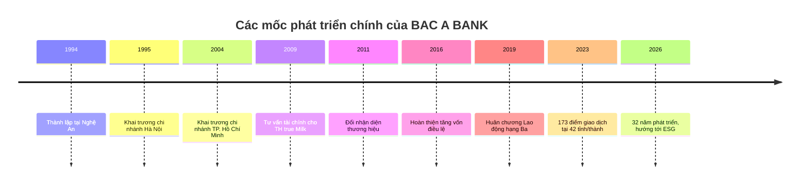
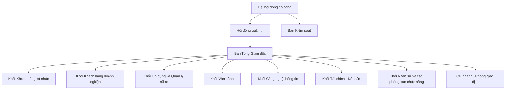

## LỜI CẢM ƠN

Lời đầu tiên, em xin gửi lời cảm ơn chân thành và sâu sắc nhất đến Ban Lãnh đạo Ngân hàng TMCP Bắc Á đã tạo điều kiện cho em được thực tập, học hỏi và trải nghiệm môi trường làm việc chuyên nghiệp tại đơn vị. Sự tin tưởng, hướng dẫn và chia sẻ của quý anh/chị là nguồn động lực quan trọng giúp em hoàn thành báo cáo thực tập này.

Em xin bày tỏ lòng biết ơn sâu sắc đến lãnh đạo **[Chi nhánh/Phòng ban thực tập]** và toàn thể anh/chị trong **[Bộ phận Công nghệ thông tin]**, đặc biệt là **[Họ tên cán bộ hướng dẫn] – [Chức vụ]**. Trong suốt thời gian thực tập từ **[ngày/tháng/năm]** đến **[ngày/tháng/năm]**, anh/chị đã tận tình chỉ dẫn, góp ý, chia sẻ kinh nghiệm thực tế và tạo điều kiện để em được tìm hiểu quy trình tiếp nhận, phân loại, xử lý yêu cầu hỗ trợ IT; nhờ đó em có thể vận dụng kiến thức đã học vào việc xây dựng hệ thống **TicketIT**.

Em cũng xin gửi lời cảm ơn chân thành đến quý thầy cô **Trường Đại học Vinh**, đặc biệt là quý thầy cô **Viện Kỹ thuật và Công nghệ**, những người đã trang bị cho em nền tảng kiến thức về công nghệ phần mềm, phân tích thiết kế hệ thống, cơ sở dữ liệu và lập trình ứng dụng web. Em xin cảm ơn **[Học vị, Họ tên giảng viên hướng dẫn]** đã định hướng chuyên môn, góp ý nội dung và cách trình bày để báo cáo được hoàn thiện hơn.

Em xin cảm ơn gia đình, bạn bè và các anh/chị đồng nghiệp đã luôn động viên, hỗ trợ và chia sẻ trong suốt quá trình học tập và thực tập. Sự quan tâm của mọi người là động lực để em cố gắng hoàn thành tốt nhiệm vụ được giao.

Mặc dù đã cố gắng hết sức, báo cáo và sản phẩm khó tránh khỏi những thiếu sót do kinh nghiệm thực tế còn hạn chế. Em rất mong nhận được sự nhận xét, góp ý của quý thầy cô, Ban Lãnh đạo và các anh/chị trong đơn vị để tiếp tục hoàn thiện hệ thống trong tương lai. Em xin chân thành cảm ơn!

**[Nghệ An], ngày … tháng … năm 2026**

**Sinh viên thực hiện**

**[Họ và tên]**

---

## MỤC LỤC

- **TRANG BÌA**
- **LỜI CẢM ƠN**
- **MỤC LỤC**
- **DANH MỤC CÁC HÌNH**
- **DANH MỤC CÁC BẢNG**
- **DANH MỤC TỪ VIẾT TẮT**
- **MỞ ĐẦU**
- **PHẦN I. GIỚI THIỆU VỀ ĐƠN VỊ THỰC TẬP**
  - I.1. Thông tin chung về Ngân hàng TMCP Bắc Á
  - I.2. Quá trình hình thành và phát triển
  - I.3. Chức năng, nhiệm vụ và lĩnh vực hoạt động
  - I.4. Cơ cấu tổ chức
  - I.5. Tầm nhìn, sứ mệnh và giá trị cốt lõi
  - I.6. Kết quả hoạt động và thành tựu nổi bật
  - I.7. Định hướng phát triển
  - I.8. Giới thiệu bộ phận thực tập và vị trí thực tập
  - I.9. Mối liên hệ giữa đơn vị thực tập và đề tài
- **CHƯƠNG 1. MÔ TẢ BÀI TOÁN** (giữ nguyên như `BaoCao.md`)
  - 1.1. Mô tả tổng quan bài toán
  - 1.2. Tìm hiểu bài toán
  - 1.3. Một số hệ thống và ứng dụng liên quan
  - 1.4. Các yêu cầu của hệ thống mới
- **CHƯƠNG 2. PHÂN TÍCH VÀ THIẾT KẾ HỆ THỐNG** (giữ nguyên các mục 2.1–2.6)
- **CHƯƠNG 3. XÂY DỰNG HỆ THỐNG** (giữ nguyên các mục 3.1–3.9)
- **KẾT LUẬN VÀ HƯỚNG PHÁT TRIỂN**
- **TÀI LIỆU THAM KHẢO**
- **PHỤ LỤC A–G**

---

# CHƯƠNG 1. GIỚI THIỆU VỀ ĐƠN VỊ THỰC TẬP

## 1.1. Thông tin chung về Ngân hàng TMCP Bắc Á

Ngân hàng TMCP Bắc Á (BAC A BANK) là ngân hàng thương mại cổ phần được thành lập tại Nghệ An, hoạt động theo mô hình ngân hàng đa năng. Trải qua hơn 32 năm hình thành và phát triển, BAC A BANK đã từng bước mở rộng mạng lưới hoạt động, đa dạng hóa sản phẩm dịch vụ và khẳng định vị thế là một ngân hàng bán lẻ, đa năng, hoạt động theo định hướng phát triển bền vững, gắn với nông nghiệp công nghệ cao, y tế, giáo dục và các lĩnh vực an sinh xã hội.

Bảng 1.1 tổng hợp một số thông tin chung về đơn vị thực tập.

**Bảng 1.1. Thông tin chung về Ngân hàng TMCP Bắc Á**

| STT | Chỉ tiêu | Thông tin |
|---:|---|---|
| 1 | Tên đầy đủ | Ngân hàng Thương mại Cổ phần Bắc Á |
| 2 | Tên giao dịch quốc tế | BAC A Commercial Joint Stock Bank |
| 3 | Tên viết tắt | BAC A BANK |
| 4 | Ngày thành lập | 17/9/1994 |
| 5 | Trụ sở chính | 117 Quang Trung, phường Thành Vinh, tỉnh Nghệ An |
| 6 | Hotline | 1800 588 828 |
| 7 | Email | callcenter@baca-bank.vn |
| 8 | Website | https://www.baca-bank.vn |
| 9 | Loại hình | Ngân hàng thương mại cổ phần |
| 10 | Ngành nghề chính | Tiền tệ, tín dụng, thanh toán, ngân hàng và các dịch vụ tài chính |
| 11 | Mạng lưới (01/12/2023) | 173 điểm giao dịch tại 42 tỉnh/thành: 01 Hội sở, 55 Chi nhánh, 117 Phòng giao dịch |
| 12 | Vốn điều lệ (nguồn công khai 2023) | Khoảng 9.900 tỷ đồng |
| 13 | Tổng tài sản (nguồn công khai 2024) | Khoảng 130.000 – 131.000 tỷ đồng |
| 14 | Nhân sự (nguồn công khai 2024) | Khoảng 3.050 người |
| 15 | Ban lãnh đạo | Hội đồng quản trị, Ban Tổng Giám đốc và Ban Kiểm soát; thông tin nhân sự cụ thể cập nhật theo website chính thức |
| 16 | Slogan định hướng | “Giữ tâm sáng để vươn xa rộng khắp” |

> **Nguồn và lưu ý về số liệu**
>
> - Thông tin chung, mạng lưới và slogan: website chính thức của BAC A BANK, truy cập ngày 18/11/2026.
> - Mốc thành lập, vốn điều lệ, tổng tài sản, nhân sự: tổng hợp từ nguồn công khai (Wikipedia tiếng Việt và các bài viết liên quan); đây là các chỉ tiêu có thể thay đổi theo từng năm.
> - Trước khi nộp báo cáo, cần đối chiếu lại với **Báo cáo thường niên** và **Báo cáo tài chính** mới nhất của BAC A BANK; nếu số liệu khác, ưu tiên sử dụng tài liệu chính thức của ngân hàng.
> - Các thông tin nội bộ như tên chi nhánh, bộ phận CNTT và cán bộ hướng dẫn được để trong dấu `[...]` để sinh viên điền theo thực tế.

---

## 1.2. Quá trình hình thành và phát triển

Ngân hàng TMCP Bắc Á được thành lập ngày **17/9/1994** tại Nghệ An, trong bối cảnh hệ thống ngân hàng Việt Nam đang từng bước chuyển đổi sang mô hình ngân hàng thương mại cổ phần. Với xuất phát điểm là một ngân hàng khu vực, BAC A BANK đã kiên trì mở rộng mạng lưới và từng bước khẳng định thương hiệu trên phạm vi toàn quốc.

Giai đoạn 1995–2004 đánh dấu bước mở rộng địa bàn quan trọng: năm 1995, ngân hàng khai trương chi nhánh đầu tiên tại Hà Nội; năm 2004, khai trương chi nhánh đầu tiên tại Thành phố Hồ Chí Minh. Việc có mặt tại hai trung tâm kinh tế lớn nhất cả nước tạo tiền đề để BAC A BANK phát triển các dịch vụ thanh toán, tín dụng và huy động vốn.

Giai đoạn 2009–2016 gắn liền với định hướng tư vấn đầu tư và phát triển bền vững. Năm 2009, BAC A BANK trở thành nhà tư vấn tài chính tham gia vào quá trình hình thành thương hiệu TH true Milk của TH Group – một dấu mốc thể hiện định hướng gắn kết với nông nghiệp công nghệ cao. Năm 2011, ngân hàng thay đổi bộ nhận diện thương hiệu; năm 2016, hoàn thiện tăng vốn điều lệ và nhận giải thưởng quốc tế “Ngân hàng Trách nhiệm xã hội tốt nhất 2016” do Tạp chí International Finance Magazine trao tặng.

Giai đoạn 2019–2023 tiếp tục ghi nhận sự tăng trưởng về quy mô và uy tín. Năm 2019, BAC A BANK vinh dự nhận **Huân chương Lao động hạng Ba**. Đến năm 2023, vốn điều lệ của ngân hàng đạt khoảng **9.900 tỷ đồng**; mạng lưới mở rộng lên **173 điểm giao dịch tại 42 tỉnh/thành**, gồm 01 Hội sở, 55 Chi nhánh và 117 Phòng giao dịch. Ngân hàng cũng nhận nhiều giải thưởng về môi trường làm việc, tín dụng xanh và phát triển bền vững.

Giai đoạn 2024–2026, BAC A BANK bước sang tuổi 32 với định hướng xây dựng hệ sinh thái kinh tế xanh – tuần hoàn, gắn với các tiêu chí ESG, nông nghiệp công nghệ cao, dược liệu sạch, y tế và giáo dục. Đây là nền tảng để ngân hàng tiếp tục chuyển đổi số, nâng cao trải nghiệm khách hàng và phát triển bền vững.

**Bảng 1.2. Các mốc phát triển chính của BAC A BANK**

| Thời gian | Mốc phát triển |
|---|---|
| 17/9/1994 | Thành lập Ngân hàng TMCP Bắc Á tại Nghệ An |
| 1995 | Khai trương chi nhánh đầu tiên tại Hà Nội |
| 2004 | Khai trương chi nhánh đầu tiên tại Thành phố Hồ Chí Minh |
| 2009 | Trở thành nhà tư vấn tài chính tham gia thành lập thương hiệu TH true Milk (TH Group) |
| 2011 | Thay đổi bộ nhận diện thương hiệu |
| 2016 | Hoàn thiện tăng vốn điều lệ; nhận giải “Ngân hàng Trách nhiệm xã hội tốt nhất 2016” (IFM) |
| 2019 | Nhận Huân chương Lao động hạng Ba |
| 2023 | Vốn điều lệ khoảng 9.900 tỷ đồng; 173 điểm giao dịch tại 42 tỉnh/thành; nhiều giải thưởng về môi trường làm việc, tín dụng xanh |
| 2024–2026 | Hướng tới hệ sinh thái kinh tế xanh – tuần hoàn, ESG; tiếp tục chuyển đổi số và mở rộng mạng lưới |

> **Ghi chú:** Website BAC A BANK ghi nhận năm 2016 hoàn thiện tăng vốn điều lệ lên “5 ngàn tỷ đồng”; một số nguồn công khai ghi 5.500 tỷ đồng. Khi đưa vào báo cáo chính thức, nên kiểm tra lại con số trong Báo cáo thường niên năm 2016 hoặc tài liệu công bố thông tin của ngân hàng.

**Hình 1.1. Dòng thời gian hình thành và phát triển của BAC A BANK**

---

## 1.3. Chức năng, nhiệm vụ và lĩnh vực hoạt động

Là ngân hàng thương mại cổ phần hoạt động theo giấy phép của Ngân hàng Nhà nước Việt Nam, BAC A BANK thực hiện đầy đủ các nghiệp vụ cơ bản của một ngân hàng thương mại: huy động vốn, cấp tín dụng, cung ứng dịch vụ thanh toán, ngân quỹ và các dịch vụ tài chính – ngân hàng khác. Bên cạnh hoạt động kinh doanh, ngân hàng chú trọng tư vấn đầu tư vào các lĩnh vực an sinh xã hội và phát triển bền vững như nông nghiệp công nghệ cao, y tế, giáo dục, dược liệu sạch.

Các nhóm dịch vụ chính của BAC A BANK gồm:

- **Huy động vốn:** tiền gửi thanh toán, tiền gửi có kỳ hạn, tiết kiệm, chứng chỉ tiền gửi.
- **Tín dụng – cho vay:** cho vay ngắn hạn, trung hạn, dài hạn; cho vay tiêu dùng, sản xuất kinh doanh, nông nghiệp công nghệ cao.
- **Thanh toán:** tài khoản nội tệ và ngoại tệ, chuyển tiền trong và ngoài nước, chi trả lương qua tài khoản.
- **Thẻ và ngân hàng điện tử:** thẻ ghi nợ, thẻ tín dụng, Internet Banking, Mobile Banking.
- **Bảo lãnh và tài trợ thương mại:** bảo lãnh thanh toán, chiết khấu bộ chứng từ, tài trợ xuất nhập khẩu.
- **Kinh doanh ngoại hối:** mua bán ngoại tệ, cung cấp tỷ giá.
- **Bảo hiểm và tư vấn đầu tư:** sản phẩm bảo hiểm; tư vấn đầu tư dự án nông nghiệp công nghệ cao, y tế, giáo dục.

Về nhiệm vụ, BAC A BANK phải tuân thủ các quy định của Ngân hàng Nhà nước và pháp luật về tiền tệ, tín dụng, thanh toán; bảo đảm an toàn hoạt động, quản lý rủi ro và bảo mật thông tin khách hàng; đồng thời thực hiện trách nhiệm xã hội, đóng góp vào sự phát triển kinh tế – xã hội của địa phương và cộng đồng.

> **Nguồn:** Website BAC A BANK – mục “Thương hiệu BAC A BANK”, truy cập ngày 18/11/2026. Danh sách dịch vụ được tóm tắt, không liệt kê đầy đủ toàn bộ sản phẩm của ngân hàng.

---

## 1.4. Cơ cấu tổ chức

BAC A BANK tổ chức hoạt động theo mô hình ngân hàng thương mại cổ phần. Đại hội đồng cổ đông là cơ quan quyền lực cao nhất; Hội đồng quản trị chịu trách nhiệm quản trị chiến lược; Ban Kiểm soát thực hiện chức năng kiểm soát độc lập; Ban Tổng Giám đốc điều hành hoạt động hằng ngày. Dưới Ban Tổng Giám đốc là các khối/phòng ban nghiệp vụ tại Hội sở và mạng lưới chi nhánh, phòng giao dịch trên toàn quốc.

**Hình 1.2. Sơ đồ cấu trúc tổ chức khái quát của BAC A BANK (tham khảo)**

> **Lưu ý:** Sơ đồ trên chỉ mô tả cấu trúc khái quát để phục vụ báo cáo. Tên gọi và số lượng khối/phòng ban thực tế có thể khác nhau giữa Hội sở và từng chi nhánh. Sinh viên cần đối chiếu với tài liệu giới thiệu nội bộ hoặc sơ đồ tổ chức chính thức của đơn vị thực tập trước khi nộp.

Có thể khái quát chức năng của các bộ phận chính như sau:

- **Hội sở:** hoạch định chiến lược, quản trị rủi ro, quản lý vốn, vận hành hệ thống, công nghệ thông tin, tài chính – kế toán, nhân sự và kiểm soát nội bộ.
- **Chi nhánh/phòng giao dịch:** trực tiếp giao dịch với khách hàng, bán sản phẩm, chăm sóc khách hàng và triển khai các chương trình kinh doanh.
- **Khối Công nghệ thông tin:** vận hành hạ tầng, phát triển và bảo trì ứng dụng, hỗ trợ người dùng, bảo mật thông tin, quản lý dữ liệu và triển khai các dự án công nghệ.

> Theo Thông điệp đăng trên website nhân dịp kỷ niệm 32 năm thành lập, bà **Thái Hương** là Tổng Giám đốc BAC A BANK. Thông tin nhân sự cụ thể của Hội đồng quản trị và Ban Tổng Giám đốc cần được cập nhật theo website chính thức tại thời điểm nộp báo cáo.

---

## 1.5. Tầm nhìn, sứ mệnh và giá trị cốt lõi

Định hướng phát triển của BAC A BANK được thể hiện rõ qua sứ mệnh, tầm nhìn và các thông điệp giá trị được công bố trên website chính thức.

**Sứ mệnh:**

> “Ngân hàng TMCP Bắc Á (BAC A BANK) tư vấn và phục vụ cho một thế hệ các doanh nghiệp phát triển bền vững, tạo ra giá trị cốt lõi, mang lại giá trị đích thực cho cộng đồng và thân thiện với môi trường.”

**Tầm nhìn:**

> “Ngân hàng TMCP Bắc Á (BAC A BANK) kiên trì phấn đấu để luôn là một ngân hàng tận tâm, tạo ra một thế hệ khách hàng phát triển bền vững, đầu tư vào các lĩnh vực công nghệ cao, hiện đại hóa nông nghiệp, nông thôn và an sinh xã hội như nông – lâm – ngư nghiệp, dược liệu sạch, y tế và giáo dục… Với tư duy vượt trội, tính tiên phong, chuyên nghiệp, cải tiến không ngừng, vì hạnh phúc đích thực của mỗi con người với quyết tâm làm giàu chính đáng, BAC A BANK hướng tới giá trị bền vững cho các nhà đầu tư và ấm no hạnh phúc cho cộng đồng.”

Tầm nhìn đến năm 2030 của ngân hàng là trở thành ngân hàng có quy mô vừa, cung cấp dịch vụ tài chính toàn diện, đồng thời tư vấn đầu tư cho các doanh nghiệp ứng dụng công nghệ cao trong nông nghiệp, y tế, giáo dục, dược liệu sạch và thực phẩm sạch, hướng tới hòa nhập với quốc tế.

**Các định hướng giá trị cốt lõi** được thể hiện trên website chính thức gồm:

1. **Tiên phong đưa công nghệ cao vào nông nghiệp nông thôn:** gắn hoạt động tài chính với phát triển nông nghiệp hiện đại, nâng cao giá trị sản phẩm và đời sống nông thôn.
2. **Cải tiến không ngừng để phát triển bền vững:** đổi mới sản phẩm, quy trình và công nghệ, hướng tới tăng trưởng bền vững thay vì chỉ theo đuổi quy mô ngắn hạn.
3. **Vì con người:** lấy khách hàng, cán bộ nhân viên và cộng đồng làm trung tâm của mọi hoạt động.
4. **Chuyên nghiệp hòa nhập với quốc tế:** chuẩn hóa chất lượng dịch vụ, tuân thủ thông lệ quốc tế và không ngừng nâng cao năng lực cạnh tranh.
5. **Đáng tin cậy và thân thiện môi trường:** bảo đảm an toàn, minh bạch trong hoạt động và thúc đẩy các sáng kiến ngân hàng xanh, ESG.

Slogan định hướng hiện tại của BAC A BANK là **“Giữ tâm sáng để vươn xa rộng khắp”**. Trước đây, ngân hàng từng sử dụng slogan **“Mãi mãi cùng thời gian”**. Sự thay đổi slogan phản ánh định hướng phát triển mới, gắn với chiều sâu giá trị, đạo đức nghề nghiệp và khát vọng vươn xa.

> **Nguồn:** Website BAC A BANK – mục “Tầm nhìn và sứ mệnh” và trang chủ, truy cập ngày 18/11/2026; thông tin slogan tham khảo thêm từ Wikipedia tiếng Việt.

---

## 1.6. Kết quả hoạt động và thành tựu nổi bật

Trong hơn 32 năm hoạt động, BAC A BANK đã đạt được những kết quả đáng ghi nhận về quy mô mạng lưới, năng lực tài chính và uy tín thương hiệu. Bảng 1.3 tổng hợp một số chỉ tiêu công khai tiêu biểu; Bảng 1.4 điểm lại các thành tựu, giải thưởng chính.

**Bảng 1.3. Một số chỉ tiêu hoạt động công khai của BAC A BANK**

| Chỉ tiêu | Số liệu công khai | Thời điểm/nguồn |
|---|---|---|
| Mạng lưới | 173 điểm giao dịch tại 42 tỉnh/thành: 01 Hội sở, 55 Chi nhánh, 117 Phòng giao dịch | 01/12/2023 – website BAC A BANK |
| Vốn điều lệ | Khoảng 9.900 tỷ đồng | 2023 – nguồn công khai |
| Tổng tài sản | Khoảng 130.000 – 131.000 tỷ đồng | 2024 – nguồn công khai |
| Nhân sự | Khoảng 3.050 người | 2024 – nguồn công khai |
| Số năm hoạt động | 32 năm | Tính đến 17/9/2026 |

**Bảng 1.4. Thành tựu, giải thưởng tiêu biểu của BAC A BANK**

| Năm | Thành tựu, giải thưởng tiêu biểu |
|---|---|
| 2015 | Ngân hàng tiêu biểu phát triển bền vững vì cộng đồng (IDG); Ngân hàng tư vấn đầu tư và cho vay doanh nghiệp tốt nhất Việt Nam (Global Banking & Finance) |
| 2016 | Ngân hàng Trách nhiệm xã hội tốt nhất 2016 (International Finance Magazine); hoàn thiện tăng vốn điều lệ |
| 2017 | Ngân hàng tiêu biểu trong phát triển bền vững vì cộng đồng; Top 10 thương hiệu dẫn đầu Việt Nam |
| 2018 | Ngân hàng Việt Nam tiên phong tư vấn đầu tư các dự án nông nghiệp sạch ở nước ngoài; Top 200 Sao Vàng đất Việt; Doanh nghiệp vì người lao động |
| 2019 | Huân chương Lao động hạng Ba; Ngân hàng tiêu biểu về Tín dụng xanh; Doanh nghiệp vì người lao động |
| 2020 | Doanh nghiệp Vì người lao động |
| 2021 | Doanh nghiệp Vì người lao động; Ngân hàng Vì cộng đồng |
| 2022 | Doanh nghiệp Vì người lao động |
| 2023 | Nơi làm việc tốt nhất Việt Nam; Ngân hàng Tín dụng Xanh tiêu biểu; Doanh nghiệp xuất sắc châu Á; Doanh nghiệp vì người lao động; Nơi làm việc tốt nhất châu Á; Ngân hàng có Dịch vụ khách hàng ưu tiên tiêu biểu; Top 60 Nhà tuyển dụng hàng đầu Việt Nam; Top 10 Nơi làm việc tốt nhất Việt Nam |

> **Nguồn:** Website BAC A BANK – mục “Thành tựu”, truy cập ngày 18/11/2026; các chỉ tiêu tài chính tổng hợp từ nguồn công khai. Danh sách thành tựu mang tính chọn lọc, không liệt kê toàn bộ giải thưởng của ngân hàng.

Các kết quả trên cho thấy BAC A BANK không chỉ mở rộng về số lượng điểm giao dịch mà còn chú trọng chất lượng môi trường làm việc, trách nhiệm xã hội và phát triển bền vững. Với quy mô hàng nghìn nhân sự và hàng trăm điểm giao dịch, nhu cầu hỗ trợ kỹ thuật cho các hệ thống công nghệ thông tin ngày càng lớn, đòi hỏi quy trình tiếp nhận và xử lý yêu cầu phải được chuẩn hóa, minh bạch và có khả năng đo lường.

---

## 1.7. Định hướng phát triển

Trên cơ sở tầm nhìn đến năm 2030 và các thông điệp được công bố trên website, có thể khái quát định hướng phát triển của BAC A BANK trong thời gian tới theo các trụ cột sau:

1. **Chuyển đổi số toàn diện:** hiện đại hóa hạ tầng công nghệ thông tin, phát triển ngân hàng số, mở rộng kênh giao dịch trực tuyến, ứng dụng dữ liệu lớn, trí tuệ nhân tạo và tự động hóa quy trình để nâng cao hiệu quả vận hành.
2. **Ngân hàng xanh và phát triển bền vững:** thúc đẩy tín dụng xanh, quản trị theo tiêu chí ESG, xây dựng hệ sinh thái kinh tế xanh – tuần hoàn và giảm tác động môi trường trong hoạt động ngân hàng.
3. **Gắn kết với nông nghiệp công nghệ cao và chuỗi giá trị:** tiếp tục tư vấn, tài trợ các dự án nông nghiệp sạch, dược liệu, thực phẩm sạch; hỗ trợ doanh nghiệp ứng dụng công nghệ cao và mở rộng thị trường.
4. **Phát triển lĩnh vực y tế, giáo dục và an sinh xã hội:** cung cấp giải pháp tài chính phù hợp cho các tổ chức, doanh nghiệp và cá nhân trong các lĩnh vực này.
5. **Nâng cao trải nghiệm khách hàng:** phát triển dịch vụ đa kênh, cá nhân hóa sản phẩm, đơn giản hóa thủ tục và rút ngắn thời gian xử lý giao dịch.
6. **Tăng cường quản trị rủi ro và tuân thủ:** bảo đảm an toàn thông tin, phòng chống gian lận, tuân thủ quy định của Ngân hàng Nhà nước và các chuẩn mực quốc tế.
7. **Phát triển nguồn nhân lực:** đào tạo kỹ năng số, xây dựng môi trường làm việc chuyên nghiệp, khuyến khích đổi mới sáng tạo và gắn kết cán bộ nhân viên.

Trong bối cảnh đó, các hệ thống công nghệ thông tin nội bộ đóng vai trò then chốt. Khi số lượng người dùng, hệ thống nghiệp vụ và điểm giao dịch tăng lên, bộ phận IT phải tiếp nhận và xử lý nhiều yêu cầu hỗ trợ khác nhau. Việc xây dựng một hệ thống hỗ trợ IT nội bộ tập trung như **TicketIT** góp phần chuẩn hóa quy trình, giảm thời gian phản hồi, tăng tính minh bạch và tạo dữ liệu phục vụ cải tiến chất lượng dịch vụ – phù hợp với định hướng chuyển đổi số và phát triển bền vững của BAC A BANK.

> **Lưu ý:** Các nội dung trên được khái quát từ tầm nhìn, sứ mệnh và thông điệp công bố trên website chính thức; không phải là văn bản chiến lược nội bộ của ngân hàng. Sinh viên có thể bổ sung các mục tiêu cụ thể nếu được đơn vị thực tập cung cấp.

---

## 1.8. Giới thiệu bộ phận thực tập và vị trí thực tập

Phần này trình bày thông tin về đơn vị/chi nhánh nơi em thực tập, bộ phận Công nghệ thông tin và các nhiệm vụ được giao trong thời gian thực tập. Các thông tin cụ thể được điền theo thực tế của đợt thực tập.

### 1.8.1. Đơn vị/chi nhánh nơi thực tập

**Bảng 1.5. Thông tin về đơn vị/chi nhánh nơi thực tập**

| Nội dung | Thông tin |
|---|---|
| Tên đơn vị thực tập | [Chi nhánh/Phòng giao dịch … – Ngân hàng TMCP Bắc Á] |
| Địa chỉ | [Số nhà, đường, phường/xã, quận/huyện, tỉnh/thành phố] |
| Điện thoại | [Số điện thoại] |
| Người phụ trách | [Họ tên – Chức vụ] |
| Thời gian thực tập | Từ [ngày/tháng/năm] đến [ngày/tháng/năm] |
| Hình thức thực tập | [Trực tiếp / Trực tuyến / Kết hợp] |
| Bộ phận thực tập | [Bộ phận Công nghệ thông tin / Phòng Kỹ thuật …] |

Trong thời gian thực tập, em được phân công về **[Bộ phận Công nghệ thông tin]** – nơi chịu trách nhiệm vận hành, hỗ trợ và phát triển các hệ thống công nghệ thông tin của đơn vị. Tại đây, em được tìm hiểu cách tiếp nhận yêu cầu từ người dùng, cách phân loại và ưu tiên xử lý, cũng như quy trình phối hợp giữa các bộ phận để giải quyết sự cố.

> **Ghi chú:** Nếu thực tập tại Hội sở, có thể ghi rõ tên Khối/Trung tâm CNTT. Nếu thực tập tại chi nhánh, có thể ghi rõ phòng/bộ phận phụ trách CNTT hoặc bộ phận được phân công hỗ trợ kỹ thuật.

### 1.8.2. Bộ phận Công nghệ thông tin

Bộ phận Công nghệ thông tin tại một ngân hàng thương mại thường đảm nhận các nhóm chức năng chính sau:

- **Vận hành và giám sát hạ tầng:** quản lý máy chủ, hệ thống mạng, cơ sở dữ liệu, sao lưu và phục hồi dữ liệu; giám sát hoạt động của các hệ thống quan trọng.
- **Phát triển và bảo trì ứng dụng:** phát triển, nâng cấp các hệ thống ngân hàng số, hệ thống nội bộ và các ứng dụng hỗ trợ nghiệp vụ.
- **Hỗ trợ người dùng (helpdesk):** tiếp nhận, phân loại, xử lý hoặc chuyển tuyến các yêu cầu hỗ trợ kỹ thuật từ cán bộ nhân viên.
- **Bảo mật thông tin:** quản lý quyền truy cập, giám sát an ninh, phòng chống tấn công mạng, tuân thủ quy định bảo mật và quy định của Ngân hàng Nhà nước.
- **Quản lý dữ liệu và báo cáo:** bảo đảm dữ liệu được lưu trữ, khai thác và báo cáo đúng quy định.
- **Quản lý dự án CNTT:** phối hợp với các khối nghiệp vụ và nhà cung cấp để triển khai dự án, kiểm thử và bàn giao hệ thống.

Tùy theo quy mô và cơ cấu của từng đơn vị, các nhóm chức năng trên có thể được tổ chức thành các phòng/ban khác nhau. Trong thời gian thực tập, em được tham gia vào một số nhiệm vụ thuộc nhóm **hỗ trợ người dùng và phát triển ứng dụng nội bộ**, qua đó hiểu rõ hơn mối liên hệ giữa nghiệp vụ ngân hàng và giải pháp công nghệ.

> **Lưu ý:** Tên gọi và cơ cấu cụ thể của bộ phận CNTT tại BAC A BANK không được công bố đầy đủ trên website. Sinh viên cần điền theo thực tế đơn vị thực tập và tuân thủ quy định bảo mật thông tin nội bộ.

### 1.8.3. Vị trí và nhiệm vụ được giao

Trong thời gian thực tập, em đảm nhận vị trí **Thực tập sinh Công nghệ thông tin**, được tham gia vào các công việc liên quan đến tiếp nhận yêu cầu hỗ trợ, phân tích nghiệp vụ và phát triển ứng dụng nội bộ. Các nhiệm vụ chính gồm:

1. **Tìm hiểu quy trình tiếp nhận và xử lý yêu cầu hỗ trợ IT:** quan sát cách người dùng gửi yêu cầu, cách bộ phận IT phân loại, ưu tiên, phân công và phản hồi; ghi nhận những khó khăn trong quy trình hiện tại.
2. **Khảo sát và phân tích yêu cầu:** xác định tác nhân, các bước nghiệp vụ, dữ liệu cần quản lý và các yêu cầu chức năng của hệ thống.
3. **Thiết kế cơ sở dữ liệu và kiến trúc ứng dụng:** xây dựng sơ đồ thực thể – liên kết, từ điển dữ liệu, thiết kế các bảng nghiệp vụ và quan hệ giữa chúng.
4. **Phát triển ứng dụng web:** sử dụng Laravel, Blade, Tailwind CSS và Alpine.js để xây dựng các chức năng quản lý phiếu, bình luận, ghi chú nội bộ, tệp đính kèm, thông báo và quản trị danh mục.
5. **Kiểm thử chức năng và phân quyền:** kiểm tra các luồng tạo – phân công – xử lý – đóng phiếu; kiểm tra quyền truy cập của từng vai trò; rà soát các lỗi bảo mật cơ bản.
6. **Viết tài liệu kỹ thuật và hướng dẫn sử dụng:** ghi lại cấu trúc mã nguồn, danh sách route, tài khoản demo, hướng dẫn cài đặt và các kịch bản kiểm thử.
7. **Báo cáo tiến độ và tiếp thu góp ý:** trao đổi định kỳ với cán bộ hướng dẫn, điều chỉnh thiết kế và chức năng theo góp ý thực tế.

Kết quả chính của quá trình thực tập là hệ thống **TicketIT** – một ứng dụng web hỗ trợ tiếp nhận, phân loại, phân công, xử lý và theo dõi yêu cầu hỗ trợ IT nội bộ. Hệ thống được xây dựng với dữ liệu mẫu, giao diện tiếng Việt và các chức năng phân quyền theo vai trò, phục vụ mục đích học tập và trình bày trong báo cáo.

### 1.8.4. Quy trình làm việc và quy định bảo mật

Trong quá trình thực tập, em tuân thủ quy trình làm việc và các quy định sau:

- **Nhận nhiệm vụ và báo cáo tiến độ:** nhận công việc từ cán bộ hướng dẫn, báo cáo tiến độ theo tuần và trao đổi kịp thời khi gặp khó khăn.
- **Trao đổi và tiếp thu góp ý:** ghi nhận nhận xét, điều chỉnh thiết kế/chức năng và xác nhận lại trước khi hoàn thiện.
- **Kiểm thử trước khi bàn giao:** tự kiểm tra chức năng, kiểm tra phân quyền, kiểm tra dữ liệu đầu vào và các trường hợp lỗi trước khi báo cáo kết quả.
- **Quản lý mã nguồn và tài liệu:** lưu trữ mã nguồn, tài liệu thiết kế và hướng dẫn sử dụng theo cấu trúc thống nhất; ghi chú các thay đổi quan trọng.
- **Bảo mật thông tin:** không sao chép, chia sẻ hoặc sử dụng dữ liệu khách hàng, mã nguồn hoặc tài liệu nội bộ ra ngoài phạm vi cho phép; chỉ sử dụng tài khoản và quyền truy cập được cấp.
- **Tuân thủ quy định:** thực hiện đúng quy định của Ngân hàng Nhà nước, quy định bảo mật thông tin và nội quy của đơn vị thực tập.

> **Lưu ý:** Các quy định cụ thể về bảo mật, lưu trữ và báo cáo tại BAC A BANK có thể khác nhau giữa các bộ phận. Sinh viên cần tuân thủ hướng dẫn trực tiếp của cán bộ phụ trách và chỉ đưa vào báo cáo những thông tin được phép công bố.

---

## 1.9. Mối liên hệ giữa đơn vị thực tập và đề tài

Việc lựa chọn đề tài **“Xây dựng hệ thống hỗ trợ IT nội bộ (TicketIT)”** xuất phát từ nhu cầu thực tế mà em quan sát được trong thời gian thực tập tại BAC A BANK. Với quy mô **173 điểm giao dịch tại 42 tỉnh/thành** và khoảng **3.050 nhân sự** (theo số liệu công khai), ngân hàng vận hành nhiều hệ thống công nghệ thông tin phục vụ giao dịch, thanh toán, tín dụng, quản trị nội bộ và chăm sóc khách hàng. Mỗi ngày, bộ phận IT phải tiếp nhận nhiều yêu cầu khác nhau: sự cố máy tính, mạng, máy in, email, phần mềm nghiệp vụ, tài khoản, phân quyền, bảo mật…

Trong nhiều đơn vị, các yêu cầu này được gửi qua nhiều kênh như điện thoại, email, chat hoặc trao đổi trực tiếp. Cách tiếp nhận rời rạc dẫn đến một số khó khăn:

- Thông tin yêu cầu không được ghi nhận đầy đủ, dễ thất lạc hoặc trùng lặp.
- Khó theo dõi tiến độ, khó xác định người chịu trách nhiệm và thời hạn xử lý.
- Không có dữ liệu tổng hợp để đo lường thời gian phản hồi, khối lượng công việc và mức độ hài lòng.
- Việc phối hợp giữa người yêu cầu và bộ phận IT phụ thuộc nhiều vào trao đổi thủ công.

Hệ thống **TicketIT** được xây dựng nhằm giải quyết các vấn đề trên bằng một ứng dụng web tập trung. Mỗi yêu cầu được ghi nhận thành một **phiếu yêu cầu** có mã duy nhất theo định dạng `TK-YYYY-NNNNNN`; mức ưu tiên được tính tự động từ ma trận **Ảnh hưởng × Khẩn cấp**; vòng đời phiếu gồm 8 trạng thái với quy tắc chuyển trạng thái rõ ràng; mọi thay đổi được ghi nhận vào lịch sử hoạt động và lịch sử trạng thái. Hệ thống còn hỗ trợ bình luận công khai, ghi chú nội bộ, tệp đính kèm, thông báo trong ứng dụng và thông báo qua email.

Những lợi ích chính mà hệ thống mang lại gồm:

- **Tập trung hóa:** mọi yêu cầu được lưu trong một hệ thống, có mã phiếu và đường dẫn truy cập ổn định.
- **Minh bạch:** người yêu cầu và bộ phận IT cùng theo dõi được trạng thái, người phụ trách và lịch sử trao đổi.
- **Trách nhiệm rõ ràng:** phân công nhóm xử lý, kỹ thuật viên và thời hạn xử lý; hạn chế tình trạng “bỏ quên” yêu cầu.
- **Đo lường được:** dữ liệu về thời gian phản hồi, thời gian giải quyết, khối lượng phiếu theo nhóm/danh mục là cơ sở để cải tiến chất lượng dịch vụ và xây dựng KPI/SLA.
- **Hỗ trợ chuyển đổi số:** chuẩn hóa quy trình nội bộ, giảm xử lý thủ công, tạo nền tảng để tích hợp thêm báo cáo, tự động phân công và trí tuệ nhân tạo.

Đề tài cũng phù hợp với các giá trị mà BAC A BANK theo đuổi: **“Vì con người”** – lấy người dùng và chất lượng phục vụ làm trung tâm; **“Cải tiến không ngừng”** – chuẩn hóa và số hóa quy trình; **“Chuyên nghiệp”** – minh bạch, có trách nhiệm và có dữ liệu; **“Đáng tin cậy”** – bảo mật, phân quyền và lưu vết đầy đủ.

> **Phạm vi áp dụng:** TicketIT là sản phẩm thử nghiệm phục vụ mục đích học tập và báo cáo thực tập, **chưa được triển khai chính thức** tại BAC A BANK. Hệ thống sử dụng dữ liệu mẫu, không sử dụng dữ liệu khách hàng thật. Trong tương lai, nếu được phép, hệ thống có thể được triển khai thí điểm tại một bộ phận để đánh giá hiệu quả trước khi mở rộng.

---

# GHI CHÚ SỬ DỤNG VÀ NGUỒN THAM KHẢO

## 1. Danh sách placeholder cần điền

| Placeholder | Vị trí xuất hiện | Ghi chú |
|---|---|---|
| `[Họ và tên]` | Trang bìa, Lời cảm ơn | Họ tên sinh viên |
| `[MSSV]` | Trang bìa | Mã số sinh viên |
| `[Lớp]` | Trang bìa | Lớp hành chính |
| `[Chuyên ngành]` | Trang bìa | Ngành/chuyên ngành |
| `[Học vị, Họ tên giảng viên hướng dẫn]` | Trang bìa, Lời cảm ơn | Giảng viên hướng dẫn của trường |
| `[Chi nhánh/Phòng ban thực tập]` | Trang bìa, Lời cảm ơn, 1.8.1 | Đơn vị thực tập thực tế |
| `[Họ tên cán bộ hướng dẫn]` | Trang bìa, Lời cảm ơn, 1.8.1 | Cán bộ hướng dẫn tại ngân hàng |
| `[Chức vụ]` | Trang bìa, Lời cảm ơn, 1.8.1 | Chức vụ của cán bộ hướng dẫn |
| `[Thời gian thực tập]` | Trang bìa, Lời cảm ơn, 1.8.1 | Từ ngày… đến ngày… |
| `[Địa chỉ chi nhánh/phòng ban]` | Trang bìa, 1.8.1 | Địa chỉ thực tế |
| `[Số điện thoại]` | 1.8.1 | Điện thoại liên hệ |
| `[Bộ phận Công nghệ thông tin]` | 1.8.1, 1.8.2 | Tên bộ phận thực tế |
| `[Hình thức thực tập]` | 1.8.1 | Trực tiếp/trực tuyến/kết hợp |
| `[Nghệ An], ngày … tháng … năm 2026` | Cuối Lời cảm ơn | Địa danh và ngày ký |
